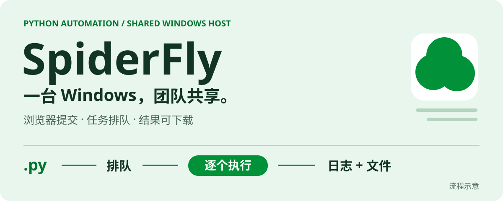
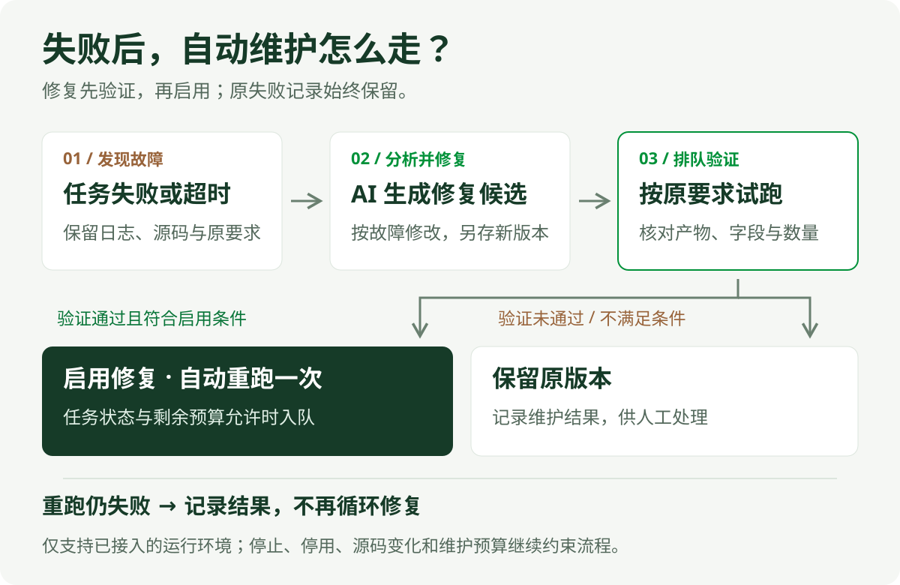
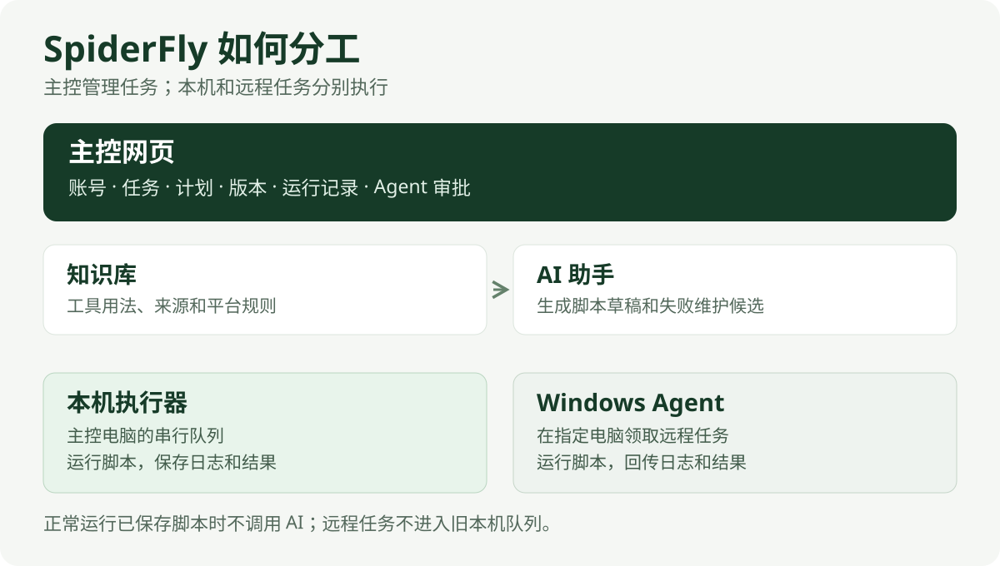

<p align="center">
  
</p>

# SpiderFly

SpiderFly 是面向 Windows 团队的局域网 Python 任务调度平台。在一个网页中上传脚本、准备依赖、设置定时，并选择主控本机或获批的 Agent 电脑执行，集中查看日志和结果。

适合定时报表、数据整理、网页采集等日常自动化。多个脚本可组成主控本机的串行工作流，按顺序执行，为整轮设置一个计划。

**主控和 Agent 都有安装向导。日常使用无需编辑 `.env` 或输入 PowerShell 命令。**

[两台电脑开始使用](#两台电脑开始使用) · [调度模式](#调度模式怎么工作) · [已有能力](#已经实现什么) · [真实案例](#真实验证过的-ai-采集案例) · [使用边界](#使用边界) · [完整文档](docs/README.md)

> [!IMPORTANT]
> 2026-10-17 用户现场反馈：双机接收任务、安装依赖、结果回传、定时触发及断网恢复已通过。重启恢复、远程升级等剩余现场项仍待验证。[查看验收记录](docs/多宿主机阶段7发布与双机验收.md)

## 两台电脑开始使用

下面以同一局域网的两台 Windows 10/11 电脑为例。部署后，账号、任务和数据由自己的主控独立保存。

| 电脑 | 用途 |
| --- | --- |
| A：主控 | 安装完整项目，管理任务、接入电脑和查看结果 |
| B：执行电脑 | 安装 Agent，接收并运行 Python 脚本 |
| 其他操作电脑 | 用浏览器访问 A，登录有相应权限的账号即可 |

### 1. 在电脑 A 安装主控

1. 打开 [GitHub 仓库](https://github.com/flyyang12-rgb/spiderFly)，点击 **Code → Download ZIP**，完整解压到固定目录，例如 `D:\SpiderFly`。
2. 安装 [64 位 Python 3.12](https://www.python.org/downloads/release/python-31210/)，选择 **Windows installer (64-bit)**，勾选 **Add Python to PATH**。
3. 双击 **`安装并启动主控.bat`**，端口保持 `8000`，勾选 **“允许局域网其他电脑访问”**。
4. 点击 **“准备环境并启动”**，允许 Windows 防火墙配置，等待依赖安装和网页打开。程序自动创建 `.env` 和数据库，无需手动配置。
5. 在 A 打开 `http://127.0.0.1:8000/`，用 **`data/首次登录信息.txt`** 中的账号和密码登录。

首次安装需要联网下载依赖，普通部署不需要 Git、Node.js 或额外的数据库软件。首次启动的命令窗口要保持打开；以后日常双击 **`SpiderFly.exe`** 启动。

在 A 运行 `ipconfig` 查看局域网 IPv4。例如 A 是 `192.168.1.50`，B 和其他电脑都使用 **`http://192.168.1.50:8000/`**，不要填各自的 `127.0.0.1`。如改用 `8383` 等端口，所有地址同步替换。

### 2. 从主控页面准备电脑 B

1. 在 A 的网页进入 **“管理中心 → 宿主机 → 接入新电脑”**，点击 **“生成接入码”** 和 **“下载 Agent 安装包”**。
2. 把 Agent ZIP、接入码和 A 的局域网地址交给 B。每台执行电脑使用一个新接入码，过期后重新生成。

### 3. 在电脑 B 接入 Agent

1. 解压 Agent ZIP，双击 **`安装并接入Agent.bat`**。缺少 Python 时，点击 **“自动安装 Python 3.12”**，等待就绪。
2. 填 A 的局域网地址，点击 **“检查连接”**；填写接入码和电脑名称，再点击 **“安装并申请接入”**。可勾选登录 Windows 后自动启动。
3. 返回 A 的宿主机页面，核对电脑名称与机器标识，点击 **“批准接入”**，再点击 **“开启主控调度”**。
4. 在 B 的右下角 Agent 托盘确认调度已开启；未开启时点击 **“开启调度”**。保持 Windows 已登录、未锁屏，A 页面显示 **“调度空闲”** 即可接收任务。

B 只需安装 Agent；脚本使用的 Office、浏览器或业务客户端需在 B 另行安装。接入更多执行电脑时，重复第 2、3 步。

### 4. 运行第一个任务

1. 在主控 **“任务中心 → 新建”** 选择单任务，上传一个简单的 `.py`，核对自动识别的依赖。
2. 把 **“默认运行电脑（手动和计划）”** 设为 B，触发方式先选 **“手动”**，保存后点击 **“运行”**。
3. B 会安装所需 Python 依赖并执行，在主控 **“运行中心 → 运行记录”** 查看日志和结果。

主控 A 和 Agent B 在使用时保持运行。每台执行电脑串行运行任务；只操作网页的电脑无需安装 Python 或 Agent。

<details>
<summary>可选：团队账号、AI、飞书与迁移</summary>

用超级管理员进入 **“管理中心 → 管理配置”**：

| 配置 | 操作 |
| --- | --- |
| 团队成员 | 创建账号；需要管理、分发远程任务的成员设为管理员 |
| API 密钥配置 | 填 DeepSeek 密钥 → 获取模型列表 → 选择默认模型 → 保存 |
| 飞书群通知 | 填 Webhook 地址；开启签名校验时再填签名密钥 → 保存 |
| 飞书个人通知 | 填 App ID、App Secret 和收件人手机号或 Open ID；应用需具备相应权限和可用范围 → 保存 |

AI 和飞书可以先不配，不影响手动运行已有脚本；通知需在具体任务里开启。额外的本机覆盖项参考 `.env.example`，日常无需编辑 `.env`。

GitHub 不含原账号、任务和密钥。替换已有主控电脑时按[备份与换电脑恢复](使用说明.md#十二备份和换电脑恢复)操作；跨电脑的密钥需重新配置，更换主控时 Agent 需保留旧数据并用新数据目录重新申请接入。

完整安装、排错和备份见[部署指南](docs/部署与操作详解.md)，Agent 运维见[Agent 说明](agent/README.md)。

</details>

## 调度模式怎么工作

一台 Agent 只有同时满足以下条件才会领取任务：

```text
管理员已批准
    + 主控页面允许调度
    + Agent 托盘开启调度
    + Windows 用户已登录且桌面会话可用
    = 可以接收任务
```

电脑 B 的使用者可在托盘切换调度模式。运行期间如需关闭调度，先停止任务，或用“紧急接管”结束本次任务。

每台 Agent 同时只运行一个任务。锁屏、注销或桌面会话不可用时，不领取新的桌面任务。

## 已经实现什么

- **脚本与依赖**：上传单个 `.py`，静态识别常见依赖，可补充清单；在运行电脑准备独立环境并记录实际版本。
- **定时与工作流**：本机支持每日、每周和 Cron，Agent 支持每日、每周。多个任务可在主控本机依次执行，任一步失败即停止后续步骤，整轮可手动或定时运行。
- **局域网调度**：管理员指定主控本机或获批 Agent；每台电脑串行，不同 Agent 可独立运行。
- **日志与结果**：查看状态、stdout/stderr 和脚本上报的进度；回收限定数量与大小的产物供下载。
- **停止与恢复**：支持主控停止、Agent 本机停止或托盘紧急接管，只处理本次进程组；断线后保留事件和结果，恢复连接后补传。
- **AI 与维护**：选择 DeepSeek 官方模型、查看余额，辅助编写脚本。本机失败修复按条件验证并最多自动重跑一次；远程维护候选经管理员确认后重跑。
- **通知与成员**：网页配置飞书群或个人通知，按任务开关发送消息；成员按角色分工，操作记录可分页查看。
- **升级与备份**：提供状态、日志、备份和恢复入口；Agent 0.5.0 起支持主控一键升级，旧版需首次本机引导。

分发时会固定任务代码、依赖、目标电脑和调度规则。之后的修改不影响已排队的运行。

## 真实验证过的 AI 采集案例

> 用 DP 创建知乎周榜前五条采集任务，并自动试跑。

一次验证完成了**读取知识 → 查看页面 → 生成 Python → 试跑 → 输出 5 条 CSV 数据**。耗时约 33 秒，调用模型 6 次；页面观察和试跑使用端口 `9123`。

这次验证只覆盖指定网站。登录、验证码、页面变化和数据完整性仍需人工检查。[查看验证记录](docs/DP创建与试跑验证_2026-09-11.md)

## AI 创建与失败维护

已有脚本可直接上传。创建采集任务时，AI 可读取知识库、观察网页、生成草稿并试跑；选择“使用草稿”后才保存任务。运行已保存脚本不调用模型。

<p align="center">
  
</p>

本机任务失败或超时后，可生成修复版；验证通过后按配置启用，最多自动重跑一次。远程任务只生成未试跑的候选，管理员确认后才启用并在原电脑重新运行。两种情况都保留原失败记录。[查看版本与修复规则](docs/功能地图/版本与修复.md)

## 系统如何分工

<p align="center">
  
</p>

- **主控网页**管理账号、任务、计划、版本和运行记录，批准 Agent 并分发任务。
- **知识库与 AI**辅助检索资料、生成脚本和维护候选。
- **本机执行器**运行主控电脑上的 Python 任务。
- **Windows Agent**在其他电脑运行远程任务，并回传过程和结果。

## 使用边界

- **网络范围**：首版面向可信局域网。HTTP 签名可以校验身份和内容，但不会加密任务代码和日志；跨局域网建议使用 Tailscale 或公司 VPN，不要直接开放公网端口。
- **电脑角色**：当前正式 Agent 应安装在第二台电脑；主控旧本机执行器与 Agent 使用共享互斥锁，不能通过改数据目录绕过。
- **桌面任务**：浏览器、Excel 和其他桌面自动化需要对应 Windows 用户保持登录，锁屏、注销、RDP 断开和休眠需要按现场环境验收。
- **执行权限**：Agent 和普通 Python 任务使用当前 Windows 账号权限，进程组管理不是安全沙箱。只批准可信人员维护的脚本。
- **运行并发**：每台 Agent 单任务串行；不同 Agent 可以独立运行。主控上的受限环境和本机任务仍遵循各自队列规则。
- **可选能力**：AI 需要模型配置；Scrapling 受控试跑需要 WSL 环境；DrissionPage 需要在平台 Python 环境安装 `backend/requirements-dp.txt` 并准备 Edge 或 Chrome。
- **业务验收**：语法通过、脚本报告完成或 AI 验证通过，都不能替代对字段、数量、登录态和最终文件的人工检查。
- **数据位置**：账号、任务、密钥、运行文件和 Agent 身份留在本机数据目录，不进入 Git。升级或迁移前先执行备份。

## 验证状态

2026-10-17 发布前隔离检查：后端 771 通过、19 条件跳过；Agent 82 通过、1 条权限跳过；前端 221 项检查和 122 模块构建通过。双机接收任务、安装依赖、结果回传、定时触发和保持 Agent 运行时的断网补传已获用户现场确认。

其余现场项继续逐项验收，包括重启恢复、桌面软件、锁屏/RDP 和主控远程升级。隔离结果不代替现场验收；详见[当前记录](CONTEXT.md#2026-10-17-github-提交范围与发布验证)和[双机验收指南](docs/多宿主机阶段7发布与双机验收.md)。

## 文档入口

| 需要了解什么 | 文档 |
| --- | --- |
| 分享给别人安装 | [下载、主控启动与 Agent 接入](#两台电脑开始使用) |
| 普通使用 | [使用说明](使用说明.md) |
| 团队账号、AI 和飞书 | [管理配置](docs/服务配置.md) |
| 定时与串行工作流 | [任务与计划](docs/功能地图/任务与计划.md) |
| Agent 安装与运维 | [Agent README](agent/README.md) |
| 宿主机和远程运行 | [功能地图](docs/功能地图/宿主机与远程运行.md) |
| 主控部署、备份和恢复 | [部署与操作详解](docs/部署与操作详解.md) |
| Agent 通信边界 | [Agent 协议 v1](docs/Agent协议_v1.md) |
| 项目结构 | [项目架构](docs/项目架构.md) |
| 开发与验证 | [开发与验证](docs/开发与验证.md) |
| 当前加载状态 | [CONTEXT](CONTEXT.md) |

## License

仓库目前尚未附带开源许可证。除非仓库所有者另行授权，否则公开可见不等于允许复制、修改或分发。
