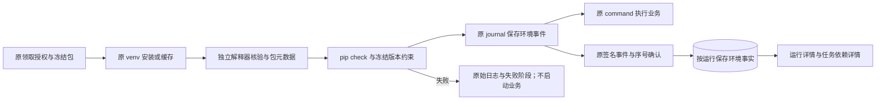

# Agent 业务环境阶段 C：精细对齐与验收

日期：2026-10-16。主改 SpiderFly，基于阶段 B 的未提交工作区。阶段 C 的业务环境校验、签名回传、落库及页面已实施，隔离回归和同机真实安装链路通过。两台独立 Windows、桌面及正式业务仍待现场验收，不以同机验证替代。

需求基线：[增量需求 v0.4](任务设置与依赖自动识别需求.md)、[任务拆分 v0.4](任务设置与依赖自动识别任务拆分.md)、[总体需求](SpiderFly总体需求.md)。历史 [A](任务内定时精细对齐与阶段A验收_2026-10-16.md)、[B](依赖自动识别阶段B精细对齐与验收_2026-10-16.md) 记录保留当时结论；当前源码与最终验证另见[阶段 C 指纹](审查证据/Agent业务环境阶段C指纹_2026-10-16.json)。

## 1. 已有能力和本轮增量

| 已有实现 | 本轮处理 |
| --- | --- |
| Agent 启动器安装自身依赖、执行 pip check、按清单哈希保存标记 | 复用；仅在 Agent requirements 增加 packaging，沿用原安装检查重试 |
| worker 按冻结脚本/依赖内容哈希创建业务 venv、pip install、缓存环境 | 复用；缓存命中仍检查实际解释器、pip check 和直接依赖约束；未完成或损坏缓存清除就绪标志，后续新运行重新创建 |
| Windows Job、进程身份、停止、准备时间计入原运行超时 | 复用 command，不另开不受管理的安装/探测子进程 |
| journal 持久事件、签名请求、序号确认、断线补传、日志/产物/终态 | 增加 environment 事件，复用原链路；不新增独立上传服务 |
| 主控本机环境记录、静态分析、版本冻结与首次计划门控 | 保持 B；Agent 记录单独绑定 remote run，不能修改主控 ready、计划或版本 |

## 2. 代码和协议逐项核对

| 要求 | 实现与证据 |
| --- | --- |
| 实际解释器 | [Agent environment.py](../agent/spiderfly_agent/environment.py) 使用目标 Python 的 `-I` 读取 sys.executable、prefix/base_prefix、3.12 和 64 位；验证本次独立环境，路径仅本机核对，不进入结构化回传 |
| 实际依赖 | 目标环境的 importlib.metadata 读取安装包及版本，不 import 业务或第三方包；原 worker command 执行 pip check；packaging 核对冻结直接依赖名称及约束 |
| 缓存复用 | 原完整包哈希和 ready 标志仍核对；命中后重新检查，不重新升级包。检查失败取消标记，本次失败；用户下一次新运行可重建，原失败不改成功 |
| 准备与停止 | [worker.py](../agent/spiderfly_agent/worker.py) 保持原 Job/时限/停止；失败记录阶段和错误，没有 started。探测与最终事件均受 256 KiB/1000 包限制；整份记录超限时在业务开始前失败，失败摘要仍可回传，禁止缓存链接路径参与重建 |
| 持久与回传 | 原 [journal](../agent/spiderfly_agent/journal.py)、[Client.flush](../agent/spiderfly_agent/client.py) 不重建；环境事件先持久化再允许业务，原签名、序号和 ack 去重 |
| 主控验证 | [agent_environment.py](../backend/app/agent_environment.py) 校对本次冻结包/清单哈希、Python/位数/检查结果、实际包和约束；[hosts API](../backend/app/api/hosts.py) 限制字段与大小，保持管理员及机器签名边界 |
| 主控事务 | [host_dispatch.py](../backend/app/services/host_dispatch.py) 增加按 run 唯一的 remote_environment_records；环境事实、事件和 ack 同事务，序号缺口全部回滚；禁止别台机器写入、业务开始后补造事实或覆盖既有记录 |
| 业务开始 | 0.4.0 新领取保存 environment_report_required；必须有 ready 事实才能接受 started，缺少开始事实不能提交成功。失败、超时、停止仍走原终态与占用收尾 |
| 旧版兼容 | 协议号仍为 1，Agent 当前 0.4.0、最低 0.3.0。0.3.0 保留旧执行，不显示已校验；历史事件规范化不新增 environment:null，旧 journal 可重放。新版 Agent 遇到旧主控缺少 environment_report_version 时拒绝业务并提示升级主控 |
| 页面 | 共用 [EnvironmentDetails.vue](../frontend/src/features/hosts/EnvironmentDetails.vue)，默认折叠；显示实际 Python、包版本、时间、缓存或失败阶段。运行详情和任务详情共用；主控环境与目标电脑环境分开 |
| 安装包 | 主控 ZIP 白名单加入 environment.py，文件名为 SpiderFlyAgent-0.4.0.zip；保留原人工升级向导、身份和 journal。不会自动给实际 Agent 升级 |

旧版继续执行不等于已具备本轮校验能力。新能力以 **Agent 0.4.0 + 新主控 + 本次回传记录** 为准。签名证明记录来自目标登记身份，不是对真实电脑配置的硬件证明。

## 3. 参考实现逐项取舍

| 对照项 | 参考行为及本项目边界 | 结论 |
| --- | --- | --- |
| RPAC PythonExecutor | 调用配置的现有 Python；不是上传单文件后静态识别并为远程目标留环境事实 | 继续使用 SpiderFly 原业务 venv，不照搬共享解释器 |
| KK dashboard publisher | 以 app.toml、pyproject、uv.lock 等项目元数据发布 | 保留普通单 Py 和冻结 requirements；不引入项目包、全局锁文件或自动同步版本 |
| KK monorepo runtime | StepSpec/Step/BaseProgram/ExecutionContext 组织项目化步骤 | 保留本机串行工作流和普通脚本；Agent 此轮不加入 DAG 或远程工作流 |
| SpiderFly 自身启动器与 worker | 启动器自身已有 pip check；业务 worker 已有安装/缓存和可重放事件 | 精确补业务环境校验/实际明细，未重复开发安装器或回传协议 |

前三项沿用 [B 的固定参考源码与哈希](审查证据/依赖自动识别阶段B指纹_2026-10-16.json)，不是本轮重新拉取的在线最新版本。C 的实现逐项对应本仓库，不把参考项目的功能视为 SpiderFly 已有能力。

## 4. TS01—TS08 / DP01—DP07 对齐

| 编号 | 结论 | 本轮核对 |
| --- | --- | --- |
| TS01 | A 保持、C 回归 | 单任务和整个流程同页定时；未扩大 Agent Cron 范围 |
| TS02 | B 保持、C 回归 | 单个 UTF-8 Py，未新增 ZIP/目录入口 |
| TS03 | B/C 对齐 | 普通包源、明确清单和 3.12/64 位；不代装 Office/浏览器/系统软件 |
| TS04 | C 软件对齐、两机待验 | Agent 实际领取后在目标准备；记录单独回传，主控 ready 不代表目标 ready |
| TS05 | 保持 | 原确认启用、冻结包、串行与维护边界；本轮不自动改源码/换包/重跑 |
| TS06 | A/B 保持、C 页面通过 | 原共用表单；实际环境组件复用，默认折叠，320px 无横向溢出 |
| TS07 | A/B 保持、C 回归 | 定义/计划/回执原子性保持；环境事件的记录和 ack 也同事务 |
| TS08 | 保持 | 原手动/每日/每周、Cron/流程和权限回归；旧版事实标记未提供 |
| DP01 | B 保持、C 回归 | 上传静态解析；业务环境探测不 import 上传代码 |
| DP02 | B 保持、C 回归 | 已审查映射和未知项人工补充；不在线猜模块同名包 |
| DP03 | B/C 对齐 | 用户固定版本优先；Agent 和主控均核对真实安装版本满足冻结约束 |
| DP04 | B/C 对齐 | 环境记录绑定本次冻结包、代码版本和目标；后改现有任务不改历史记录 |
| DP05 | B 保持、C 回归 | 主控后台环境、首次门控、原任务失败重试保持；无远程安装触发本机执行 |
| DP06 | C 软件通过、现场待验 | 实际 Agent Worker、签名 HTTP、失败不开始、缓存重验和确认丢失补传；非两机结论 |
| DP07 | C 软件通过 | 目标实际包/Python/位数、哈希、时间、失败阶段；只读展示，不推断业务验收成功 |

## 5. AT01—AT18 验收表

| 验收 | 结果 | 证据 |
| --- | --- | --- |
| AT01 | A/B 保持、回归通过 | 共用计划字段与原子创建；C 未改调度计算 |
| AT02 | A/B 保持、回归通过 | 整流程计划、成员冲突与原串行队列 |
| AT03 | A/B 保持、回归通过 | 原值回填、停用、编辑冲突及草稿 |
| AT04 | A/B 保持、回归通过 | 非法配置与审计/回执失败不留半对象 |
| AT05 | A/B 保持、回归通过 | 稳定请求号、丢失响应重试与重复对象保护 |
| AT06 | B 保持、回归通过 | 常见库与标准库分类；C 合成 Py 自动识别 requests 并安装 |
| AT07 | B 保持、回归通过 | 别名、去重、from、行号与注释排除 |
| AT08 | B 保持、能力限制保留 | 未知、条件、动态项需补充；不保证发现所有动态依赖 |
| AT09 | B/C 通过 | requests==2.32.5 的真实安装/回传；错误版本 HTTP 拒绝 |
| AT10 | B/C 通过 | 静态分析不执行业务；新增探测只读平台指定元数据；真实失败没有 started 或产物 |
| AT11 | B/C 通过 | 冻结哈希不符、错目标、晚改清单、重复记录及覆盖均拒绝/保持原事实 |
| AT12 | B 保持、C Agent 追加通过 | 原本机测试；Agent 真 venv、pip、metadata、缓存和原始失败另验 |
| AT13 | B 保持、回归通过 | 首次准备门控、未来点及竞争；未以 Agent 事实释放主控计划 |
| AT14 | B/C 通过 | 原版本确认、环境/工作流保护；记录绑定已冻结 remote run |
| AT15 | C 同机链路通过、两机待验 | 五轮真实 Worker；实际缺依赖导致 pip check 失败、坏缓存重建、不可达包源、签名响应丢失后 journal 重开补传；没有回落主控 |
| AT16 | 自动校验通过、实际异构电脑待验 | 真实签名/权限；32 位、非 3.12、错误路径、重复元数据/版本及超限拒绝；不自动变更机器软件 |
| AT17 | 页面通过 | 运行和任务两处明细、默认折叠、320px、键盘可滚动与 Esc 恢复焦点；控制台无错误 |
| AT18 | 回归通过、现场条件待验 | 后端 767 项：748 通过/19 条件跳过；Agent 62 项：61 通过/1 条件跳过；前端 213 通过，122 模块构建 |

后端新增 13 项 [test_agent_environment.py](../backend/tests/test_agent_environment.py)；Agent 新增 11 项 [test_environment.py](../agent/tests/test_environment.py)。原安装/日志/停止/升级检查保留。前端新增 7 项 [隔离页面行为检查](审查证据/Agent环境页面隔离检查_2026-10-16.mjs)，其余 206 项重验。19+1 项跳过分别为已有 Chromium/WSL/DP 和 Windows 符号链接条件，没有新增静默跳过。

## 6. 同机真实安装与实页

[实际结果](审查证据/Agent业务环境实测_2026-10-16.json) 仅合成账号/脚本/身份。用同一 Windows 的隔离主控和实际 Agent Worker，运行原 venv/pip/Job、journal 和签名 HTTP；不是改生产锁运行正式 Agent。

| 轮次 | 结果 |
| --- | --- |
| 首次 requests==2.32.5 | 独立环境、实际包清单、Python 3.12.10/64 位；合成脚本输出同版本产物 |
| 响应丢失 | 主控已提交环境/日志后模拟响应丢失，本地 ack 仍为 0；关闭/重开 journal 后补传，环境记录仍只有一份 |
| 缓存重验 | 不重复 pip install，重新探测和 pip check，回传 cache_reused=true |
| 实际依赖冲突 | 加入要求不存在依赖的合成 distribution 元数据，真实 pip check 非零；记录失败阶段、无 started/产物、ready 标志清除 |
| 下一次新运行 | 清理未就绪缓存并重新安装/核验，成功；原失败保留 |
| 包源不可达 | 实际访问本机不可达包源，pip install 失败；记录 install 阶段，无业务开始或产物 |

Codex 隔离浏览器访问本轮最终构建，核对实际数据库返回的版本与环境事实，未用模拟前端响应替代。宽屏 1280px 页面宽 1280；320px 视口页面宽 305、环境容器宽和 scrollWidth 均 251。任务弹窗 Escape 后焦点回到编辑按钮。页面错误日志 0。截图：[任务详情](审查证据/Agent实际环境任务详情_2026-10-16.png)、[窄屏](审查证据/Agent实际环境窄屏_2026-10-16.png)。

## 7. 交付及剩余现场项

N01 的 Agent 状态/事实和 N09 软件实施、N10 的隔离回归/页面/文档完成；N10 的两台实际 Windows 和正式业务现场保持待验。原 A/B 能力本轮回归，不改写历史指纹。未提交或推送 Git，实际 Agent 不自动升级。

本地主控加载、备份和最终资源哈希见本轮指纹的 local_release 字段。其他电脑从主控下载 0.4.0 包，在空闲且 journal 已回传后走原人工升级流程。主控先升级，再升级 Agent；旧 0.3.0 仍可按旧链路运行，其记录不会被标为已校验。

剩余现场：第二台电脑首次安装/缓存/损坏环境、实际不同 Python/位数、断网/主控及 Agent 重启、Windows 桌面/锁屏/RDP、浏览器/Excel和真实业务。此处保留检查项，不声称现场通过，也不因此重复开发已实现的安装和回传能力。
