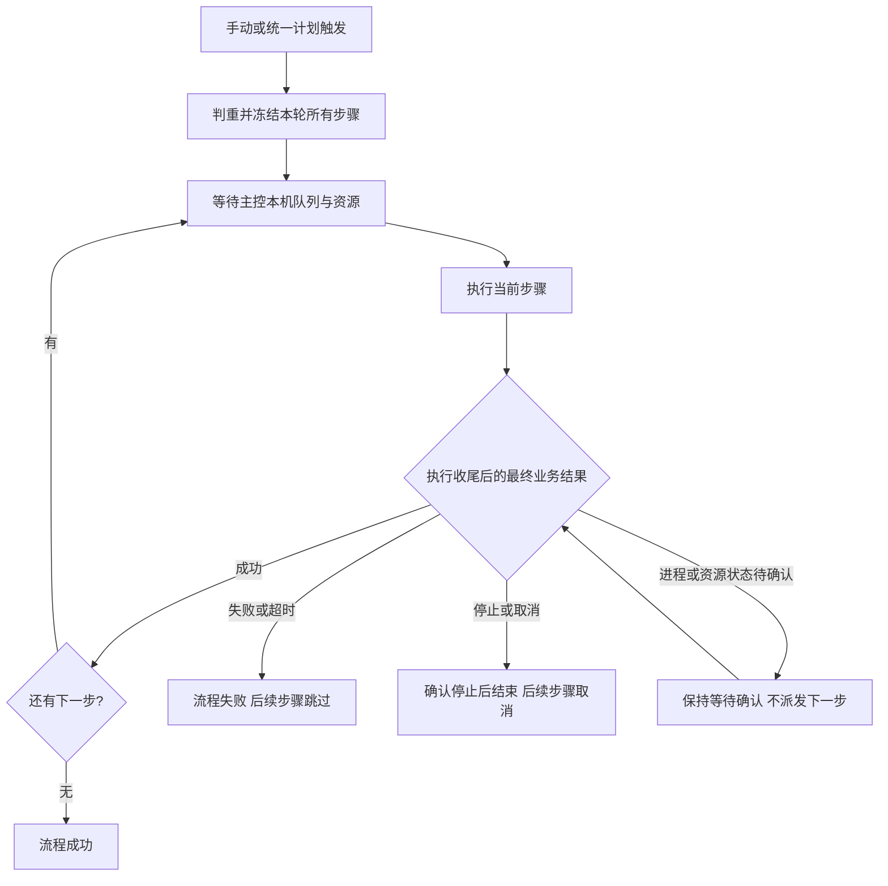

# Cron 与串行工作流场景边界

核对日期：2026-10-13。对象：当前 SpiderFly 工作区及相邻 RPAC-main 源码。

**主修改项目是 SpiderFly。RPAC-main 仅供读取和对照，Cron 与串行工作流的后续实现、文档和验收都在 SpiderFly 中完成。**

本文保留最初代码阅读和范围定义。下面的“首版规则”是完整实施基线，不代表所有能力通过业务验收，也不构成对历史候选项的实施授权。后续 M1—M3 已完成相应工作区实现、隔离回归和实际隔离页面验收，并于 2026-10-14 由正式主控加载；最新状态见文末和[M3 记录](M3实现与验证记录_2026-10-14.md)。下文历史阅读及阶段记录保留各自时点。

配套交付：[需求文档](Cron与串行工作流需求.md)定义行为与验收；[任务拆分](Cron与串行工作流任务拆分.md)定义实施阶段、代码落点和完成条件。

用户已确认首版场景：**在 SpiderFly 主控电脑本机按顺序运行多个脚本；只需执行顺序，脚本自行读写业务目录或数据库**。因此采用主控本机优先，撤回此前“首版只支持 Agent”的范围取舍。其余规则来自本次代码核对，依据和限制列在下文。

用户随后确认：删除任务后保留简要流程历史，不额外保存已结束步骤的源码/模板内容、完整日志和平台产物；未结束轮次使用的快照与环境到可信收尾后才能清理。新增单任务 Cron 在自动维护及一次修复重跑期间跳过新计划，不积压或事后补跑；原失败、维护与重跑保留同一轮次关联。详细规则已同步需求 v1.1；Cron 维护轮次已在 M1 实施，删除协调、全部未结束步骤保护及独立六项流程摘要已在 M2 实施。

评估结论：在这些已确认条件下，本机 Cron 加串行流程更适合当前需求。它复用现有队列、版本、日志和业务结果判定，不增加执行端安装和步骤间数据传递。实施顺序是先接通可靠 Cron，再接本机串行流程；版本快照、失败停止和重启恢复属于必要工作，不能省成几个按顺序点击的按钮。

## 1. 本次要解决什么

- Cron：表达一个任务或整条流程的运行时间，支持一天多次、周一至周五的固定时间段、每月指定日期等规则，并预览未来 5 次触发时间。
- 串行工作流：将已有、可独立运行的普通 Python 任务按顺序排列。前一步确认成功，才派发下一步；任一步失败，本轮不再执行后续步骤。
- 继续使用 SpiderFly 的账号、任务版本、SQLite、主控 API 和本机串行队列。不为这两项能力迁入 RPAC 的 PostgreSQL、Redis 或 Worker，也不要求在主控本机另装 Agent。

| 场景 | 首版范围 |
| --- | --- |
| 每天 9 点和 14 点运行一个已有任务 | 纳入 Cron |
| 周一至周五 9:00—18:30 每半小时运行 | 纳入 Cron；周一至周五不等于法定工作日 |
| 每月 1 日 9 点运行 | 纳入 Cron |
| 主控本机：写业务数据库 → 从数据库汇总 → 核对处理状态 | 纳入串行流程；脚本自行读写已明确配置的业务数据 |
| 主控本机：三个可独立启动、收尾的任务依次执行 | 纳入串行流程，不保证步骤间独占电脑 |
| 下载文件到本次 artifacts → 自动作为下一步 inputs | 不纳入；当前没有步骤间输入输出绑定 |
| 延续上一脚本的 Excel 实例、浏览器登录态或桌面位置 | 不纳入；每步必须能够独立运行和收尾 |
| 跨电脑传文件、并行分支、汇合、条件判断、循环、审批、失败补偿 | 不纳入首版 |
| 财务扣款等依赖业务“恰好一次”、历史日期逐期补处理 | 不作为首版验收场景；调度判重不能代替业务幂等 |

## 2. 现有代码的实际边界

### SpiderFly

下表为初次阅读时的基线事实和行号，不覆盖后续 M1/M2 代码变动。当前公共 schema/页面已新增 Cron 和手动工作流；统一解析、事务账本与可信收尾见[M1 记录](M1实现与验证记录_2026-10-13.md)，整轮快照与当前步骤协调见[M2 记录](M2实现与验证记录_2026-10-13.md)。旧 daily/weekly 保持兼容，新 Cron 仅主控本机 native/readonly-v1；M2 流程仅普通 native。

| 已核实事实 | 代码证据 | 对范围的影响 |
| --- | --- | --- |
| 页面和公共任务 schema 只开放 manual、daily、weekly | [schemas.py](../backend/app/schemas.py) 第 49、82 行；[constants.js](../frontend/src/lib/constants.js) 第 24 行 | once、interval 只是底层计算能力，不写成已开放的 API 功能 |
| 北京时间计算、UTC 持久化，每秒扫描 next_run_at | [scheduling.py](../backend/app/scheduling.py) 第 11、87、146 行 | Cron 沿用北京时间和既有调度入口，不另开一套常驻调度进程 |
| 先推进计划，再入队；分发错误被吞掉 | scheduling.py 第 163—175 行 | 新触发必须留下成功、跳过或错误事实，计划推进和触发登记需一致提交 |
| 计划可多次排队，远端按任务和 scheduled_for 判重 | [execution_queue.py](../backend/app/services/execution_queue.py) 第 58—85 行；[host_dispatch.py](../backend/app/services/host_dispatch.py) 第 452—485 行 | 分钟级 Cron 必须增加重叠规则，不能依赖机器串行消除积压 |
| 本机只有一个业务执行队列，业务、维护和试跑共用串行边界 | execution_queue.py 第 168—225 行 | 流程复用该队列及资源检查，不另开 Worker 或绕过机器锁 |
| 本机解析 result.json，failure、manual_required 或无效回执可将退出码 0 降为失败 | [execution_results.py](../backend/app/execution_results.py) 第 207—252 行；[runner.py](../backend/app/runner.py) 第 361—415 行 | 依据本步骤真实 execution_id 的最终状态，在完整收尾后推进；不只看退出码、日志或 task.last_status |
| 本机每次运行的产物、下载、截图、临时目录独立；模板按现有入口提供，公共工作区任务前后清理 | runner.py 第 265—274、458—462 行；execution_results.py 第 70—91 行；[execution_artifacts.py](../backend/app/execution_artifacts.py) 第 44 行 | 本机尚无每次运行独立的 inputs 目录；保留现有模板，自行接力的业务目录必须位于清理区之外 |
| 本机启动恢复把意外中断的 running 标为 failed，保留 pending | [database.py](../backend/app/database.py) 第 139—169 行 | 流程恢复原执行关联；不能声称继续旧进程，也不能自动新建尝试 |
| 本机维护和手工版本发布都会重绑同任务的 pending 记录 | [maintenance.py](../backend/app/maintenance.py) 第 380—419 行；[task_versions.py](../backend/app/task_versions.py) 第 193—198 行 | 两处必须排除流程执行，保护整轮快照；独立任务保留既有维护行为 |
| runner 仍读取当前任务的模板和通知等参数，超时采用全局配置，默认 600 秒 | runner.py 第 416—420、458—462、500 行；[config.py](../backend/app/config.py) 第 50—52 行 | 不能只冻结代码路径；首版不虚构逐步骤超时能力，长时补数上线前需核对实际耗时 |
| 远端目前限定普通 Python，尚无步骤间输入绑定，且与本机业务结果契约不同 | [host_dispatch.py](../backend/app/services/host_dispatch.py) 第 400—415 行；[worker.py](../agent/spiderfly_agent/worker.py) 第 70、88—94、256—258 行 | Agent 流程后续接入并单独验收，不成为本机首版的前置要求 |

任务与流程的公开入口、编辑、运行记录和时间表都需要接通。现有 SpiderFly 没有工作流定义、节点依赖或流程运行模型，不能只补一个排序页面。

当前源码、历史发布记录、服务实际加载和现场验收是不同证据。本次不读取正式数据库或验证正式进程。本机流程实施后仍需本机现场验收；[宿主机说明](功能地图/宿主机与远程运行.md)中的真实双机验收属于后续 Agent 范围。

### RPAC-main：借鉴点与不能照搬的部分

下列路径相对于相邻 `RPAC-main/`。该目录不属于 SpiderFly 仓库，这里只记录阅读证据，不建立发布后失效的跨仓库相对链接。

| 项目 | 核对结论与证据 |
| --- | --- |
| Cron 预设、校验、未来时间预览 | 可借鉴产品入口。`frontend/src/components/CronPicker.vue`；`backend/app/api/cron.py:22` |
| 独立流程运行和步骤运行 | 可借鉴概念。`backend/app/services/execution_service.py:261`；本次只采用有序步骤，不引入完整 DAG |
| Cron 与流程关系 | Cron 当前只生成单任务 Execution；流程只手动启动。给首节点加 Cron 不会触发整条流程。`scheduler_service.py:136`、`dependency_resolver.py:22`、`execution_service.py:282` |
| 预览与执行不一致 | croniter 与 APScheduler 分别解析，星期编号、日与星期组合、字段数及时区存在差异。`api/cron.py:22`、`scheduler_service.py:35/76/99`。本次必须使用同一套解析及时间计算 |
| 工作流成员及隔离 | 只保存边，未连边节点会丢失；传播查询没有限定 workflow_id，多流程复用任务会互相干扰。`api/workflows.py:138`、`execution_service.py:273`、`dependency_resolver.py:29/59`。本次保存独立有序节点并按流程运行隔离 |
| 运行快照、取消与收尾 | 运行期间仍读取当前任务与边；单节点取消不完整传播；没有整流程停止或失败步骤恢复 API。`dependency_resolver.py:29/76/109`、`execution_service.py:222`。本次单独定义并验收这些行为 |
| 数据传递与验证 | 流程无输入输出绑定；现有测试目录没有 Cron、DAG 专项测试。不能据此承诺数据流水线、可靠恢复或业务验收 |

纯解析器核对示例：基准 `2026-10-13 00:00 UTC`，预设 `0 9 * * 1` 在 croniter 中是下一周一的 09:00 无时区时间；本机 APScheduler CronTrigger 则按周二、Asia/Shanghai 计算。六字段表达式可通过预览，却被实际 CronTrigger 拒绝。本次仅验证解析库，未导入业务 app 或触发任务。

## 3. Cron 首版规则

1. **格式**：五字段，分钟精度：分、时、日、月、星期。支持 `*`、列表、范围、步长及明确的星期名称。不接受秒、年、`L/W/#`、宏表达式或任意业务表达式。
2. **时间**：固定 Asia/Shanghai；持久化 UTC；页面明确北京时间。校验、未来 5 次预览、正式触发共用同一套计算规则，不能混用解析器。
3. **星期**：数值 0 是周日、1—6 是周一至周六，7 可规范化为周日；页面星期选项按该契约转换，也可使用 MON—SUN。首版禁止“日”和“星期”同时受限，避免 OR/AND 歧义。
4. **日期**：不存在的日期不运行，如每月 31 日会跳过没有 31 日的月份。字段合法但永无可执行日期的组合（如 `0 9 31 2 *`）保存时拒绝并说明原因，校验与预览必须有界，不能无限搜索。法定节假日、调休、工作日历、多时区与 DST 不纳入首版。
5. **触发对象**：明确选择单任务或整条流程。流程只有一个统一计划；不能靠首节点的独立计划隐式启动流程。
6. **兼容**：保留 daily、weekly 简单入口和既有独立任务行为；新增 cron 类型，不自动把已有任务或计划迁成 Cron。新增 Cron 首版只开放主控本机目标，已绑定远端的任务明确拒绝，不改写目标或在主控代跑；已有 Agent 行为保留，远程新增 Cron 后续单独接入与验收。
7. **漏触发**：新增 Cron 在主控恢复后只补最近一次错过的时间点，不逐次补历史；已有未结束运行时不新增。记录原计划时间、实际触发时间和合并范围，业务不能据此假设每个周期均已处理。
8. **重叠**：同一 Cron 任务或流程已有排队、执行、停止中或状态待确认的运行时，新时间点记为“因上一轮未结束而跳过”；不累计无限队列。手动重复运行也拒绝；相同请求重试返回原记录。
   新增单任务 Cron 的自动维护生成、等待验证、验证及一次修复重跑也计入原轮次；维护结束且实际执行收尾确认后，才允许后续未来计划。期间跳过点及占用期间的停机漏点不补跑，即使恢复先结算维护也不能转为普通漏触发补跑；旧 daily/weekly 独立任务不自动迁移这一规则。
9. **本机忙碌或资源不可用**：允许保留一轮排队，沿现有队列等待；后续 Cron 时间点按重叠规则跳过。首版不自动过期、不自动换电脑；用户可以取消。
10. **触发登记**：按对象和计划时间判重。计划推进与触发事实同一事务提交；暂时派发失败有可见原因并可恢复，不能吞异常后永久漏掉本轮。
11. **启停**：单任务继续使用现有 `task.enabled`，停用会阻止未来触发并取消本机 `pending` 和远端 `queued`，不自动停止本机 `running` 或远端 `preparing/running`；其中 `preparing` 也可能尚未 claim，不能把“未领取”当成所有运行的现有取消条件。新流程使用独立计划开关 `schedule_enabled`；关闭该开关只阻止未来计划触发，不停用成员任务，也不取消当前流程。取消当前流程使用独立停止操作，不能把“停用计划”写成“已停止进程”。

上述新增 Cron 规则与历史 daily/weekly 的积压行为不同；迁移历史计划需要另行明确，不在本次默认发生。

| 模板 | 表达式 | 含义 |
| --- | --- | --- |
| 每天两次 | `0 9,14 * * *` | 北京时间 9:00、14:00 |
| 周一至周五每半小时 | `*/30 9-18 * * MON-FRI` | 9:00—18:30；包含 18:30，不读取节假日历 |
| 每月 1 日 | `0 9 1 * *` | 每月 1 日 9:00 |
| 每周五 | `0 18 * * FRI` | 每周五 18:00 |

## 4. 串行工作流首版规则

### 定义与触发

- 管理员编排已有任务，有序步骤 `A → B → C`；拒绝空流程、循环和同一任务重复出现。单步骤流程保留节点，不能因没有连线丢失。
- 首版所有步骤均在 **Windows 主控本机**，使用普通 native Python 任务及其已有依赖。可使用现有本机输入模板；普通任务使用 DrissionPage 库不因此被排除。需要 drissionpage-v1、readonly-v1、collection-v1 专用执行器的任务，待逐类完成快照和停止验证后再纳入。
- 使用现有本机队列、资源检查和机器锁，不另启 Agent 或执行队列。已经绑定远程电脑的任务明确拒绝加入本机流程，不能通过流程临时覆盖目标。
- 支持手动启动和整条流程的每日、每周、Cron 计划。流程权限按任务和目标检查，不因流程入口扩大普通成员权限。
- 所有新增流程共用“最多一轮未结束”的规则，包括手动、每日、每周和 Cron：重复手动请求拒绝，相同请求 ID 返回原运行；新计划时间点留下跳过原因，不继续积压。流程停机漏触发也只补最近一次，仍需通过这项判重。历史独立任务 daily/weekly 不自动改用该策略。
- 启用流程计划时，所引用任务必须没有已启用的独立计划，避免重复触发；需将成员任务触发方式设为手动，并保持任务本身启用，不能用停用任务来代替关闭独立计划。保留单任务手动入口，修改独立计划时也检查反向冲突。
- 流程运行彼此隔离。不同流程可复用任务定义，但当前步骤所引用任务已有未结束的真实运行时，该步骤等待，不创建重叠运行；只有已派发的真实运行占用任务，尚未派发的等待步骤不预留机器或任务。等候期间按机器队列规则处理。

### 快照、执行与推进

1. 一次流程有独立运行 ID；每个步骤有独立节点 ID，并关联真实本机 execution_id。流程不替代任务原日志和结果记录，也不通过任务最后一次状态推测当前步骤结果。
2. 启动时在一个事务内冻结步骤顺序、每步源码/依赖及版本、目标、输入模板内容和通知等执行参数；整轮用该快照。下游入队和 runner 必须读取节点快照，不重新选当前任务版本或当前模板。既有维护与手工发布不得重绑流程 pending 记录或将其复用为维护重跑。
3. 任务源码、名称、目标或流程顺序的后续修改只影响新运行。安全状态例外：任务停用或删除会阻止尚未派发步骤，并留下明确终态原因。
4. 先派发当前步骤，其他步骤等待。在 run_execution 完整返回、进程树结束和清理完成后，读取该 execution_id 的最终状态；队列兜底失败写入后也执行同一协调逻辑。最终状态为 success 才允许下一步，重复协调不得再次入队。
5. 保留本机结构化业务结果判定：failure、manual_required、无效回执、清理失败等不能仅因退出码为 0 而放行。日志“完成”、进度 100% 和任务最后状态都不是推进依据。
6. 任一步 failed/timeout 使本轮流程失败，未开始步骤标为因上游失败跳过。普通独立任务继续沿用现有自动维护；流程执行不进入旧自动启用与重跑链路，可保留诊断和人工版本操作，不能偷偷在流程外重跑业务步骤。
7. 新增流程协调与恢复逻辑：pending 恢复原执行记录；成功已保存但尚未推进时补推进一次；意外中断的 running 按现有启动恢复标为失败并结束本轮，不自动重新运行。现有 maintenance.reconcile_reruns 只结算维护重跑，不能用它代替流程恢复。进程或资源状态未确认时保持等待，不能提前派发下游。
8. 流程不独占整个桌面会话；步骤之间可能运行其他任务，所以每个脚本必须独立初始化和关闭所用资源。沿用本机全局超时配置（默认 600 秒），本轮记录并使用启动时生效的全局值，首版不新增逐步骤超时编辑；长时历史补数须在上线前核对耗时和全局配置，不以删掉超时来掩盖问题。

### 停止与重跑

- 停止流程后立即禁止新步骤，取消尚未派发或本机 pending 的步骤；当前步骤调用现有停止入口，等进程树结束及执行收尾后再结束流程。不能先显示已停止、提前释放机器。
- 当前步骤若因手动停止、运行资源被移除或不可用、取消而结束，不再推进下游，所有等待步骤获得明确结束原因；停用任务本身不自动停止已经运行的进程。
- 首版仅支持整条流程新开一轮。新一轮重新冻结当前版本，不覆盖原失败/取消记录。管理员采用修复候选后，单独重跑成功或独立任务自动维护成功均不会使原流程自动继续。
- “从失败步骤继续”、节点自动重试、补偿回滚、流程暂停/恢复、运行中编辑步骤不纳入首版。

### 删除与简要历史

- 成员任务删除后，历史仍显示本轮冻结的步骤名称、版本号、顺序、执行时间、状态和错误摘要；摘要不依赖已删除任务或执行记录。
- 已确认收尾的源码/模板内容快照、完整日志和平台产物可随任务删除清理；详情标示资料已删除并关闭失效链接。所有未结束轮次引用的文件和环境先保护，协调取消/停止并确认收尾后再清理。
- 含已删除成员的定义拒绝新启动或整轮重跑，不能自动省略步骤或用历史快照复活。任务删除不删除或回滚业务目录、外部数据库中已写入的数据。

下图保留 2026-10-13 的完整目标生命周期；当时手动路径已在 M2 实施，统一计划触发待 M3。本图不提供验收证据，2026-10-14 实际计划路径和加载状态见文末，代码调用图见[项目架构](项目架构.md)。

## 5. 数据与桌面边界

用户已确认只需执行顺序，由脚本自行读写业务目录或数据库。首版只有控制依赖，没有步骤间数据映射。本次产物、下载、截图、临时目录与结果回执属于该次运行；模板按现有入口提供，本机尚无独立 inputs 目录。同一电脑不代表继承这些产物，也不继承上一任务的 Python 内存、浏览器对象或 Office 进程。

脚本可以自行访问已明确配置的业务数据库或业务目录，并自行检查读写是否成功；持续保留的业务目录必须在任务前后会被清理的公共工作区之外。平台不创建隐式共享目录、不猜测文件名、不将本次产物自动注入下一步，也不自动传递账号或凭据。日后需要平台自动传文件的报表流水线，再单独定义最小输入引用及文件校验、权限、保留期限和重跑规则。

跨电脑执行、数据传递和并行 DAG 均独立立项。首版不承诺跨步骤业务事务或“失败后自动撤销已完成的业务操作”。

## 6. 后续实现落点与验收边界

| 工作项 | 落点 | 必须验证 |
| --- | --- | --- |
| Cron 契约与预览 | scheduling.py、schemas.py、任务创建/编辑、时间表 | 星期、月底、北京时间、5 字段限制、无未来日期组合有界拒绝；预览与触发完全一致 |
| 触发持久化与恢复 | 调度循环、SQLite 触发记录、现有队列路由 | 计划与入队一致、重复扫描判重、派发失败可恢复、漏触发/重叠可见 |
| 流程定义与运行模型 | 新增独立定义、节点快照、流程运行和步骤关联 | 有序节点持久化、单节点保留、流程之间隔离、任务计划冲突 |
| 按节点快照执行 | execution_queue.py、runner.py、maintenance.py、task_versions.py | 下游源码/模板/参数编辑和版本发布不改变本轮；安全停用仍生效；普通任务维护回归通过 |
| 结果推进、恢复与停止 | 本机队列完整收尾入口、新流程协调器、启动恢复 | success 仅推进一次；业务回执失败、意外中断、取消和停止等待不误推进；不重复创建执行 |
| 页面与审计 | 流程编辑、运行详情、既有日志和结果入口 | 显示步骤、版本、目标、计划与实际时间；失败/跳过/等待原因完整 |

验证只使用隔离副本和合成脚本，不导入正式目录的 app，不借真实业务任务、密钥、数据库或用户文件。后续 Agent 行为变更需单独发布和人工升级，不以主控源码更新冒充已更新执行端。

隔离自动检查之后，还需在实际 Windows 主控本机，用测试身份、独立验证数据目录及非业务脚本做现场验收，覆盖调度开关、资源占用、停止与服务恢复；使用桌面的脚本还需验证锁屏和会话不可用。不在正式主控上启动同机 Agent 绕过机器锁；本机验收不等于后续双机验收。

首批验收至少覆盖：A 成功后 B 才启动；A 失败后 B 永不启动；停止与重复协调不放行 B；主控恢复不重复运行 A；排队期间改源码/模板、手工发布或维护发布仍用本轮快照；任务停用/删除终止等待节点；独立任务占用时流程按规则等待；意外中断明确结束本轮；重跑生成新记录；failure/manual_required 回执即使退出码 0 也不放行 B；普通独立任务自动维护、原 daily/weekly 和单任务执行回归通过。

最初交付是范围核对、事实纠正及配套需求文档和任务拆分，上面的参考事实保留当时判断。后续 M1 单任务 Cron 已完成对应源码、隔离回归和页面验证；M2 已实现普通 native 本机手动有序步骤、整轮源码/依赖/环境/模板/通知/超时/浏览器端口冻结、失败停止且不进入旧维护、持久停止恢复、简要删除历史和当前版本整轮重跑。

2026-10-13 M2 阶段记录：真实隔离页面已确认 A→B→C 成功、F→C 失败后 C 无执行、S→A 停止后 S 取消且 A 无执行，以及 390/320 像素窄屏编辑与详情正常、表格仅内部滚动。最终证据以[M2 记录](M2实现与验证记录_2026-10-13.md)为准。当时 M3 每日/每周/Cron 整流程计划及双向成员计划冲突未实施；T13 仅完成 M1/M2 范围的隔离检查，T14 正式 Windows 现场、备份/回退与发布仍待执行，正式服务未加载本轮代码。该段不覆盖下节最新状态。

## 2026-10-14 M3 实施、页面验收与正式加载状态

用户确认统一定时入口，选择单个任务或整个工作流，保留上传和任务管理。M3 已接入流程每日/每周/Cron、独立开关、双向成员冲突、workflow_triggers 唯一触发事实、登记/全部快照/运行关联/计划推进同事务、跳过/漏点及准确时间表。新增 service 与代码落点见 [M3 记录](M3实现与验证记录_2026-10-14.md)。

用户手动清除保存的浏览器拒绝规则后，T12 实际 Codex 页面和到点运行验收完成：统一入口及每日/每周/Cron 未来 5 次预览、非法输入保留、双向计划冲突、Cron A→B→C 整轮成功、忙碌跳过、关闭计划保留本轮、每日首步失败不放行下游，以及日志跳转、320/1280 像素页面和键盘操作均已核对。验证只使用隔离合成脚本，所有合成计划已关闭。

T13 的 M3 页面、构建和交付部分完成；隔离后端 570 通过、18 条件跳过，Vue 21 项、86 模块构建通过。正式主控已确认空闲、完整备份、同步 dist 并以原 EXE 单 worker、无 reload 重启加载 M1—M3，健康与鉴权检查通过。未创建正式测试任务或改写已有计划、.env，未提交或推送。历史审查与指纹保留原时点；T14 的真实业务、WSL、桌面、Agent 及恢复/回退现场剩余项仍待验收，不能把正式加载写成这些场景通过。
