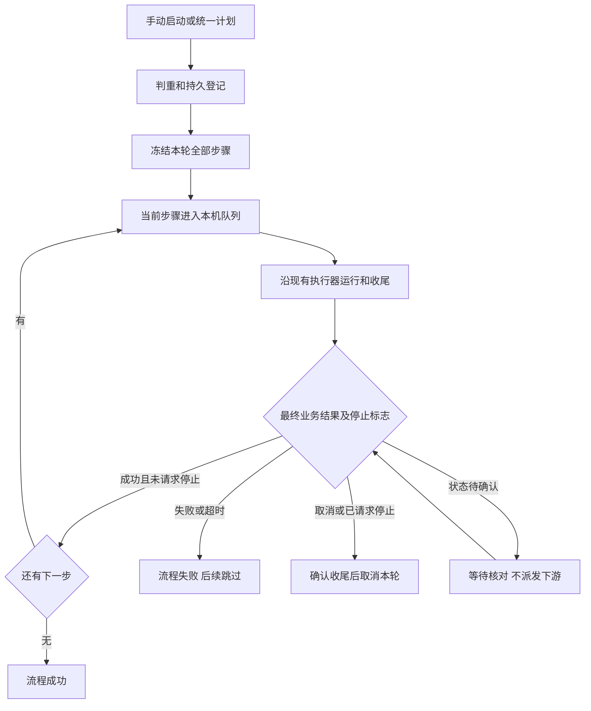

# SpiderFly Cron 与串行工作流需求

版本：v1.2。基线日期：2026-10-13。2026-10-14 更新：M1—M3 及统一任务中心、新建、运行记录入口已由正式主控加载，本轮隔离回归、真实页面、native 到点及空闲备份加载证据见[日期记录](统一任务中心实现与验证记录_2026-10-14.md)。产品导航和创建行为以上层 [总体需求](SpiderFly总体需求.md) 为准，本文件继续定义 Cron 与串行执行契约。真实业务、WSL、桌面、Agent 双机及活动主控崩溃矩阵仍待独立验收，未提交或推送。

本需求只改 SpiderFly，RPAC-main 作为只读参考。已确认的业务范围是：**在 SpiderFly 主控电脑本机按顺序运行多个脚本；只需要执行顺序，脚本自行读写业务目录或数据库。**

代码阅读证据见[场景边界](Cron与串行工作流场景边界_2026-10-13.md)，开发安排见[任务拆分](Cron与串行工作流任务拆分.md)。本文定义需要交付的行为，不表示已发布或已通过业务验收。

v1.1 按用户确认补充两项规则：任务删除后只保留简要流程历史；新增单任务 Cron 自动维护及一次修复重跑期间跳过新计划。其余审查项及源码证据见[精细对齐报告](Cron与串行工作流精细对齐报告_2026-10-13.md)，不能据本次定稿认为全部工程问题已闭合。

M1 实现与验证见[日期记录](M1实现与验证记录_2026-10-13.md)。已接入单任务 Cron、持久轮次、维护占用、native/readonly-v1 可信收尾及页面；新 Cron 仅主控本机，collection-v1/drissionpage-v1 专用执行器当前拒绝。旧 daily/weekly 和 Agent 路由不自动迁移。

2026-10-13 M2 阶段记录：已接入普通 native 本机有序流程、整轮源码/依赖/环境/模板/通知/超时/浏览器端口冻结、可信收尾后推进、失败停止且不进入旧维护、持久停止恢复、整轮按当前版本重跑及删除后简要历史。真实隔离页面已验证 A→B→C 成功、F→C 失败后 C 无执行、S→A 停止后 S 取消且 A 无执行，以及 390/320 像素窄屏编辑与详情；结果统一见[M2 记录](M2实现与验证记录_2026-10-13.md)。当时 M3 整流程每日、每周、Cron 及双向计划冲突尚未实现，不能把 M1/M2 子场景检查写成 AC01—AC24 全面通过或正式部署。

2026-10-14 用户确认 M3 继续实施，并选择统一定时入口：选择单个任务或整个工作流，保留现有脚本上传和任务管理。每日/每周/Cron、计划开关、双向成员冲突、整轮原子接受和计划历史已实施。用户清除保存的浏览器拒绝规则后，实际页面验证统一入口、未来 5 次预览、非法输入保留、双向冲突、Cron 到点 A→B→C、忙碌跳过、关闭计划保留本轮及失败不放行下游；正式主控已空闲备份、同步 dist 并重启加载。证据与现场剩余项见[M3 记录](M3实现与验证记录_2026-10-14.md)。上段 M3 未实现的表述保留 M2 时点，以本条为最新实施状态。

## 1. 目标与范围

### R01：执行范围

在现有账号、任务、版本、SQLite、本机队列、运行日志和结果体系中增加两项能力：Cron 表达运行时间；串行工作流表达已有任务的执行顺序。生产仍为单进程、单业务 worker，业务任务、维护验证和采集试跑共用现有串行边界。

| 业务需求 | 首版交付 |
| --- | --- |
| 每天 9 点和 14 点运行脚本 | 单任务 Cron |
| 周一至周五指定时段每半小时运行 | Cron 预设及未来触发预览 |
| 每月指定日期启动一组脚本 | 整流程 Cron |
| 先写业务数据库，再汇总，最后核对 | 本机有序步骤，成功后推进 |
| 脚本之间使用已配置的业务目录 | 脚本自行读写，目录位于公共清理区之外 |
| 任一步失败或取消 | 本轮结束，不执行下游 |

首版流程接入普通 native Python 任务、已声明依赖和已有本机模板入口。普通任务使用 DrissionPage 库不因此被排除；drissionpage-v1、readonly-v1、collection-v1 专用执行器流程在逐类完成快照和停止验证后再纳入。

不纳入：Agent 流程、跨电脑执行、自动改派、平台自动传文件、字段映射、共享 Python 内存或桌面会话、并行 DAG、条件分支、循环、审批、失败节点续跑、节点自动重试、补偿回滚、暂停恢复。业务脚本可自己处理历史月份，平台不按漏掉的计划逐期补业务数据，不承诺跨步骤事务或业务“恰好一次”。

## 2. Cron 与计划

### R02：表达式契约

- 五字段、分钟精度：分、时、日、月、星期；支持通配符、列表、范围、步长和 MON—SUN 星期名称。
- 固定北京时间 Asia/Shanghai；存储 UTC，展示北京时间。不支持秒、年、L/W/#、宏、多时区、DST、法定节假日和调休日历。
- 数字星期采用 0=周日、1—6=周一至周六，7 规范化为周日；不能直接沿用解析库的不同星期编号。
- 首版禁止日与星期同时受限，保存时解释原因。不存在的日期跳过；永无可运行日期的表达式拒绝，例如 `0 9 31 2 *`。
- 校验和日期搜索有明确上限；合法闰日不能被误判为无未来日期。解析规则只有一份，页面不得自行另算一套。

| 预设 | 表达式 | 北京时间含义 |
| --- | --- | --- |
| 每天两次 | `0 9,14 * * *` | 每天 9:00、14:00 |
| 周一至周五每半小时 | `*/30 9-18 * * MON-FRI` | 9:00—18:30，包含 18:30 |
| 每月 1 日 | `0 9 1 * *` | 每月 1 日 9:00 |
| 每周五 | `0 18 * * FRI` | 每周五 18:00 |

### R03：校验、预览与时间表

编辑任务或流程时提供 Cron 预设、表达式输入、说明、北京时间标识和未来 5 次预览。后端对最终保存内容重新校验；无效输入保留用户内容并显示具体字段错误。

统一定时入口支持“单个任务 / 整个工作流”选择，不将多脚本合并成一个文件。脚本仍先创建为已有任务；一个任务可直接定时或组成单步骤流程，多任务组合后由流程统一定时。成员计划按 R09 双向校验，已有计划不会自动改成手动。

v1.2 增加创建入口整理目标：任务和工作流在同一任务中心管理，从同一个新建入口选择类型；新建默认手动，创建成功后使用统一设置定时，创建与计划保存的失败边界按总体需求 U03/U04 处理。该界面已完成本轮页面与正式加载；非法计划保留输入、只修改已创建对象已有真实页面证据，响应丢失/迟到等由组件检查覆盖，完整子场景层级见本轮记录。M3 执行规则保留。

校验、预览、next_run_at、时间表和正式调度使用同一时间计算入口。预览以明确的基准时刻计算严格晚于该时刻的触发点。时间表能够区分计划对象是任务还是流程，并按计划时间关联触发事实，不能再用“当天最近一次任务执行”代表一天多次计划。

### R04：触发登记与可靠入队

调度到点先持久登记触发事实。对象类型、对象 ID 和计划时间构成唯一身份；同一时间点重复扫描不能创建第二轮。计划推进与触发事实在同一数据库事务提交。

触发事实至少记录计划时间、登记时间、实际入队时间、结果、跳过或错误原因、关联的 execution_id 或流程运行 ID。若入队不能与登记同事务完成，应保存可恢复的待入队记录，并让重复派发返回已关联运行。

新增单任务 Cron 的原执行、维护记录和至多一次修复重跑持久关联同一轮次；保留原 execution_id 和 scheduled_for，另存维护及修复执行关联。维护发布、重跑入队和关联写入须原子提交，恢复返回原关联。原失败结果不改成成功，维护结果和修复重跑结果单独可查。不能复用其他触发或新手动请求的执行作为该轮修复重跑，导致原触发关联被替换。

入队失败必须可见。暂时性分发错误可以重试入队，但不能重新运行已经创建的业务执行；任务停用、删除、快照损坏等不可恢复条件明确结束该触发，不能吞异常后仅推进下一时间点。

### R05：重叠与手动判重

同一新增 Cron 任务或流程最多保留一轮未结束运行，包括已登记但待入队、排队、执行、停止中和状态待确认。已有一轮未结束时，新的计划时间点记录“上一轮未结束，已跳过”，不创建无限积压。

新增单任务 Cron 失败后，从失败写入、维护决定落库，到自动维护生成、等待验证、验证和一次修复重跑，均属于原轮次，维护是否进入尚未确定的窗口也持续占用。期间的新计划点记录“自动维护或修复重跑中，已跳过”，不积压、不在维护结束后补跑这些时间点。同任务新的手动运行按未结束轮次规则拒绝；相同请求的网络重试返回原记录。

未进入维护时，先持久记录不进入的决定和原因，并在原执行可信收尾后结束轮次；已进入维护时，需维护已结束，且若已创建修复重跑，该执行也达到终态并确认收尾，才释放原轮次。维护无法修复、预算不足、不支持或被取消均须有明确终态和原因；进程或资源未确认时仍不释放。主控恢复重新核对原维护和重跑关联，不凭原执行的 failed、维护的 activated 或 ended_at 单独释放占用；中断维护不自动重发模型或创建第二次重跑。

新增流程的手动、每日、每周和 Cron 统一遵守此规则。手动重复点击产生的新请求被拒绝；相同请求标识的网络重试返回原运行。同一 Cron 任务的手动入口也必须检查已有运行。普通历史 daily/weekly 单任务不自动迁移此策略。

本机忙碌或资源不可用时允许保留这一轮排队，显示等待原因；不自动过期或换电脑。不同流程可以引用相同任务，但当前步骤遇到该任务已有真实排队或运行时等待；尚未入队的下游步骤不预留任务或机器。

### R06：主控停机与漏触发

主控恢复后，新增 Cron 及流程计划只补最近一个错过的计划时间点，不逐次回放。已有未结束运行时仍按 R05 跳过。记录原计划时间、实际登记时间、合并范围和原因，页面不能将较早被合并的时间点表示为已执行。

已经登记但尚未入队的触发先恢复原记录，再计算新的到期点；不能因进程重启重复建一轮。离线合并与日常重叠跳过分开记录。

新增单任务 Cron 的维护轮次占用期间发生的漏点，恢复时仍按维护跳过记录，可合并注明范围；即使恢复先确认收尾并结束维护轮次，也不得将这些点转为普通停机补跑。轮次释放与相应计划推进应可恢复，之后只接受占用结束后的计划点。

### R07：计划编辑与开关

单任务保留现有 task.enabled 语义：停用阻止未来触发并取消本机 pending；不自动停止本机 running。运行停止使用既有停止入口。

流程有独立 schedule_enabled 开关。关闭计划只阻止未来计划触发，不停用成员任务，不取消已登记或正在运行的流程；取消当前轮次使用流程停止操作。开启计划从当前时刻重新计算未来时间，不追补主动关闭期间的计划。修改表达式只影响后续计划，不重写已登记触发和既有运行。

流程触发类型为手动、每日、每周或 Cron，只有一份统一计划；单任务 Cron 不能隐式启动含有该任务的流程。

## 3. 串行工作流

### R08：定义、权限与编辑

流程由名称、说明和有序任务列表构成，支持新增、编辑、调整顺序和归档。拒绝空列表、重复任务、已不存在的任务、远端绑定任务和暂未接入的执行策略；单步骤流程有效。流程运行期间修改定义只影响新一轮，不修改当前运行的顺序或快照。

流程管理、启动和停止使用管理员权限。读取列表、详情和运行记录遵循现有登录与任务可见规则；日志、产物下载复用既有鉴权。后端检查成员任务及执行目标，新增入口不能扩大普通成员运行或停止权限。既有执行取消入口仍遵守原权限，但取消关联步骤必须触发流程结束。

归档关闭未来计划并保留历史运行摘要与冻结元数据；有活动运行或待入队触发时拒绝归档。归档与删除成员任务是不同操作，归档本身不触发任务资料删除。

任务或程序被删除后，流程保留冻结的步骤名称、版本号、顺序、执行时间、状态和错误摘要，摘要查询不依赖已删除任务或执行记录。可信收尾后的该任务源码/模板内容快照、完整日志和平台产物可随任务删除清理，不要求为流程额外保留完整文件。尚未结束轮次引用的快照和环境按 R10 保护。

定义中仍有已删除成员时，新启动和整轮重跑明确拒绝并提示修正步骤；不能省略该步骤或从历史快照复活任务。任务删除仅处理平台受管资料，不删除或回滚脚本已写入业务目录或外部数据库的数据。

### R09：成员独立计划冲突

启用流程计划时，成员必须启用且触发方式为手动；不能通过停用成员来消除独立计划。成员已有独立计划时，列出冲突任务并拒绝开启，不自动改写任务设置。

对已被启用流程计划引用的任务设置独立计划时，也检查反向冲突。编辑已启用流程的成员列表时重新校验，不能绕过该规则。不同流程可复用同一手动任务；运行隔离和任务占用由 R05 保证。流程计划关闭后，成员仍可独立手动运行；手动流程启动不自动更改成员计划。

### R10：整轮快照

启动时冻结本轮全部步骤的顺序、任务名称、版本、源码、依赖、解释器与执行策略、主控本机目标、模板内容及哈希、通知、全局超时和浏览器端口等参数。快照形成独立于 AI 是否已配置，不能只依赖当前维护快照。

快照文件先准备并核验，再通过事务提交流程运行、步骤和引用；准备失败不留下可运行的半轮流程。源码和模板不能只保存指向可变文件的路径。所有未结束轮次引用的快照文件、解释器与环境均受保护；某一步结束或数据库已写失败不表示整轮已可信收尾。删除与流程取消/停止先协调，所有相关轮次确认收尾后才可清理被删除任务的文件及无活动引用环境；历史摘要先持久保留。

每步关联唯一的真实本机 execution_id；日志和产物仍属于原执行记录。运行器读取本轮快照，任务编辑、手工发布、自动维护发布或回退都不能替换流程的 pending 快照。任务停用或删除属于安全检查，仍应阻止尚未执行的步骤。

### R11：本机队列与资源

协调器只把当前步骤送入现有本机串行队列；在一个事务边界完成占用检查、步骤关联和入队，防止手动与计划并发请求创建同任务重叠执行。后续步骤保持等待。

保留本机资源检查、公共工作区清理、机器锁、现有模板入口和每次运行的产物、下载、截图、临时目录。当前本机没有每次独立 inputs 目录，首版不新增文件接力协议。脚本的业务目录须在公共清理区之外。

沿用全局超时，默认 600 秒；本轮记录并使用启动时生效的全局值，不增加逐步骤超时编辑。长时补数上线前核对实际耗时和全局配置。流程不独占整个桌面会话，步骤之间允许其他任务或维护验证进入队列，各脚本必须独立初始化并收尾。

### R12：成功、失败与推进

只有 run_execution 完整返回、进程树结束并完成清理后，该 execution_id 的最终状态为 success，才可创建下一步骤的执行。队列兜底失败写入之后也调用同一协调逻辑；状态更新和下一步入队须可判重恢复。

本机 result.json 的 failure、manual_required、无效回执、非零退出码、超时和清理失败按现有结果规则判定。日志“完成”、进度 100%、退出码 0 或 tasks.last_status 都不能单独放行。

| 本轮事件 | 流程结果 | 尚未执行步骤 |
| --- | --- | --- |
| 当前步骤 success，仍有后续 | 继续本轮 | 只派发下一步 |
| 最后一步 success | success | 无 |
| 当前步骤 failed 或 timeout | failed | skipped，记录上游失败 |
| 当前步骤 cancelled | cancelled | cancelled |
| 当前轮已请求停止，即使步骤随后成功 | cancelled，等收尾确认后结束 | cancelled，不放行下游 |
| 下一步骤任务被停用或删除 | cancelled，记录具体原因 | cancelled |
| 快照缺失或执行参数损坏 | failed，记录具体原因 | skipped，不静默改用当前版本 |
| 进程或资源状态待确认 | 保持等待或 stopping，显示原因 | 不派发 |

### R13：停止与重新运行

停止流程先持久化停止标志，立即禁止下一步。尚未入队步骤直接取消，本机 pending 使用现有取消规则；running 调用既有进程树停止入口。在完整收尾前显示“停止中”，不能提前宣称已停止或释放机器。

停止与成功回写发生竞争时，以已保存的停止标志阻止下游。单独停止或取消本流程关联的执行也会结束本轮。终态流程再次收到停止或完成事件不得变回运行。

重新运行只支持整条流程新开一轮，使用新的运行 ID 和当前版本快照；保留原失败或取消记录。不支持从失败节点继续。业务目录或数据库中的重复处理由脚本自己判重。

### R14：流程恢复

| 恢复时事实 | 必须执行的处理 |
| --- | --- |
| 步骤仍 waiting | 复核本轮停止标志和前序结果，满足条件才入队 |
| 已关联 execution 为 pending | 恢复该关联，不新建执行 |
| execution 成功且已完成收尾，步骤尚未推进 | 补推进一次 |
| 服务异常中断的 running | 按现有启动恢复标为 failed，结束本轮，不重启旧进程或新建尝试 |
| 已保存停止标志 | 继续取消或停止收尾，不放行下一步 |
| 快照缺失、关联矛盾、进程资源未确认 | 留下明确错误或等待原因，不猜测成功 |

正常完成路径需保存可核对的收尾事实。异常重启后只有数据库中的成功状态、没有收尾确认时，必须先检查进程和资源；不能凭提前写入的状态放行。

流程恢复在服务启动及串行协调边界执行。maintenance.reconcile_reruns 只结算修复重跑，不代替流程恢复器。

### R15：维护与版本兼容

普通独立任务保留既有自动维护、兼容 pending 重绑和一次修复重跑。流程关联执行不进入旧自动启用与重跑链路；保留失败证据和人工版本操作，不在流程外偷偷重跑业务步骤。

新增单任务 Cron 的维护仍沿用既有验证及一次重跑行为，但按 R04/R05 关联原轮次、维护期间跳过新计划，并排除跨触发、跨请求或流程 pending 的复用。按持久轮次关联识别适用范围，不仅看任务当前 trigger_type；后续计划编辑不能把旧运行迁入新规则。普通历史 manual/daily/weekly 任务不自动迁移该轮次策略；流程仍不自动启用修复或重跑。

maintenance.py 与 task_versions.py 对 pending 的版本改写、维护重跑复用都必须排除流程执行。管理员修复任务后，独立重跑成功不会使旧失败流程继续；需要重新启动整条流程。

## 4. 页面、记录与兼容

### R16：页面与记录

| 页面 | 必须展示或支持 |
| --- | --- |
| 任务编辑 | Cron、北京时间、预设、校验和未来 5 次；本机目标限制和计划冲突原因 |
| 统一任务中心与创建 | 同一列表区分单任务/工作流，同一新建容器切换上传脚本或选择已有任务排序；侧栏不再独立列工作流、管理中心移除创建任务；按总体需求 U01—U08 已实施并加载，子场景验收层级见本轮记录 |
| 工作流对象与编辑 | 名称、说明、有序步骤、主控本机、触发方式、计划开关、顺序调整；使用列表，不增加 DAG 画布；复用原流程模型和接口 |
| 流程运行详情 | 运行 ID、发起人、触发来源、计划/实际时间、状态、当前步骤、失败/等待/跳过原因、停止与整轮重跑 |
| 步骤详情 | 本轮名称、位置、冻结版本、状态、时间及错误摘要；原资料存在时链接 execution_id、日志与产物，删除后显示资料已删除并关闭失效入口 |
| 时间表与触发记录 | 任务/流程类型、计划点、登记结果、重叠或维护期间跳过、停机合并、入队错误、原执行及维护/修复重跑关联 |
| 历史查询 | 运行中心统一记录入口，任务执行与流程整轮保持各自后端身份和分页；任务执行保留流程步骤并标明来源；流程按状态、时间筛选，不只筛当前前端已加载记录；入口已加载，真实来源/步骤/日志与组件分页证据分别记录 |

新增日志只记录触发、当前步骤变化、异常和流程结束摘要，不反复打印轮询成功。按一次触发、一轮流程和一个步骤关联事件；终态重复处理不能重复写结束摘要。现有脚本日志与任务通知继续走原入口，首版不新增另一套飞书流程通知。

新增操作审计包括创建/编辑/归档、计划开关、手动启动、停止和重跑；记录操作者、对象、运行关联与原因，不记录业务账号或凭据。

### R17：兼容与发布范围

历史 manual/daily/weekly 单任务、任务上传、版本、自动维护和现有 Agent 功能保留，不自动迁移计划，不改写真实任务。新增单任务 Cron 首版只开放主控本机目标；已绑定 Agent 的任务明确提示后续接入，不能悄悄在主控代跑。

不迁入 RPAC 的 PostgreSQL、Redis、Worker，不在主控同机启动 Agent 绕过机器锁。数据库采用增量迁移并保留历史执行；未执行的未来步骤只存在于流程模型，不能伪造已有 executions 记录。

## 5. 运行关系

下图表示本需求的运行关系；手动路径由 M2 接入，统一计划路径由 M3 接入，2026-10-14 均已加载。实际代码调用见[项目架构](项目架构.md)，阶段证据见[M2 记录](M2实现与验证记录_2026-10-13.md)和[M3 记录](M3实现与验证记录_2026-10-14.md)。

## 6. R18：验收与交付标准

以下为完整验收目标。M1 单任务、M2 手动流程及 M3 整流程计划的对应隔离回归和实际页面验收已完成，M1—M3 已加载；条件跳过与现场剩余项见[M1 记录](M1实现与验证记录_2026-10-13.md)、[M2 记录](M2实现与验证记录_2026-10-13.md)和[M3 记录](M3实现与验证记录_2026-10-14.md)。不将一个主编号中的子场景通过写成 AC01—AC24 全面通过或真实业务验收通过。

| 编号 | 场景 | 通过标准 |
| --- | --- | --- |
| AC01 | Cron 保存、预览和调度 | 同一基准下未来时间一致，均显示北京时间 |
| AC02 | 星期、月底、闰日 | 0/7 为周日；每月 31 日跳过缺失月份；闰日可运行 |
| AC03 | 非法表达式 | 秒/年、L/W/#、日与星期同时受限、永无未来日期有界拒绝 |
| AC04 | 重复扫描与手动请求重试 | 同一计划时间只建一轮；同一请求返回原记录 |
| AC05 | Cron 任务或流程未结束 | 后续计划点显示跳过，不积压；单任务 Cron 维护生成/等待验证/验证/一次重跑期间均跳过，结束及重启恢复后都不补占用期间漏点，确认收尾后恢复未来计划 |
| AC06 | 登记后入队失败或服务崩溃 | 恢复原触发并只入队一次，错误可查 |
| AC07 | 主控错过多个时间点 | 只补最近一次，较早计划显示合并范围 |
| AC08 | 开关与计划修改 | 关计划不停止本轮；重新开启不追补主动关闭期间；修改不改已有记录 |
| AC09 | 一个步骤及三个步骤 | 单步保留；A 收尾成功后 B 才开始，B 成功后 C 才开始 |
| AC10 | 非零退出、failure、manual_required、无效回执、清理失败 | 后续不启动，原错误保留；退出码 0 不掩盖业务失败 |
| AC11 | 停止与完成回写竞争 | 下游永不启动，等进程结束才结束流程 |
| AC12 | 取消关联 pending 或停止关联 running | 本轮同步结束，不由其他入口绕过流程规则 |
| AC13 | 未完成收尾、异常中断和重复协调 | 不提前推进；中断的 running 失败；不重复创建 A 或 B |
| AC14 | 排队时修改代码、模板、参数、发布和回退版本 | 本轮继续用冻结内容，下一轮用新版本 |
| AC15 | AI 未配置及模板快照缺失 | 未配置 AI 仍可冻结运行；缺失快照明确失败，不换用当前模板 |
| AC16 | 独立计划与流程计划冲突 | 开启流程计划和设置成员独立计划双向拒绝并说明原因 |
| AC17 | 多流程复用任务及独立手动运行竞争 | 不互相读取其他流程结果，同任务不重叠，等待节点不预占 |
| AC18 | 成员停用、删除、目标改动或专用执行策略 | 停用/删除终止待执行节点；所有未结束轮次引用在收尾前受保护；缺成员拒绝新启动/重跑；保存远端/暂未支持策略明确拒绝；目标后改不改本轮快照 |
| AC19 | 流程失败与独立任务维护 | 流程不自动启用/重跑；历史独立任务既有维护和 pending 衔接仍通过；新 Cron 维护及重跑关联原轮次，不跨触发复用，异常恢复不重复重跑 |
| AC20 | 整轮重跑 | 新运行 ID、新快照；旧轮次保持终态，外部业务重复由脚本判重 |
| AC21 | 权限、日志、产物和审计 | 管理员操作受控，普通成员不能借流程获得新增权限 |
| AC22 | 时间表、历史与错误原因 | 同一天多个计划点、跳过、合并、错误和步骤准确关联；成员删除后摘要仍完整，日志/产物入口关闭，收尾后平台文件可清理且不影响外部业务数据 |
| AC23 | 原功能回归 | manual/daily/weekly、本机串行、停止、结果、版本、维护及 Agent 路由不退化 |
| AC24 | 实际 Windows 主控现场 | 使用测试身份和非业务脚本，验证资源占用、停止、重启及计划；桌面脚本补锁屏/会话验证 |

自动测试必须在隔离副本完成，不能导入正式目录 app 或借用真实数据库、密钥和用户文件。页面修改需构建前端并完成页面检查；自动测试、现场验收、源码发布和正式服务加载分别记录。

v1.2 的导航、统一创建和列表调整另按总体需求 UA01—UA12 验收。原 AC01—AC24 保留运行规则的回归目标，不能将 M1—M3 已有记录当作新增界面验收通过。

交付至少包括代码与增量迁移、隔离测试结果、前端构建、现场验收记录、更新后的功能文档和备份/回退步骤。只有对应阶段达到这些标准，才能将该能力标为已实现；双机验收不属于本机首版交付。
