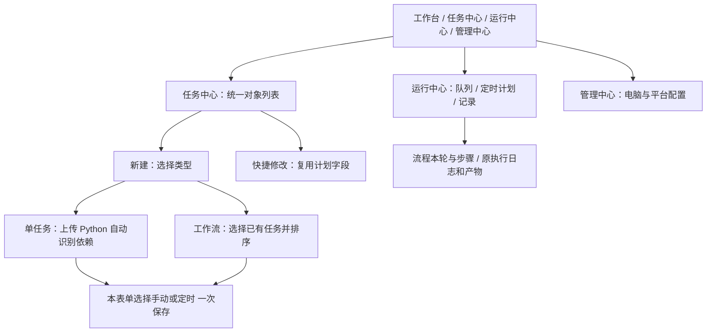

# SpiderFly 总体需求

版本：v1.8。更新日期：2026-10-16。A/B 保持，C 已补 Agent 0.4.0 业务环境核验和实际依赖版本回传，原安装、缓存、签名及补传复用。当前实现与全表验收见[阶段 C 记录](Agent业务环境阶段C精细对齐与验收_2026-10-16.md)；两台真实 Windows/正式业务仍待现场。本地加载、GitHub 发布和现场结论分别记录。

v1.5 按用户工作梳理页面分组，集中列表的操作、筛选与结果，统一内容边界和窄屏行为；见[界面布局与分组](界面布局与分组.md)。v1.4 统一白绿界面，团队成员、API 密钥和飞书通知合并到管理配置，新增群/个人飞书网页配置；见[界面与服务配置记录](全站界面与服务配置_2026-10-15.md)。v1.3 按用户要求精简 AI 页面，并允许超级管理员明文查看已配置密钥，实施见[明文显示记录](AI配置明文显示与界面精简_2026-10-15.md)。v1.2 增加账户余额查询与远程未知用量预留规则，实施与验收见[余额与预算记录](DeepSeek余额与维护预算修复_2026-10-15.md)。v1.1 的官方模型列表与全局默认模型见[模型选择记录](DeepSeek模型列表选择实现与验证_2026-10-15.md)，v1.0 的界面整合见[统一任务中心记录](统一任务中心实现与验证记录_2026-10-14.md)。真实 WSL、桌面、业务、两机及活动主控崩溃恢复仍按子场景分别待验；当前运行状态见 [CONTEXT](../CONTEXT.md)。

SpiderFly 管理公司的 Python 自动化任务。用户在同一任务中心选择运行一个脚本，或把已有任务按顺序组成工作流；运行中心统一查看执行、定时和结果。平台管理时间、版本、目标电脑与运行事实，业务逻辑仍由普通 Python 脚本负责。

v1.0 调整产品入口和页面组织，v1.1 增加 DeepSeek 模型选择，v1.2 增加账户余额和维护预算补充规则。运行规则分别沿用 [Cron 与串行工作流需求](Cron与串行工作流需求.md)、[多宿主机需求](多宿主机调度需求.md) 和 [任务执行约定](任务执行约定.md)，不因页面或配置入口改变执行范围与可靠性要求。

## 1. 产品和场景边界

| 编号 | 总体要求 | 本轮边界 |
| --- | --- | --- |
| G01 | 脚本承担业务，平台承担管理 | 普通单文件 Python 和现有模板/结果入口继续使用；v1.6 待增加静态依赖识别及用户清单合并，不引入专用业务指令库 |
| G02 | 单任务与工作流共同管理 | 单任务负责一个脚本及其环境、版本和目标；工作流引用已有任务并管理顺序，允许单步骤流程，不把已有单任务改造成流程 |
| G03 | 明确运行电脑 | 单任务保留已有主控本机或获批局域网 Agent 目标；新增工作流仍只在主控本机串行运行普通 native 任务 |
| G04 | 定时跟随运行对象 | v1.6 在新建/编辑单任务或整个工作流时一起选择手动或定时；Cron 仍限主控本机，既有单任务每日/每周 Agent 目标保留；流程成员独立计划冲突双向拒绝，原有计划不自动迁移 |
| G05 | 各脚本独立执行 | 前一步成功且确认收尾后才执行下一步；脚本自行读写业务目录或数据库，不共享 Python 内存、浏览器或桌面会话 |
| G06 | 权限与失败处理保持原规则 | 现有后端鉴权、审计、本机维护和远程候选确认继续生效；流程失败不进入独立任务自动修复与重跑链路 |

本轮不增加：Agent/跨电脑工作流、外网控制、多脚本 ZIP/项目包上传、DAG 画布、分支或并行、平台文件接力、失败节点续跑、业务事务回滚。局域网单任务能力保留，双机与桌面现场验收状态另列，不用当前界面调整宣称已经完成。

### DeepSeek 官方模型列表与默认模型（v1.1 增量）

用户于 2026-10-15 确认只使用 DeepSeek，由官方模型列表选择一个主控全局默认模型。超级管理员维护密钥和默认模型；普通管理员只读配置并按原权限使用助手，普通成员不能使用 AI。服务商和地址固定为 DeepSeek 官方服务，不增加多厂商、网关、多模型分工或每用户、每任务、每工作流独立 AI 配置。

操作顺序为：填写密钥 → 获取官方模型列表 → 选择列表返回的模型 ID → 保存配置。获取列表只查询官方模型目录，草稿密钥不落盘、不调用内容生成；保存时重新使用同一有效密钥查询目录并确认所选 ID 存在，再提交配置。目录返回错误、内容无效或模型已移除时，保留原配置并提示原因，不能仅凭页面上次取得的列表保存。

非空 `DEEPSEEK_API_KEY` 环境变量优先，页面说明当前密钥来源并禁止通过网页提交非空替换密钥；空白环境变量视为未配置。密钥输入留空保留原有效密钥。读取已保存设置不联网，保留的模型目录与检查时间只表示历史结果；页面打开不自动宣称实时可用。

新保存的模型、调用限额、目录及其检查时间，与同一设置文件中的 DPAPI 密文一次原子提交；公开配置只返回显式允许的字段，不返回密钥或密文。旧独立密钥文件兼容读取，新密文字段损坏时明确失败，不回退到旧密钥。备份和回退须包含完整 data 与匹配代码，不能只回退代码而误读旧密钥。具体存储及操作见 [AI 任务助手](AI任务助手.md#配置与操作)。

每轮 20 分钟及后台调用、Token、维护预算保持原规则。已登记对话和失败维护继续使用其模型快照，不自动改写旧轮次；每次模型请求仍读取当前有效密钥。模型目录查询不证明内容生成、tools、截图输入或业务验收已通过，不自动进行付费生成探测。G06、U07 的执行和版本确认规则保持。

本增量的 DS 验收项、实施、隔离检查、页面及正式加载分别见 [模型选择记录](DeepSeek模型列表选择实现与验证_2026-10-15.md)。[2026-10-14 AI 对齐报告](AI配置与需求精细对齐报告_2026-10-14.md)及指纹保留原时点，AF01—AF08 按本轮实际证据逐项结算；AF09 在模型选择阶段尚未修复，本次 v1.2 按下述规则补齐；AF08 共用权限错误提示也已改为“需要超级管理员权限”。

### DeepSeek 账户余额与维护预算（v1.2 增量）

用户确认在“管理中心 → AI 模型”显示 DeepSeek 官方账户余额。超级管理员和管理员可查询，普通成员无权访问；服务端使用当前已保存或环境配置的有效密钥，只访问固定官方 `GET /user/balance`，不使用输入框中的未保存密钥，不发起生成请求，不回传密钥或密文。

显示各币种可用金额、充值余额、赠送余额及查询时间，保留官方十进制字符串精度；账户余额不足时明确显示。金额属于服务商账户共享余额，不等于剩余 Token、调用次数、每轮预算或平台滚动 24 小时维护预算。不增加充值、价格估算、余额历史、自动告警或后台轮询。

保存配置成功后查询一次，平时手动刷新；打开页面和读取配置保持离线。查询失败保留当前页面的上次金额及原查询时间并标为过期；保存新配置清空旧余额，迟到响应、离开页面及会话变化不能覆盖新状态。余额不持久写入平台配置、数据库或审计，普通脚本不受余额查询结果影响。

远程维护已登记发起的模型请求在超时、连接失败、中断或缺少有效用量时保留该次 Token 预留，继续纳入滚动 24 小时共享维护额度；收到合法输入/输出用量后一次结算，真实零用量也可结算。调用前取消或校验失败释放未使用预留。滚动窗口外不再计入预算；不将历史已丢失用量伪造为实际消费，也不自动重发未知请求。管理员确认远程候选后才启用和重跑的规则保持。

### AI 页面与密钥显示（v1.3 增量）

配置页只保留必要字段、操作、金额、时间和错误；删除重复说明及与当前操作无关的技术提示。超级管理员保存后直接显示完整密钥，重新进入页面时通过独立鉴权接口读取当前有效密钥；环境密钥显示来源且不可在网页修改。普通管理员仍只读模型和余额，成员无 AI 配置权限。

明文展示不改变 DPAPI 本地保存方式。专用读取响应禁止缓存；普通配置响应、模型目录、余额、审计、对话和任务环境不返回密钥。页面退出、卸载及权限变化清空显示，迟到响应不得恢复旧密钥。密钥读取失败可重新输入，空值保存仍保留原有效密钥。

### 界面统一与服务配置（v1.4 增量）

保持白底、绿色主操作、系统字体和四个主导航。同类页面共用标题、表单、列表、空状态和错误反馈，删除英文装饰、编号式伪流程、重复账号卡及通知政策说明。任务常驻运行与编辑，低频操作收入“更多”；成员创建、宿主机接入步骤和运行技术信息按需展开。保留对象类型、来源、时间、真实状态、失败原因、权限和危险确认，日志与 AI 回复不裁剪。

管理中心按顺序保留管理配置、宿主机、操作审计三个标签，默认进入管理配置。管理配置上方是团队成员，下方是 API 密钥配置与飞书通知；原“AI API”标题改为“API 密钥配置”。运行信息移到操作审计页，默认折叠，与操作记录同页。旧 AI/系统设置/成员管理导航映射到管理配置。AI 密钥、目录、默认模型、余额、权限及 DPAPI 规则继续遵循 v1.1—v1.3。

操作记录使用后端分页，每页 10 条，覆盖全部历史，按最新在前排列。显示总条数、当前页与上一页/下一页；刷新保留当前页，请求失败保留已显示记录和页码。查询权限仍限管理员及超级管理员。

宿主机以电脑列表为主，接入新电脑默认收起，概况与筛选归入列表。默认显示待批准、已批准电脑；全部电脑包含已拒绝和已撤销登记。调度操作跟随电脑，机器详情与撤销按需展开，待批准标识和危险确认保留；远程记录位于下方，继续明确近期最多 100 条的查询范围。

飞书网页默认群通知：Webhook 地址与可选签名密钥；选择个人通知后填写 App ID、App Secret 和手机号，Open ID 兼容选项折叠。两种配置保留但同时只生效一个渠道。保存不发送通知，不能标记为已连接或已送达。仅超级管理员能保存和清除；普通管理员只读状态，普通成员不能访问专用配置接口。敏感输入留空保留已存值，可单独清除签名；清除整个本机配置须明确确认，同时移除两种渠道。

飞书本机配置整包 DPAPI 加密并原子提交。请求附带读取时的 revision，冲突返回 409，不覆盖其他编辑；损坏或保存失败如实提示并保留原文件，损坏文件可以明确清除恢复。部署环境中任一飞书凭据存在时整组优先并只读，不混用环境与本机接收对象；原 .env 群优先和应用通知保持兼容。保存后新通知器读取最新配置，已经开始的一次通知沿用其配置快照。专用接口、审计和普通设置不返回 Webhook 或两类密钥，普通管理员不取得手机号；不扩大任务或维护的通知规则。

### 任务内定时与依赖识别（v1.8，A/B/C 软件已实施）

新建/编辑同一表单选择手动或定时，定义与计划一次保存；运行中心保留计划总览及快捷修改。单任务上传后自动静态识别常见第三方依赖，用户明确清单优先，未知包、条件项和冲突定位补充；正常项不要求逐包确认。识别和上传不执行脚本，主控本机后台准备独立环境，Agent 在领取运行后准备自己的环境。

A 已实现同页定时及原子保存；B 已实现静态依赖识别、本机首次环境门控与真实版本记录；C 复用 Agent 旧安装/回传链路，补业务环境校验及实际版本明细。原已就绪任务调度和维护保持。新增能力分别按阶段证据结算，两机/业务现场继续单列。

## 2. 目标导航

### U01：按用户工作组织入口

管理员一级导航保留工作台、任务中心、运行中心、管理中心；其他角色按原权限显示可访问入口。侧栏不再独立列工作流；管理中心移除创建任务。

| 页面 | 职责 | 主要入口 |
| --- | --- | --- |
| 工作台 | 概览和异常 | 显示统计、队列与最近运行，保留区域内的查看入口；新建对象从任务中心进入 |
| 任务中心 | 定义和管理运行对象 | 一份对象列表、新建、编辑、运行、设置定时；类型筛选为全部、单任务、工作流 |
| 运行中心 | 查看计划、队列和运行结果 | 运行队列、定时计划、运行记录；流程步骤和任务日志从这里展开 |
| 管理中心 | 配置平台与电脑 | 管理配置、宿主机、操作审计 |

下图为 v1.6 入口关系；任务内定时已实施，自动依赖仍是 B 阶段目标。实际入口与本次证据见第 5 节及阶段 A 记录。

### U02：任务中心是一份列表

对象数量、新建操作、筛选和列表在同一面板；窄屏筛选默认收起并保留输入。默认展示全部可见运行对象，每行标明单任务或工作流；类型使用筛选控件，不新增两套平行页面或三级导航。字段至少包含名称、类型、运行电脑、触发方式、可用/计划状态、最近结果和操作。任务和流程同名仍是不同对象，不按名称合并。

任务 ID 与流程 ID 可以相同。列表键、选中项、弹窗、请求、缓存和日志跳转均使用对象类型加 ID；单任务 1 与工作流 1 不能串用。列表总数说明为对象数，成员任务只按独立任务计一次，不按每条流程引用重复计数。

保留已有任务查询功能，并增加类型筛选。启用状态、归属人等单任务专属筛选只在单任务范围使用；流程归档是独立状态，不能把不适用的筛选直接套到流程。两类定义使用相同名称排序及稳定的类型/ID 次序。合并排序或分页只能建立在两类完整数据上，不能把各取一页当成全局第一页。

一类读取失败时，可以显示另一类已取得的数据，但必须提示哪类未载入；不能把失败解释为对象数为零或宣称全部查询完成。切换筛选、关闭详情或退出登录后，迟到响应不得覆盖当前对象。

### U03：共用新建入口，按类型填写

管理员在任务中心点击新建，选择单任务或工作流，在同一创建容器内展示对应表单。新建使用一个弹层或页面容器，不同时叠加任务和流程两个弹窗。

下表的同页定时已实施；自动识别仍待 B。当前依赖继续使用可选 requirements.txt 或手填清单，不把它称作已经自动识别。

| 类型 | 必需内容 | 保留内容与约束 |
| --- | --- | --- |
| 单任务 | 名称、一个 `.py`、手动或定时 | 自动识别常见依赖，可附 requirements.txt/手填约束；说明、默认电脑、启用和通知保留；源码/依赖更新沿用版本流程 |
| 工作流 | 名称、一个或多个已有任务的顺序、整轮手动或定时 | 说明、步骤调整和成员校验沿用现有工作流；仅选择符合本机 native 范围的任务，成员不另设计划 |

多个 `.py` 仍分别创建单任务，再选择它们组成流程。缺少成员时，从同一任务中心先新建单任务；本轮不增加在流程表单中批量上传脚本或嵌套新建任务。

切换类型保留当前新建会话中两种表单各自的未提交输入；文件对象、依赖文本、步骤顺序和错误不串到另一种表单。提交期间禁止切换类型或重复提交。取消、退出和会话过期清理该会话，后续新建不得误用上次未保存的步骤或文件。

### U04：任务设置内选择定时，一次保存（v1.6，A 已实施）

新建/完整编辑单任务或工作流时，在同一表单选择手动或定时；定时展开每日/每周/Cron、时间和未来 5 次。默认手动，计划字段与快捷入口共用原校验，不要求创建后再去另一处补设置。运行中心保留定时总览、触发状态和快捷修改。

定义与计划同一次提交、同事务校验和持久化；非法计划不留下半个新对象，编辑失败不覆盖原值。请求编号判重及结果查询处理重复点击和响应丢失。安装在配置提交后异步进行，失败保留已保存任务并明确显示安装错误，不引导重复创建。详细行为见增量 TS06—TS08、DP05。

旧 v1.0—v1.5 的“先建手动对象，再单独设置定时”已由阶段 A 替换。新保存行为按本轮 AT01—AT05 结算；AT13 的首次环境门控已在 B 用独立安装、虚拟时间与竞争检查验收，不能借旧 UI 或 Cron 测试代替；Agent 新事实已由 C 补齐，两机现场继续待验。

### U05：操作按真实对象分派

运行、编辑、定时和查看结果可以使用一致文案；动作仍分派到各自后端接口。独立任务执行按原规则停止或取消；如果所操作的 execution 是流程步骤，停止或取消仍结束其所属整轮并阻止下游，从任务入口操作也不能绕过该规则。流程对象停止整轮；流程重跑新建整轮，不由按钮自动变成独立步骤重跑。

单任务启用/停用、工作流计划开启/关闭与工作流归档分别表示不同含义，不能合成同一个状态或开关。删除任务仍显示原删除范围；归档流程仍保留历史，不把归档改成删除其成员。删除引用任务后的简要历史和未结束快照保护继续满足既有需求。

单任务的电脑、环境准备、版本、模板和通知入口保留；工作流明确标为主控本机，不出现可提交的 Agent 工作流电脑选择。错误应说明对象名称、执行范围或计划冲突，不仅显示提交失败。

### U06：运行记录统一入口，保留两类身份

运行中心的运行记录将任务执行和流程整轮的类型选择放入筛选区，数量和刷新在上、结果与分页在下，日期范围成组展示；窄屏默认收起筛选，展开状态与输入在类型切换间保留。两类记录分别使用已有历史查询与分页规则；本轮不增加跨类型混排的全局历史接口，也不把流程运行伪造成 execution。任务执行查询保留现有集合，其中包含流程步骤产生的真实 execution；页面应标明触发来源，让用户知道它属于流程步骤，不擅自过滤或把两处展示累计为两次执行。

流程记录展示整轮状态，展开本轮步骤后，通过实际 execution_id 进入原日志和产物；单任务记录继续使用原执行详情。关联存在且资料未删除时才开放链接。远程单任务继续进入已有远程运行详情，不冒充本机 execution；全面统一远程历史列表另列后续范围。

对象行可提供最近运行或查看记录快捷入口，但不在任务中心再次铺一份完整流程历史列表。失败、跳过、停止中和等待收尾的状态、原因保持原事实。计划点、普通执行、流程轮次和步骤不得用同一个裸 ID 互相代替。

### U07：所有旧入口一起迁移

工作台删除与主导航重复的一排快捷入口；任务中心创建按钮、AI 草稿转创建、创建成功回跳、错误后的返回、任务或流程详情入口均指向统一任务中心。旧内部 view=workflows 或 management/apps 的引用继续映射到新页面的对应类型或新建会话，不形成隐藏的第二份列表或创建页。

保留 AI 草稿的脚本、依赖、说明和当前确认流程，不因换入口自动执行草稿、扩大远程维护授权或丢失已有版本关联。此前确认的本机/远程差异继续生效。

### U08：权限和易用性

两种类型沿用各自已有后端鉴权与审计。普通成员可读取原本有权查看的对象与记录，操作权限按对象和行为保留：单任务既有编辑、启停和本机运行向已就绪成员开放；上传、删除、指定 Agent 目标、远程运行及流程对象管理使用原管理员权限。运行记录的排队取消向已就绪成员开放，运行中强停使用管理员权限；取消关联流程步骤仍停止所属整轮。统一定时入口沿用其现有页面及后端权限，不借本轮扩大或收缩权限；隐藏按钮不能替代后端校验。

沿用项目白色工作面和绿色主操作样式，一个操作区只保留一个主要新建按钮。检查 320px 与常用宽屏无横向页面溢出，弹窗内容独立滚动、标题和保存按钮可见，Tab/Shift+Tab、Esc 和焦点恢复可用。部分载入失败、保存失败和会话过期均有具体反馈。

## 3. 保留的执行规则

导航和表单改变不迁移已保存任务、版本、计划或历史，不重写原任务 ID，也不把计划从成员悄悄搬到工作流。既有数据与后端能力继续复用；v1.6 仅对新本机任务首次环境准备增加计划门控，具体按增量 DP05，不批量重装或重算旧任务。

- Cron、北京时间、未来 5 次、触发判重、重叠跳过及停机补最近一次沿用 R02—R07。
- 工作流成员、独立计划冲突、整轮快照、可信收尾、停止和整轮重跑沿用 R08—R15。
- 删除后的简要历史、日志/产物、后端历史查询、权限与审计沿用 R16—R18。
- 单任务的本机/Agent 目标、远程候选确认、桌面会话门控与两机验收按多宿主机需求执行；新工作流不因此扩展为 Agent 流程。

## 4. 界面调整验收

v1.0 界面与状态处理的实施、后端 588 通过/19 条件跳过、前端 72 通过、94 模块构建及页面/native 到点结果见[分层验收记录](统一任务中心实现与验证记录_2026-10-14.md#6-真实页面与分层验收)。v1.6 的同页定时、配置保存与对应 UA/AT 阶段 A 部分已按本次记录验收；B 的自动依赖和本机首次环境门控已独立验收，见[阶段 B 记录](依赖自动识别阶段B精细对齐与验收_2026-10-16.md)；C 已补 Agent 环境核验/明细并单独验收，两机现场继续待验，不继承旧通过状态。部分历史异常和身份保护由组件/HTTP mock 证明，现场条件仍分别待验。

| 编号 | 场景 | 必须达到的结果 |
| --- | --- | --- |
| UA01 | 一级与二级入口 | 管理员四个一级入口，其他角色按权限显示；工作流不再独立列侧栏，管理中心没有创建任务；工作台不再重复平铺主导航入口 |
| UA02 | 统一对象列表 | 全部/单任务/工作流筛选正确；同名、同 ID 的两类对象不合并或串用；完整数据才显示完整总数 |
| UA03 | 单任务新建（A 通过，依赖待 B） | 自动识别依赖，说明、电脑、启用、通知与手动/定时同页保存正确；细项按 AT01、AT06—AT13 |
| UA04 | 工作流新建（A 通过） | 单步骤和三步骤可同页保存整轮计划；排序、重复/失效成员和计划冲突校验正确，不能创建远程流程；按 AT02、AT04 |
| UA05 | 表单切换与会话 | 两种未提交草稿各自保留；提交中不可切换；取消/退出后正确清理，迟到响应不起作用 |
| UA06 | 同次保存失败与重复请求（A 通过，安装增量待 B） | 定义/计划不部分落盘；请求判重、结果核对和原值保护正确；安装失败保留已保存任务，不重复创建；按 AT04、AT05、AT12 |
| UA07 | 操作语义 | 单任务停用/停止、流程关计划/停止/归档各按原规则处理；从任务执行入口停止或取消流程步骤仍终止所属整轮，历史和成员不被错误删除 |
| UA08 | 运行记录与跳转 | 任务执行和流程整轮历史各自后端分页，流程步骤执行标明来源；流程展开真实步骤与日志，远程入口保持原身份，已删除资料不开失效链接 |
| UA09 | 旧入口与 AI 草稿 | AI 转创建、保存返回和旧内部引用都到统一入口，草稿内容与权限保持 |
| UA10 | 部分失败和身份切换 | 一类接口失败有提示且不伪造空集合；同类型/跨类型切换、关闭和退出忽略迟到结果 |
| UA11 | 角色、布局、键盘 | 管理员与普通成员按对象和操作权限核对，320px/宽屏与焦点、滚动、Esc 均正常 |
| UA12 | 执行回归与加载 | 单任务、本机/Agent 路由、M1 Cron、M2/M3 流程等相关回归无退化；隔离页面与构建分别验证，正式空闲备份后加载另记 |

## 5. 实施和比对依据

当前工作区由 [constants.js](../frontend/src/lib/constants.js) 和 [App.vue](../frontend/src/App.vue) 组装四区导航，[TaskCenterPage.vue](../frontend/src/features/taskCenter/TaskCenterPage.vue) 合并定义列表，[CreationDialog.vue](../frontend/src/features/taskCenter/CreationDialog.vue) 共用新建容器并嵌入 [CreateTaskPage.vue](../frontend/src/features/apps/CreateTaskPage.vue)。运行记录入口为 [RunHistoryPage.vue](../frontend/src/features/executions/RunHistoryPage.vue)，计划继续复用 M3 的 [PlanEditor.vue](../frontend/src/features/schedule/PlanEditor.vue)。[OverviewPage.vue](../frontend/src/pages/OverviewPage.vue) 和 AI 草稿回跳已指向统一任务中心。

实施前分散入口及参考源码指纹保留在[对齐报告](统一任务中心参考实现与需求对齐报告_2026-10-14.md)；实施、隔离结果与待验事项见[本轮记录](统一任务中心实现与验证记录_2026-10-14.md)，不使用历史审查结论代替新界面证据。

实际任务、流程与历史接口分别见 [apps.py](../backend/app/api/apps.py)、[tasks.py](../backend/app/api/tasks.py)、[workflows.py](../backend/app/api/workflows.py) 和 [executions.py](../backend/app/api/executions.py)。改界面时优先复用这些能力，不为统一视觉而更换 SQLite、队列或任务模型。

参考 RPAC 的任务/流程界面和 Cron，KK dashboard 的管理入口、计划与运行模型，以及 KK monorepo 的执行分层。逐条比对必须注明固定源码版本、文件与行号，区分设计说明、真实源码、已有验收和本轮目标；参考项目的 DAG、执行器、会话、外网或架构能力不自动成为 SpiderFly 本轮范围。
