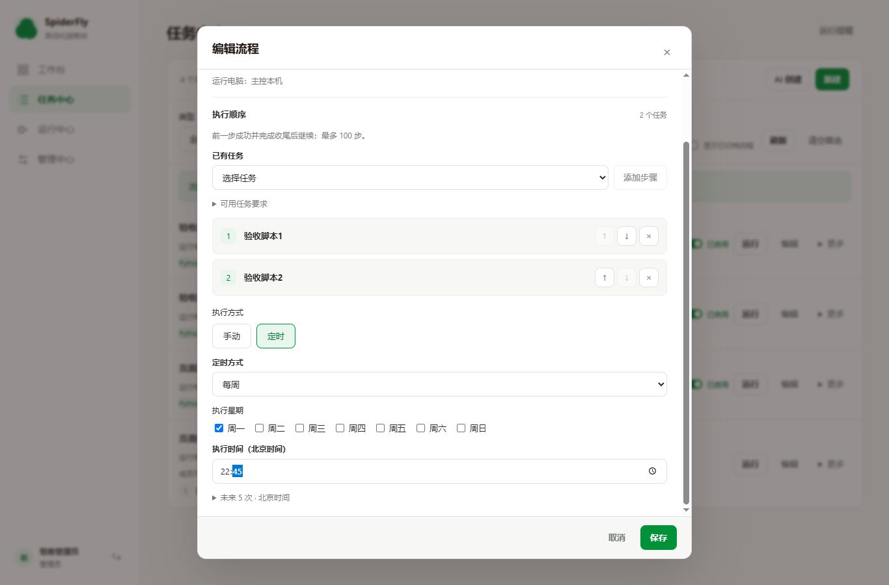

# 任务内定时：精细对齐与阶段 A 验收

日期：2026-10-16。主改 SpiderFly。需求基线为[任务设置与依赖自动识别需求](任务设置与依赖自动识别需求.md) TS01—TS08、DP01—DP07，任务基线为[N01—N10](任务设置与依赖自动识别任务拆分.md)。

结论：阶段 A 的同页定时、定义与计划同次保存、创建判重和失败保护已实施并更新本地服务。自动识别依赖、首次环境准备门控及新增 Agent 安装证据属于 B/C，尚未实施，不能把阶段 A 记为整份需求全部完成。

本次是 AI 对实际文件、事务顺序和验证结果的逐项核对；没有把参考项目测试的存在算作 SpiderFly 通过，也没有冒称独立第三方审查。源码、构建、检查与参考文件的固定指纹见[证据 JSON](审查证据/任务内定时阶段A指纹_2026-10-16.json)。未提交或推送。

## 1. 参考版本和采用范围

| 参考 | 本次实际阅读 | 可采用部分 | 保留的差异 |
| --- | --- | --- | --- |
| KK dashboard，`e33570e47ec671343c485fdd63d69e144c81bab3` | [NewTask.tsx L13—122](https://github.com/flyyang12-rgb/kk-rpa-dashboard/blob/e33570e47ec671343c485fdd63d69e144c81bab3/apps/web/src/live/NewTask.tsx#L13)、[PlanSchedule.tsx](https://github.com/flyyang12-rgb/kk-rpa-dashboard/blob/e33570e47ec671343c485fdd63d69e144c81bab3/apps/web/src/live/PlanSchedule.tsx)、[tasks.py L98—138](https://github.com/flyyang12-rgb/kk-rpa-dashboard/blob/e33570e47ec671343c485fdd63d69e144c81bab3/apps/backend/src/rpa_console/tasks.py#L98) | 实际页面把配置和 schedule 一次提交；后端事务保存、revision 冲突检查；字段组件复用 | 它管理应用/机器人计划，与 SpiderFly 的已有独立任务组合流程不同。NewTask 的临时运行使用 request ID，计划保存没有同等创建回执保证；不能据此声称 TS07 全部已被参考证明 |
| KK monorepo，`d65b4edfa9859c897fdf445f4860cf723d3e4267` | [runtime.py L48—105](https://github.com/flyyang12-rgb/kk-rpa-monorepo/blob/d65b4edfa9859c897fdf445f4860cf723d3e4267/packages/rpa-core/src/rpa_core/runtime.py#L48) | 配置层和执行层分工可参考 | 它提供应用内 Step、ExecutionContext；不是 SpiderFly 的独立 Python 任务、独立环境和整轮快照模型。本轮不移植执行框架 |
| RPAC，本地固定文件 SHA256，无可用 Git 版本依据 | [任务 API L52—61](../../RPAC-main/backend/app/api/tasks.py#L52)、[task_service.py L45—50](../../RPAC-main/backend/app/services/task_service.py#L45) | 任务创建处填写 Cron 的交互归属可参考 | 服务先 commit，再注册 Cron；注册失败会在对象已落库后报错。这是静态顺序发现的部分保存风险，本次未运行参考服务复现；SpiderFly 使用自己的同事务配置保存 |

参考检出只读，没有修改、启动或运行其测试。SpiderFly 不引入参考的 Redis、机器人发布模型、DAG 或应用内共享会话；时间计算与冲突语义继续使用原实现。

## 2. 本轮实现证据

| 编号 | 实际入口 | 本轮行为 |
| --- | --- | --- |
| S01 | [PlanFields.vue](../frontend/src/features/schedule/PlanFields.vue)、[plans.js](../frontend/src/lib/plans.js) | 手动/定时、每日/每周/Cron、回填、远程限制和后端预览共用；未来 5 次默认折叠，预览错误直接显示 |
| S02 | [CreationDialog.vue](../frontend/src/features/taskCenter/CreationDialog.vue)、[CreateTaskPage.vue](../frontend/src/features/apps/CreateTaskPage.vue)、[useApps.js](../frontend/src/features/apps/useApps.js) | 两类对象新建时带计划；去掉强制 manual 和创建后第二次设置定时；结果不明可查回执或原请求重试 |
| S03 | [TaskEditor.vue](../frontend/src/features/tasks/TaskEditor.vue)、[useTasks.js](../frontend/src/features/tasks/useTasks.js) | 单任务完整编辑使用同一字段；保留 version、停用状态和通知；版本冲突不再关闭并丢弃输入 |
| S04 | [WorkflowEditor.vue](../frontend/src/features/workflows/WorkflowEditor.vue)、[useWorkflows.js](../frontend/src/features/workflows/useWorkflows.js) | 名称、步骤和计划一次提交；无计划改动时省略 schedule，避免名称编辑覆盖原来关闭但保留的计划 |
| S05 | [schemas.py](../backend/app/schemas.py#L124)、[api/workflows.py](../backend/app/api/workflows.py#L55)、[services/workflows.py](../backend/app/services/workflows.py#L168)、[workflow_schedules.py](../backend/app/services/workflow_schedules.py#L72) | 可选嵌套 schedule；同事务创建/编辑和冲突校验；完整编辑只增加一次定义 revision。旧独立计划接口继续兼容 |
| S06 | [api/apps.py](../backend/app/api/apps.py)、[environments.py](../backend/app/environments.py) | 原 multipart 计划参数接回新建表单；程序、任务、v1、审计、回执同事务提交；受管文件失败清理；安装仍为原后台流程 |
| S07 | [creation_requests.py](../backend/app/services/creation_requests.py)、[database.py](../backend/app/database.py)、[security.py](../backend/app/security.py#L302) | 新表主键为操作者/对象类型/请求编号；实际提交内容生成指纹；同编号异内容 409；回执与创建审计同事务。删除/归档后保留回执，不复活对象 |
| S08 | [api/tasks.py](../backend/app/api/tasks.py)、[api/workflows.py](../backend/app/api/workflows.py) | 单任务编辑、旧单任务创建和工作流计划快捷修改的审计也并入写事务，审计失败回滚配置 |
| S09 | [PlanEditor.vue](../frontend/src/features/schedule/PlanEditor.vue)、[CronEditor.vue](../frontend/src/features/schedule/CronEditor.vue) | 运行中心和对象行继续快捷修改；刷新选项仍保留原编辑版本，不拿新版本号配旧草稿覆盖别人修改 |
| S10 | [test_inline_plans.py](../backend/tests/test_inline_plans.py) | 新增 18 项 HTTP/事务测试；包括并发判重、审计/回执故障注入、版本保护、权限和关闭计划保留已接受轮次 |

新增 `GET /api/creation-requests/{kind}/{request_id}` 仅管理员访问，只能取得当前操作者自己的结果，返回公开对象身份和状态。新前端每次创建携带稳定 request_id；原客户端省略编号仍兼容旧行为，不声称旧客户端因此也自动获得创建判重。回执只存指纹和身份，不复制源码、密钥或业务数据。

## 3. TS01—TS08、DP01—DP07 逐条对齐

“对齐”指本轮范围内已有源码和对应验证；“保留”指沿用已有约束；“待 B/C”指尚未实施，不能作为缺陷已解决结算。

| 要求 | 参考对照 | SpiderFly 本轮结论与证据 |
| --- | --- | --- |
| TS01 单任务/工作流内选择计划 | KK 可借同次配置，RPAC 可借字段归属；无同型组合流程保证 | A 对齐，S01—S05；单任务和整轮均同页，保留 Agent 每日/每周和本机 Cron 边界 |
| TS02 上传 Python 后静态识别 | 本次参考阅读未证明有同等单文件分析器 | 待 B。当前仍单文件及可选清单，不把上传能力写成已自动识别 |
| TS03 公开包自动清单及格式限制 | 不从参考的应用发布推断包名识别能力 | 自动清单待 B；现有依赖格式校验保留，不开放 URL、Git、本地包和 pip 参数 |
| TS04 本机后台准备/Agent 领取后准备 | KK 机器人与发布环境不可直接代替当前 Agent | 保留现有时机；新增分析和目标环境证据待 B/C，没有改成上传即远程运行 |
| TS05 原版本、队列、失败和权限规则 | 两参考都不能替代 SpiderFly 原运行约定 | A 保留，S03—S09；717 项回归覆盖相关链路，19 条件跳过另列，未扩大现场通过范围 |
| TS06 同页字段与页面归属 | 采用 KK 组件复用思路，不照搬页面模型 | A 对齐，S01—S04、S09；一个保存按钮，计划总览保留，无创建后强制二次设置 |
| TS07 一次保存与未知结果 | KK 事务/revision 可借；RPAC 提交后注册不满足原子要求 | A 配置部分对齐，S05—S08、S10；后台安装不进数据库长事务，分析绑定及首次准备门控待 B |
| TS08 成员冲突及启停 | 参考未证明同等成员独立计划双向冲突 | A 对齐；创建/编辑复用原双向校验，不自动改成员计划，关闭计划不停止当前轮次、不启用停用任务 |
| DP01 静态分析 | AST 能力设计独立于参考调度器 | 待 B，未新增分析/语法检查接口；仍不试跑上传代码 |
| DP02 模块到包名对应 | 本次参考阅读无此功能证据 | 待 B，不能直接按 import 名安装同名包 |
| DP03 用户清单合并与版本约束 | 不从参考 Git 发布推断依赖合并 | 待 B；当前用户清单、格式校验继续使用 |
| DP04 分析结果与版本绑定 | KK 有快照思路，但不是同等依赖分析凭证 | 待 B；既有源码/requirements 版本与冻结包保留，新分析依据未添加 |
| DP05 本机安装与首次计划门控 | 参考的不同调度/环境时机不直接复制 | 现有安装器保留；首次就绪后才激活未来点的新门控待 B。本轮新建计划仍按原环境准备规则，未声称该门控已完成 |
| DP06 Agent 安装证据 | KK executor 不等于当前 Agent 的新证明 | 待 C；不新增 Agent pip check/版本清单回传，两机现场仍待验 |
| DP07 实际解析版本记录 | 不能把 requirements 字符串当实际环境证明 | 待 B/C；本轮回执存创建身份，不存或伪造实际安装包版本 |

## 4. AT01—AT18 精细核验

| 验收 | 本轮结果 | 证据及边界 |
| --- | --- | --- |
| AT01 同页创建计划 | A 通过 | HTTP 覆盖手动/每日/每周/Cron；真实页面上传 Python 同页保存每日，再编辑为每周；后端预览仍用原计算器 |
| AT02 整轮计划和双向冲突 | A 通过 | 页面创建两成员 Cron，冲突时未创建、输入保留，换成员后保存；反向给成员独立计划也被拒；完整编辑可同时改名称和计划 |
| AT03 旧对象、停用与版本 | A 通过 | HTTP/组件覆盖停用不自动启用、过期 revision/version 拒绝；关闭计划不停止已接受轮次；编辑失败保留输入 |
| AT04 非法计划/成员及落盘失败 | A 通过 | HTTP 校验、受管文件与数据库检查；审计/回执故障注入回滚对象、计划、版本或文件，编辑原值保留 |
| AT05 重复与未知请求 | A 通过 | 真实 HTTP 线程并发创建只得一个身份；同编号异内容拒绝；响应丢失/回执查询/原请求重试由实际 Vue 及合成 HTTP 故障覆盖，未把它声称为真实物理断网试验 |
| AT06 标准库/常见包自动填入 | 待 B | 当前手填依赖正常回归不等于自动识别已通过 |
| AT07 import 别名、注释、去重 | 待 B | 未实施新分析器 |
| AT08 动态/条件/本地模块 | 待 B | 未实施分类与待补充交互 |
| AT09 用户约束合并 | 待 B | 当前接受合法 requirements，不代表新合并规则已实现 |
| AT10 静态语法与无副作用分析 | 待 B | 本轮只证明保存未执行业务；没有用它代替 AST 分析验收 |
| AT11 分析失效与服务端重验 | 待 B | 创建内容指纹仅用于判重，不冒充依赖分析凭证 |
| AT12 安装、失败、重试 | 既有能力回归；新增部分待 B | 回放创建结果按真实 ready/failed 提示；未新增自动清单或环境事实采集 |
| AT13 首次准备跨计划点 | 待 B | 本轮没有新建环境就绪门控，不能用旧 Cron 漏点测试结算 |
| AT14 版本与环境保护 | 原有回归；分析绑定待 B | 页面上传任务编辑计划前后代码版本数保持 2；其余旧快照保护由全套回归覆盖，不宣称新依赖元数据已冻结 |
| AT15 Agent 目标安装 | 待 C/现场 | 原路由回归及远程 Cron 控件限制保留，未代替两机安装现场 |
| AT16 权限、Python 与依赖格式 | A 权限/原限制通过；分析兼容待 B/C | 回执管理员及同操作者隔离、原目标权限/范围检查通过；无新增 Python 兼容分析证明 |
| AT17 表单、草稿、窄屏 | A 通过；依赖明细待 B | 192 项前端检查；真实 1366×900、320×740，无横向溢出，保存区可见，Esc 和焦点恢复正常；最后构建再次核对资源和流程保存 |
| AT18 回归与交付 | A 交付通过；整份需求现场未完成 | 最终 717 项后端中 698 通过/19 条件跳过，前端 192 通过，116 模块构建，本地备份/重启/HTTP；WSL、业务、两机和新增 B/C 仍分别待验 |

## 5. 发现的问题与处理

| 编号 | 发现 | 处理及证明 |
| --- | --- | --- |
| A01 | 上传强制 manual，工作流定时另开弹窗 | 新建/编辑共用 PlanFields，实际页面证明同页保存 |
| A02 | 工作流定义和计划两次提交存在部分完成窗口 | 同一事务保存，非法 Cron/成员后无新定义，编辑原定义/计划不变 |
| A03 | 创建没有持久请求身份 | 新回执主键、内容指纹和同事务审计；并发、删除/归档及异内容检查通过 |
| A04 | 刷新选项拿新版本号配旧草稿，可能覆盖别人修改 | PlanEditor 保留原 editVersion，组件证明提交仍带旧版本并被拒 |
| A05 | 单任务版本冲突会关闭表单，丢失待核对输入 | 保留表单，错误说明核对后重开；组件验证名称和时间仍在 |
| A06 | 重试已创建对象仍一律提示环境准备中 | 改为按真实 ready/failed/远程状态反馈，新增两种环境状态子场景检查 |
| A07 | 没有实际轮次也显示“本轮继续使用原步骤” | 普通成功只显示已保存；仅活动轮次显示版本/步骤保持提示 |
| A08 | 单任务编辑和计划快捷保存后另写审计，审计失败会报失败但配置已提交 | 单任务新建/编辑、流程完整/快捷保存的审计均纳入相同事务；额外 3 项故障注入通过，最终全套重新执行 |

## 6. 验证结果与页面证据

所有测试只使用新隔离副本；测试进程清空项目、模型和通知变量，断言所有资料路径都在副本，后端普通回归阻止外部服务商 HTTP。正式目录没有被测试进程导入。

- 后端最终全套：717 项，698 通过，19 条件跳过，0 失败/错误；新增 `test_inline_plans` 18 项全部通过。跳过涉及未准备的 WSL/collection/DP/独立 Chromium 和符号链接权限，不能算通过。
- 前端：原 178 项加新增 14 项，共 192 项通过；使用实际 Vue SFC、受控 renderer/JSDOM 与合成请求。旧“手动创建/只读计划标签”的断言按新需求改为实际提交计划和编辑字段值，没有删除对应覆盖。
- 最终 npm ci/build 通过，Vite 116 模块；最终资源为 `index-CsQOviSx.css`、`index-B0USwIxD.js`，加首页及图标共 4 文件。
- 实际浏览器：Codex 内置浏览器访问同一隔离后端和构建，完成 Python 上传、创建/编辑、计划双向冲突、失败后修正、计划回填和关闭；没有真实业务运行、通知或模型调用。最后构建的 script URL 已读取核对，错误控制台为空。
- 页面边界：宽屏页面宽 1366，保存按钮 bottom=846＜900；320px 下页面内容宽 305，弹窗宽 281，保存按钮 bottom=715＜740；新建任务同样检查边界。临时 viewport 已恢复，验收标签和服务已关闭，合成计划及活动数归零。

最后的后端审计事务收尾补了 HTTP/回滚用例并重跑全套；前端资源未再变化，沿用已核对最终 JS 的页面结果，不把后端故障注入描述为浏览器断网或现场业务试验。

## 7. 本地加载和剩余工作

正式主控空闲检查通过后，停止服务，完整备份 data、`.env` 和配置指向的外部目录，逐文件核对哈希；保留匹配的前一版源码和旧构建，并检查私有备份加密。精查补齐审计事务后再次完成最终回归和新的完整备份，再由原启动器重启。最后一份备份含 17 份运行/配置文件及 275 份匹配的前版源码，最初基线另保留；完整 data 与匹配代码须一起恢复。

最终本地地址为 `http://127.0.0.1:8383/`。四个静态文件 HTTP 内容与隔离构建哈希一致，四个后台 worker 健康，新回执表已创建、匿名回执查询返回 401；未使用正式账号、任务或真实配置做验收。实际加载核对结果写入证据 JSON。未提交或推送。

N01 的定时/回执部分、N02—N04 以及本阶段所需的 N10 验证交付完成；N01 的依赖状态约定留到 B/C，N05—N09 未开始，N10 的完整依赖/两机交付不能提前完成。接下来按原拆分进入 B，不改变已有阶段编号和现场验收边界。
