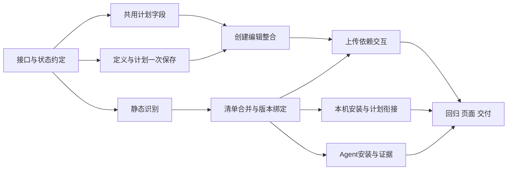

# 任务设置与依赖自动识别任务拆分

版本：v0.4。日期：2026-10-16。A/B 保持；C 的 N01 Agent 事实、N09 软件实施及 N10 隔离回归/页面/文档完成。N10 两机和真实业务现场仍待验。见[阶段 C 逐项记录](Agent业务环境阶段C精细对齐与验收_2026-10-16.md)。

需求基线：[任务设置与依赖自动识别需求](任务设置与依赖自动识别需求.md)。TS01—TS08 为任务设置，DP01—DP07 为依赖处理，AT01—AT18 为验收。以下使用独立编号，不改写既有 Cron/工作流 M1—M4、T01—T14 的交付状态。

## 1. 实施顺序

| 阶段 | 任务 | 交付内容 | 完成条件 |
| --- | --- | --- | --- |
| A：任务内设置定时 | N01 的定时/回执部分、N02—N04 | 共用计划字段、一次保存、新建与编辑整合 | AT01—AT05 及对应 AT17 通过；无半创建和重复对象 |
| B：依赖识别与本机安装 | N05—N08 | 静态分析、清单合并、独立环境和首次计划衔接 | AT06—AT14、AT16 及对应 AT17 通过 |
| C：Agent 衔接与交付 | N09—N10 | 冻结清单、目标安装事实、完整回归及文档 | AT15、AT18 与全表逐项有证据；两机/业务不能用模拟替代 |

先解决“在任务设置里选择定时”，再接自动识别。A 阶段可单独验收和发布，原依赖上传方式继续使用；B 阶段本机能力可单独验收，Agent 不提前宣称支持自动清单端到端。C 的两机环境不具备时记录待验，不能据此扩张已验证范围。

## 2. 逐项任务

### N01：固定提交、分析与环境状态约定

依赖：无。需求：TS01—TS05、TS07、DP04—DP07。

- 根据当前 API 明确单任务和工作流的统一计划字段、手动状态与各自启用语义；不重建队列或任务模型。
- 固定请求编号的作用域、内容指纹、结果查询和重复请求行为；数据库唯一约束负责判重，不只禁用按钮。定义与计划原子提交，安装独立异步执行。
- 确定分析结果结构、目标 Python/映射版本、显式排除项、最终清单及哈希；区分分析、配置保存、本机环境、Agent 环境和业务运行状态。
- 数据迁移仅新增必要字段/表，不批量重算历史计划、识别旧源码或重装旧环境。旧客户端按原参数默认行为兼容；请求编号回执与任务删除、审计的保留规则一并明确，避免复用旧编号复活对象。

主要落点：[schemas.py](../backend/app/schemas.py)、[database.py](../backend/app/database.py)、[apps.py](../backend/app/api/apps.py)、[workflows.py](../backend/app/api/workflows.py)、[task_versions.py](../backend/app/task_versions.py)。

出口：接口/状态表和迁移方案可审查；新增模块与字段在此阶段写成实际方案，此前均为计划。对应 AT03—AT05、AT11、AT13—AT15。

### N02：提取共用定时字段与草稿状态

依赖：N01。需求：TS01、TS06、TS08。

- 从 PlanEditor/TaskEditor 提取手动/定时、每日/每周/Cron、预览和错误组件；新建、编辑、快捷修改共用，不复制完整对象选择器。
- 保留后端预览、CronEditor 与原计划校验，不在前端另写调度计算。目标不支持的选项明确禁用并解释；后端仍再次拒绝。
- 保留两种创建草稿和编辑原值，处理切换、关闭、迟到请求、会话清理与窄屏焦点；不增加常驻教学文案。

落点：[PlanEditor.vue](../frontend/src/features/schedule/PlanEditor.vue)、[CronEditor.vue](../frontend/src/features/schedule/CronEditor.vue)、[TaskEditor.vue](../frontend/src/features/tasks/TaskEditor.vue)。已新增共享 PlanFields.vue 组件，入口与记录已同步索引。

出口：组件测试证明复用和回填，AT01、AT03、AT17 的字段部分通过。

### N03：后端一次保存定义与计划

依赖：N01。需求：TS07、TS08。

- 单任务复用已有 multipart 计划参数和受管程序/任务/v1 事务；补服务端请求判重和结果查询，不新增前端“创建后补计划”的隐式链路。
- 工作流 create/patch 接收可选计划配置，在同一事务内保存名称、顺序和计划，复用 workflow_schedules 双向冲突校验及 revision；独立计划快捷 API 继续兼容。
- 校验失败回滚定义和计划；文件写入失败按受管路径清理；安装异常返回已保存对象的环境状态，不能回滚为创建失败。并发请求、审计和回执一致。
- 保留现有对象和操作权限。需要完整表单携带的只读字段不能借此获得修改权；旧调用与新共用表单都由后端检查。

落点：[apps.py](../backend/app/api/apps.py)、[environments.py](../backend/app/environments.py)、[api/tasks.py](../backend/app/api/tasks.py)、[api/workflows.py](../backend/app/api/workflows.py)、[services/workflows.py](../backend/app/services/workflows.py)、[workflow_schedules.py](../backend/app/services/workflow_schedules.py)、[schemas.py](../backend/app/schemas.py)。

出口：真实隔离 HTTP/数据库覆盖同次保存、回滚、判重、版本竞争与成员冲突，AT02—AT05 通过。

### N04：新建、编辑与计划入口接入

依赖：N02、N03。需求：TS06—TS08。

- 单任务去掉 uploadApp 强制 manual；工作流提交定义和计划；两类都在原创建容器一次保存。
- 完整编辑能修改定义及计划；纯计划快捷编辑仍使用同一组件。去掉创建后必须再设置定时的成功页及 AI 草稿旧提示。
- 运行中心保留计划总览与修改入口；任务中心不再叠加另一轮选择对象。保存失败保留表单，结果未知按请求编号核对。
- 重用已有提交中、权限、退出及关闭保护；环境尚未准备时反馈真实状态。

落点：[CreationDialog.vue](../frontend/src/features/taskCenter/CreationDialog.vue)、[CreateTaskPage.vue](../frontend/src/features/apps/CreateTaskPage.vue)、[useApps.js](../frontend/src/features/apps/useApps.js)、[TaskEditor.vue](../frontend/src/features/tasks/TaskEditor.vue)、[useTasks.js](../frontend/src/features/tasks/useTasks.js)、[WorkflowEditor.vue](../frontend/src/features/workflows/WorkflowEditor.vue)、[TaskCenterPage.vue](../frontend/src/features/taskCenter/TaskCenterPage.vue)、[SchedulePage.vue](../frontend/src/features/schedule/SchedulePage.vue)。

出口：单任务和两步工作流在同页选择定时并真实保存，AT01—AT05 与相关 AT17 通过，形成 A 阶段独立验收记录。

### N05：实现不执行源码的依赖分析器

依赖：N01。需求：TS02、TS03、DP01、DP02。

- 已新增职责明确的 dependency_analysis.py，使用 AST 提取导入、行号和条件上下文；限制输入、耗时及语法树资源，处理编码、语法及版本错误。
- 标准库按受支持目标 Python 版本分类；维护可审查的模块到包名映射与来源，覆盖需求规定的常见库。未知/本地/相对模块进入待处理，不直接拼 pip 命令。
- 检测直接字符串动态导入和可见可选分支，纯类型导入排除；不执行用户代码、不用 find_spec 导入用户模块，不访问业务目录或外部模型。
- 先提供纯函数测试，再提供受鉴权、限大小、无持久业务副作用的分析接口。接口路径为 POST /api/apps/analyze-dependencies，已实现。

落点：新增 dependency_analysis.py、dependency_catalog.py 和 stdlib_312.json；[apps.py](../backend/app/api/apps.py)、[environments.py](../backend/app/environments.py)、[schemas.py](../backend/app/schemas.py)。

出口：AT06—AT08、AT10、AT16 分析部分通过；带顶层写文件/联网动作的合成脚本分析后未产生副作用。

### N06：清单合并、服务端复核与版本冻结

依赖：N01、N05。需求：DP03、DP04、DP07。

- 用户约束优先，自动项补缺；规范化包名、明确重复冲突和不支持格式；允许补充隐式引擎、显式排除可选/外部模块并保留理由。
- 服务端按实际上传文件、目标和用户清单重新分析，校验待处理项；变更内容后旧分析结果失效，不能信任客户端状态。
- 最终 requirements、分析依据和排除项绑定 v1/后续版本；任务包仍按最终源码和清单哈希冻结；映射升级不改历史。
- 纯计划编辑不重新分析/安装；实际环境包版本另存事实记录，不伪造为源码推断出的版本锁。旧无分析记录的版本仍可读取和运行。

落点：[environments.py](../backend/app/environments.py)、[task_versions.py](../backend/app/task_versions.py)、[maintenance.py](../backend/app/maintenance.py)、[host_dispatch.py](../backend/app/services/host_dispatch.py)、[database.py](../backend/app/database.py)。

出口：AT09、AT11、AT14 的版本/清单部分通过，旧版本和冻结包兼容，分析与实际安装输入一致。

### N07：自动识别与补充依赖的表单

依赖：N04、N06。需求：TS06、DP01—DP04。

- 选文件后自动分析，正常显示“已识别 N 项依赖”；明细折叠，只有待处理项默认展开并定位行号/原因。
- 常见项自动采用；requirements.txt、手动包名/约束和显式排除作为补充操作。不再要求用户逐包确认已验证映射。
- 更换文件、清单、运行电脑及版本时正确失效旧结果，取消过期请求；分析错误保留表单和文件，不清空用户清单。
- AI 草稿已有依赖作为明确清单合并，不重新发模型请求；新建、源码/依赖版本提交沿用同一组件及既有确认边界。

落点：[CreateTaskPage.vue](../frontend/src/features/apps/CreateTaskPage.vue)、[useApps.js](../frontend/src/features/apps/useApps.js)、[CreationDialog.vue](../frontend/src/features/taskCenter/CreationDialog.vue)、[TaskEditor.vue](../frontend/src/features/tasks/TaskEditor.vue)及版本上传入口；新增共享 DependencyFields.vue 与 DependencyDetails.vue。

出口：AT06—AT11、AT17 交互部分通过，普通 requests/pandas 脚本只上传 py 即可保存。

### N08：本机安装、实际环境记录与首次计划门控

依赖：N03、N06。需求：DP05、DP07。

- 将最终清单交给现有后台环境安装器；复用独立 venv、超时、解释器验证、pip check 和失败日志，不新建第二套安装服务。
- 新本机任务首次就绪前保存计划意图但不执行业务；成功按当前配置计算未来点。失败/重试/重启需幂等，不补跑准备期间计划、不触发业务 AI 修复。
- 任务已停用、删除、改目标或变更版本时丢弃旧安装结果；编辑已经就绪的任务计划不重装，已有运行/流程保护环境。
- 记录实际包版本、Python、目标、清单和完成时间；重试沿用任务身份，改依赖走版本流程。检验不从系统已安装包复制出一份虚假的可用清单。

落点：[environments.py](../backend/app/environments.py)、[scheduling.py](../backend/app/scheduling.py)、[services/runtime.py](../backend/app/services/runtime.py)、[cron_runs.py](../backend/app/services/cron_runs.py)、[execution_queue.py](../backend/app/services/execution_queue.py)、[task_versions.py](../backend/app/task_versions.py)及环境状态展示。

出口：AT12—AT14 通过；隔离虚拟时间覆盖安装跨计划点、失败重试、停用及重启竞争，真实本机合成安装另记录。不得改变既有已就绪任务的漏触发/维护规则。

### N09：补齐 Agent 业务环境核验与实际明细（软件已完成）

依赖：N06。需求：TS04、DP06、DP07。

- 沿用冻结包下发最终清单及哈希，不把用户上传动作改为远程运行；区分主控兼容环境状态与目标未准备状态。
- 已有：启动器自身安装/检查、业务 venv/pip install/哈希缓存、Job/超时/停止、journal/签名/补传。均复用，不重复建设。
- 本轮补齐：业务解释器/位数/路径、pip check、实际包与冻结约束核验；缓存也重验，成功后提交标记。失败、取消、损坏缓存不能复用为成功。
- 环境记录按现有签名事件/协议回传并做权限与大小校验；需要协议字段时明确兼容版本和旧 Agent 反馈，不能未经升级就显示新能力已完成。
- 首次安装失败仍属于该远程运行，时限、停止、原目标、远程候选人工确认规则保持。

落点：[worker.py](../agent/spiderfly_agent/worker.py)、[Agent API](../agent/spiderfly_agent/api.py)、[主控 hosts API](../backend/app/api/hosts.py)、[host_dispatch.py](../backend/app/services/host_dispatch.py)、[Agent 协议](Agent协议_v1.md)及宿主机运行详情。

出口：AT15、AT16 目标部分、AT18 远程回归通过；先隔离协议测试，再两台 Windows 电脑验证首次安装、缓存复用、失败、离线与恢复。没有现场证据时明确待验。

### N10：逐项核验、文档和交付

依赖：本次拟交付阶段的全部任务。需求：全部。

- 维护 AT01—AT18 证据表，区分单元/组件、真实 HTTP/数据库、实际安装、页面、真实到点、两机及业务验收；失败和待验不能记为通过。
- 按改动运行针对性测试及仓库规定的隔离全套回归、前端测试/构建；320px 与宽屏检查创建、编辑、分析补充、安装失败重试和未知保存结果。
- 用无业务副作用的合成脚本验证 A→B 只按整轮计划运行；正常自动包安装证明 pip 网络链路，不使用业务脚本或真密钥做试验。受限/特殊运行环境另按现有支持矩阵验证。
- 同步总体需求、功能地图、执行约定、Agent 协议/说明、使用说明及 CONTEXT。记录实际源码/构建指纹和未验项；正式加载单独遵守空闲检查、完整备份、静态同步、重启与健康检查，不能用测试通过冒充已加载。

落点：前后端及 Agent 对应测试、[开发与验证](开发与验证.md)、[使用说明](../使用说明.md)、[总体需求](SpiderFly总体需求.md)、[功能地图](功能地图/任务与计划.md)、[CONTEXT](../CONTEXT.md)。

出口：本阶段有可审查实现、有效测试和页面证据，状态与交付范围一致；提交/推送按用户另行授权，不默认执行。

## 3. 需求与任务对应

| 需求 | 任务 | 主要验收 |
| --- | --- | --- |
| TS01—TS05 场景和范围 | N01、N03、N05、N09、N10 | AT01、AT02、AT15、AT16、AT18 |
| TS06 同页字段与入口 | N02、N04、N07 | AT01、AT03、AT17 |
| TS07 一次保存与判重 | N01、N03、N04 | AT04、AT05 |
| TS08 工作流与启停 | N02—N04、N10 | AT02、AT03、AT18 |
| DP01 静态分析 | N05、N07 | AT06、AT07、AT10、AT16 |
| DP02 模块分类和对应 | N05—N07 | AT06—AT08 |
| DP03 清单与版本约束 | N06、N07 | AT08、AT09 |
| DP04 内容与版本绑定 | N01、N06、N07 | AT11、AT14 |
| DP05 本机安装与首次计划 | N08 | AT12—AT14 |
| DP06 Agent | N09 | AT15、AT18 |
| DP07 环境事实 | N01、N06、N08、N09 | AT12、AT14、AT15 |

## 4. 当前进度与下一阶段

阶段 A 已完成 N01 的计划参数/回执约定、N02—N04，以及 N10 本阶段的隔离回归、页面与本地加载；新增 18 项后端和 14 项前端检查，最终后端 698 通过/19 条件跳过、前端 192 通过、116 模块构建。证据见[本轮记录](任务内定时精细对齐与阶段A验收_2026-10-16.md)。

A/B 原能力本轮回归；N09 和 N01 的 Agent 事实已由 0.4.0 补齐，N10 的隔离全套、真实 Worker/签名 HTTP、实页和文档完成。N10 的两台真实 Windows 与正式业务仍待现场，详见[阶段 C 记录](Agent业务环境阶段C精细对齐与验收_2026-10-16.md)，不以模拟或同机验证提前结算。
