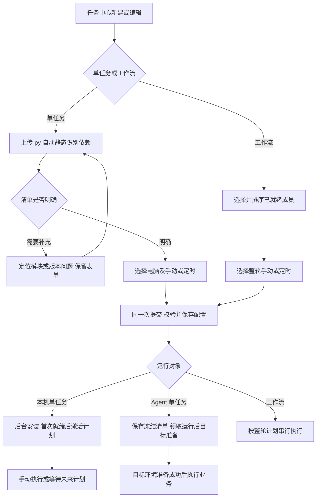

# 任务设置与依赖自动识别需求

版本：v0.4。日期：2026-10-16。A/B 保持，C 的业务环境核验、实际版本回传、落库和页面已实施并完成隔离验收；见[阶段 C 记录](Agent业务环境阶段C精细对齐与验收_2026-10-16.md)。两台真实 Windows 和正式业务仍待现场；本地加载与 GitHub 发布分开记录。

用户要求：设置任务时一起选择定时；上传 `.py` 后由平台识别并下载安装需要的 Python 包。主改 SpiderFly，沿用现有单任务、工作流、独立环境和局域网目标规则。实施任务见[任务拆分](任务设置与依赖自动识别任务拆分.md)，总体归属见[总体需求](SpiderFly总体需求.md)。

## 1. 要达到的效果

用户上传一个 Python 文件，填写名称、运行电脑和执行方式后保存。常见依赖自动识别并进入安装流程，不要求用户先准备 requirements.txt，也不要求创建完成后再去另一个弹窗设置定时。

例如，一个脚本导入 `os`、`requests` 和 `pandas`：平台忽略标准库 `os`，生成 `requests`、`pandas` 的依赖清单，保存后为主控本机任务准备独立环境。选择每天 09:00 时，脚本和计划一起保存；环境准备好后按计划运行。多个脚本组成工作流时，分别准备各自环境，工作流表单只设置整轮计划。

“下载依赖”指下载并安装到平台管理的任务环境。上传和保存不执行用户脚本；安装完成只说明环境准备完成，业务结果由实际运行记录证明。

## 2. 实施前基线与缺口

下表保留 2026-10-16 阶段 A 实施前的源码基线。当前 A/B 已补齐定时、依赖识别和本机环境证据；下表仅为实施前基线，当前结果以阶段 B 记录为准。

| 事项 | 现有行为 | 本轮目标 |
| --- | --- | --- |
| 新建单任务 | [useApps.js](../frontend/src/features/apps/useApps.js) 强制提交 manual，依赖由用户提供 | 表单内选择执行方式；自动生成常见依赖 |
| 新建工作流 | [CreationDialog.vue](../frontend/src/features/taskCenter/CreationDialog.vue) 只提交名称、说明、成员 | 同一表单填写整轮计划，一次保存 |
| 编辑单任务 | [TaskEditor.vue](../frontend/src/features/tasks/TaskEditor.vue) 已有手动/每日/每周/Cron | 与新建、计划快捷入口共用字段和校验，避免几套表单各自演进 |
| 定时保存 | [PlanEditor.vue](../frontend/src/features/schedule/PlanEditor.vue) 创建后另开；工作流定义与计划分别提交 | 创建/完整编辑内保存；保留定时总览和快捷修改 |
| 单任务后端 | [apps.py](../backend/app/api/apps.py) 已接受计划参数；[environments.py](../backend/app/environments.py) 同事务创建程序、任务及 v1 | 复用已有能力，补分析结果绑定、请求判重和准备状态 |
| 工作流后端 | [workflows.py](../backend/app/api/workflows.py) 定义与计划分开，计划接口已有 revision | 定义和计划同事务校验、写入，不串联两个前端请求冒充一次保存 |
| 本机依赖 | [environments.py](../backend/app/environments.py) 已建 venv、按清单安装、验证解释器并执行 pip check | 自动清单接入现有安装器，完善首次准备与计划衔接 |
| Agent 依赖 | [worker.py](../agent/spiderfly_agent/worker.py) 领取任务后按冻结清单建环境、安装并缓存 | 传递自动清单，补依赖检查和环境事实记录；不把主控准备结果当作 Agent 可用证明 |

上述为原能力基线。A/B/C 已接入同页定时、静态 import 识别、本机首次门控及 Agent 0.4.0 业务环境核验/实际版本回传。Agent 安装、缓存、签名事件和补传均复用旧实现，只补核验与事实。环境校验不代表业务验收，两机现场另记。

## 3. 场景与边界

| 编号 | 本轮纳入 | 保留的限制 |
| --- | --- | --- |
| TS01 | 单任务与工作流新建、编辑时选择手动或定时 | 单任务本机支持每日/每周/Cron；Agent 保留每日/每周，Cron 仅本机 |
| TS02 | 上传单个 UTF-8 Python 文件后静态识别依赖 | 沿用单文件和现有大小限制，不增加 ZIP、多文件目录或项目包上传 |
| TS03 | 常见公开 Python 包自动生成清单并安装 | 只使用允许的包名、版本约束；不开放 URL、Git、本地安装路径、pip 参数或私有源配置 |
| TS04 | 本机上传后后台准备；Agent 按领取运行时准备 | 不增加上传即远程部署/试跑，不将离线 Agent 显示为安装成功 |
| TS05 | 计划、依赖和版本与当前任务绑定 | 不改流程顺序、失败停止、快照、维护和权限规则，不扩大受限执行器支持范围 |

不增加外网控制、Agent 工作流、DAG/并行、多个脚本共享环境、跨步骤内存、自动安装 Office/浏览器/驱动、自动执行脚本寻找漏包、全局 pip 安装或新的 AI 服务。依赖识别默认在主控静态完成，不调用 DeepSeek、不发送源码到外部模型。

## 4. 同一表单设置定时

### TS06：字段与页面归属

新建和编辑沿用统一任务容器，按下面顺序组织：

| 单任务 | 工作流 |
| --- | --- |
| 名称、说明、Python 文件 | 名称、说明、成员顺序 |
| 运行电脑；依赖摘要与按需展开的明细 | 主控本机；成员可用性及冲突 |
| 执行方式：手动 / 定时 | 执行方式：手动 / 定时 |
| 定时展开：每日 / 每周 / Cron、时间和未来 5 次 | 定时展开：每日 / 每周 / Cron、时间和未来 5 次 |
| 原有启用、通知等设置 | 原有流程设置 |
| 一个“保存”按钮 | 一个“保存”按钮 |

新对象默认手动。选择定时后才展开时间字段；北京时间及未来 5 次由同一后端计算。切回手动在本次未提交会话中保留时间草稿，保存手动时不激活计划。重新编辑按已保存状态回填，不能把界面默认值写回覆盖原计划。

运行中心保留计划总览、状态、触发记录和快捷修改；对象行的“设置定时”可继续打开同一套计划字段。用户不必再走“创建完成 → 设置定时”。删除创建成功页上要求二次配置的引导，成功反馈只保留结果和真实准备状态。

### TS07：一次保存和失败处理

脚本/依赖、任务定义与计划意图作为一次配置提交；工作流定义、顺序和整轮计划同事务处理。任何字段、成员、权限或计划冲突校验失败，都不留下半个新对象；编辑失败保留原定义和原计划。文件写入与数据库失败按现有受管目录规则清理，不把网络安装放进数据库长事务。

环境安装在配置提交后异步进行。安装失败时显示“任务已保存，依赖安装失败”，保留任务和计划配置供重试，不能显示创建失败并引导再次上传，也不能把安装成功写成脚本执行成功。

提交使用稳定请求编号；同一用户、同一编号、同一内容只生成一个对象，同编号不同内容拒绝。连接中断后先查该编号结果；无法确认时保留草稿并提示核对，不换编号重复创建。编辑继续带版本号/revision，过期提交返回冲突。切换对象、退出或关闭后，迟到响应不能覆盖另一份表单。

### TS08：成员计划与启停

定时作用于当前对象。选工作流只保存整轮计划，成员保持启用且手动；成员已有独立计划时指出具体任务并拒绝，不自动取消或迁移其计划。反向修改成员也继续校验。已有单任务可单独定时，不要求先包装成工作流。

切为手动只取消后续定时，不停止当前运行、不停用成员。单任务启用/停用、工作流计划开关、归档仍是不同状态；编辑停用任务不能因选择定时而偷偷启用它。关闭/删除操作保持现有权限与确认。

## 5. 上传后识别依赖

### DP01：静态分析

选择或更换 `.py` 后自动发起分析；只解析语法树和文本，不导入或执行脚本，不访问脚本引用的业务目录。识别普通 import、from import、别名及同一行多个导入，取顶层模块并去重。字符串和注释中的 import 不算依赖。

分析沿用当前文件与 requirements 限制，增加耗时和语法树资源上限；异常或解析超限返回具体原因。语法错误给出行号，不建立可运行的新对象。解析使用项目支持的 Python 语法，不能因开发电脑版本更高就承诺目标 Agent 可运行。目标 Python 信息缺失时注明未核验，实际准备时再检查兼容性。

本条是对现有“上传前不检查语法”的明确调整，仍保留“上传不试跑”的边界。它不能作为修改既有任务、自动维护或受限执行器验证规则的授权。

### DP02：模块分类和包名对应

| 分类 | 处理 |
| --- | --- |
| 目标 Python 的标准库，如 os、json | 排除；标准库名集按支持的目标版本维护，不照搬主控已安装包列表 |
| 有已验证对应关系的第三方模块 | 自动填入包名，例如 requests → requests、pandas → pandas、PIL → Pillow |
| 相对导入、脚本同名导入或无法确认来源的模块 | 显示行号与“待补充”；不能直接把模块名当 PyPI 包名安装 |
| TYPE_CHECKING 中的纯类型导入 | 标记不参与运行安装，保留识别依据 |
| try/except ImportError、平台条件中的导入 | 标记条件依赖，允许按实际环境选择；不执行条件去猜运行分支 |
| importlib.import_module / __import__ 的直接字符串调用 | 识别到时加入待核对项；变量拼接、exec、插件及库内部延迟依赖不能承诺发现 |

模块名和安装包名并非一一对应，依据为维护在代码中的可审查映射表。首版自动表至少覆盖 requests、httpx、pandas、numpy、openpyxl、Pillow、beautifulsoup4、lxml、PyYAML、python-dateutil、pywin32、DrissionPage 的已验证导入名；映射需有测试和来源，未验证的名字统一待补充。DrissionPage 包的识别不把任务切到 DP 专用执行器。

待补充项提供两个明确动作：填写正确包名/约束，或说明由现有业务模块、可选分支提供而不安装。后者记录理由，不代表平台已提供缺失文件。确实依赖另一个 `.py` 时应告知单文件上传边界，用户可改成单文件或按既有业务路径准备；本轮不悄悄递归上传目录。

### DP03：版本与用户清单

保留可选 requirements.txt 和手动补充，默认折叠。用户明确声明的合法包名和版本约束优先，自动分析只补缺失项；不会覆盖锁定版本，也不会因未在源码发现就删掉用户声明的间接用途依赖。包名归一化去重，同包多行冲突及不支持的语法给出错误，不静默取一条。

只凭 import 不能确定适用版本或额外功能包。没有用户约束的自动项只生成包名，交给安装器解析目标环境可用版本；不编造 `==` 版本，不声称自动选出的版本必定兼容业务 API。读写 Excel 引擎、数据库驱动和插件等未直接导入的包可以手动补充。安装器负责第三方包自身声明的传递依赖，不由平台递归猜包。

正常已验证项自动采用，无须逐包确认。有条件导入、无法映射或冲突时，保留表单并定位待补充项；处理完成前不能保存为可运行对象。首版只保留前端会话草稿，不为此增加服务器“草稿任务”状态。用户明确排除的条件/外部模块随清单记录。

### DP04：结果与源码绑定

分析结果包含源码哈希、用户清单哈希、目标/运行环境信息、解析器和映射版本、识别项及行号、最终清单和待处理项。结果属于当前文件与表单，会话内更换文件、目标或清单后立即过期。保存时服务端按实际上传内容重验，不能信任客户端传来的“已分析”或包名。

保存时冻结最终 requirements、分析依据及显式排除项到任务版本；远程冻结包继续包含源码和最终 requirements，并保持现有哈希校验。以后映射表更新不能自动改写已保存任务。新建产生 v1；替换源码或依赖继续走版本提交/确认，纯名称或计划编辑不生成代码版本、不重新装包。

## 6. 安装、状态和定时衔接

### DP05：主控本机

配置提交后复用现有后台安装器，为任务建立独立环境，按最终 requirements 下载、安装，再验证解释器和 pip check。只含标准库也需准备可用解释器。安装日志保留必要阶段和错误，页面默认只显示“准备中 / 已就绪 / 安装失败”与重试入口。

新任务首次准备期间保存计划意图但不放行业务执行；主控本机的实际下一次触发在环境就绪时按当前有效配置计算为未来计划点，准备期间不补跑。恢复或重试成功也按此首次准备规则处理，不伪造业务失败或触发 AI 修复。页面在此期间显示“准备中”，不能显示一个已保证执行的过去时间。既有已就绪任务的停机补触发、重叠、维护和重跑规则保持原规定。

安装失败可在同一任务重试，不新建任务或版本；重试需要改依赖时按版本流程提交。任务被停用、删除、改目标或更新版本后，旧安装结果不得重新启用计划或覆盖当前环境；未结束运行/流程引用的环境不得删除。不得在每次触发前升级已准备好的包。

### DP06：局域网 Agent

上传后完成静态识别并保存冻结清单，不在上传时启动 Agent 业务运行或新增远程环境部署。Agent 仍在实际领取手动或每日/每周运行后，在目标电脑安装/复用与冻结包匹配的环境，验证解释器、依赖一致性后才执行业务；安装耗时仍按现有本次运行时限计算。

主控可显示“依赖已识别，目标环境待准备”，不能用旧兼容环境的 ready 推断 Agent 已安装。离线/忙碌仍在原目标排队，不回落主控。安装失败计入本次远程运行，保留原始错误；沿用远程维护建议与人工确认，不新增自动换包、改源码、启用或重跑。

Agent 0.4.0 复用旧安装器和缓存，补业务解释器、pip check 与实际版本核验。协议仍为 v1；0.3.0 保留旧运行和回传，明确标记未提供环境明细，不显示已校验。新版 Agent 遇到缺少环境记录能力的旧主控，拒绝执行业务并提示先升级主控；不自动升级电脑。

### DP07：实际环境记录

成功安装记录任务版本、清单哈希、实际安装包名/版本、Python 版本、目标电脑与完成时间，作为环境证据；运行引用具体环境与冻结版本。失败记录已完成阶段和错误，不能写 ready。Agent 缓存需同时核对包哈希、解释器及成功标志，不复用半成品。

Agent 记录由原签名事件回传，按本次运行唯一保存，并校对冻结包及清单哈希；实际目标和代码版本取主控冻结运行，不能拿当前任务替代。环境事件、事实及确认序号同事务，重复补传不新增记录；明细最多 1000 个包、256 KiB，默认折叠。

首版记录实际解析结果，不新增跨电脑通用 lock 文件或自动同步全部包版本。无版本约束的同一清单在不同时间或电脑重建可能得到不同版本，页面详情保留事实；有复现要求时由用户明确约束。安装和业务运行仍分开，pip check 通过也不等于业务验收通过。

## 7. 目标流程

下图为完整目标。阶段 A 的同页计划与配置保存已实现；自动识别、首次就绪门控及新增 Agent 环境证据仍待 B/C，不用整张图宣称已完成。

## 8. 验收清单

AT01—AT05 和对应 AT17 的 A 部分保持通过；B 已验证 AT06—AT14、AT16 本机校验和 AT17 依赖交互。AT15 及 AT18 的新增 Agent 软件部分已在 C 通过同机真实安装/签名回传，AT16 校验与两机/异构环境现场分开记录；逐条结算见[阶段 C 记录](Agent业务环境阶段C精细对齐与验收_2026-10-16.md)，不以隔离或旧回归代替现场。

| 编号 | 场景 | 必须达到的结果 | 对应需求 |
| --- | --- | --- | --- |
| AT01 | 新建单任务选择每日/每周/Cron或手动 | 同页保存完整定义与计划，无二次设置步骤，未来 5 次与服务端一致 | TS01、TS06 |
| AT02 | 新建/编辑两脚本工作流定时 | 只为整轮设计划；成员独立计划冲突双向拒绝且列出任务 | TS07、TS08 |
| AT03 | 编辑旧对象和停用对象 | 原计划正确回填，版本冲突不覆盖；切手动不停止当前运行，不偷偷启用 | TS06—TS08 |
| AT04 | 保存非法计划、非法成员或文件失败 | 无半创建、无部分更新；原对象与输入保留 | TS07 |
| AT05 | 重复点击、断网、响应丢失、同编号异内容 | 只创建一次，可核对请求结果；异内容冲突，迟到响应不串对象 | TS07 |
| AT06 | 仅标准库及常见库的单文件 | 标准库排除，已验证包自动填入，正常流程无需手写清单或逐包确认 | DP01—DP03 |
| AT07 | PIL 等别名、重复导入、from 和注释 | 正确对应、去重并保留行号；不安装注释或字符串中的 import | DP01、DP02 |
| AT08 | 动态、条件、未知、本地导入与缺失隐式引擎 | 已识别不确定项有处理入口；不盲装同名包、不承诺发现所有动态依赖 | DP02、DP03 |
| AT09 | 用户版本约束、额外依赖及同包冲突 | 明确清单优先并保留；冲突阻止保存，不猜版本或删除补充包 | DP03 |
| AT10 | 语法错误、超限和含顶层副作用脚本 | 精确报告语法/限制；分析与保存不执行业务，不触碰业务目录 | DP01 |
| AT11 | 更换文件/目标/清单、伪造分析结果 | 旧结果失效，服务端重验；冻结版本与安装内容一致 | DP04 |
| AT12 | 本机正常安装、无第三方包、网络失败及重试 | 独立环境、解释器与 pip check 真实；失败不 ready，重试不重复建任务 | DP05、DP07 |
| AT13 | 首次安装跨过计划点、停用/删除/版本竞争 | 未就绪不执行或触发维护；就绪后从未来点开始，旧结果不复活对象 | DP05 |
| AT14 | 版本更新、既有环境与工作流快照 | 纯计划编辑不重装；源码/依赖更新走原版本流程，旧运行环境受保护 | DP04、DP05 |
| AT15 | Agent 安装、失败、缓存、离线和目标不符 | 在实际目标准备，失败不执行；不回落主控，不宣称本机安装证明远程可用 | TS04、DP06、DP07 |
| AT16 | 权限、32/64位及 Python 不兼容、禁止的依赖格式 | 后端拒绝越权与不支持配置，错误具体；不自动改机器或安装方式 | TS03、TS05、DP01 |
| AT17 | 新建/编辑/快捷定时/AI 草稿与窄屏 | 共用字段与同一状态；草稿清单可合并，不重复入口，320px 可用 | TS06、DP03、DP04 |
| AT18 | 现有运行与维护回归 | Cron/流程/Agent/版本/权限不退化；真实两机和业务验收分别记录 | TS05、TS08、DP05、DP06 |

## 9. 核对依据

产品规则沿用[任务执行约定](任务执行约定.md)、[Cron 与工作流需求](Cron与串行工作流需求.md)和[多宿主机需求](多宿主机调度需求.md)。阶段 A 已替代总体需求旧 U04 的“先创建手动对象，再单独设置定时”，旧 UA06 留作旧版证据，新保存行为按 AT04—AT05 和本轮记录结算。

静态分析采用 Python [AST 文档](https://docs.python.org/3/library/ast.html) 中的语法树能力；模块与安装包名的区别参照 [PyPA 说明](https://packaging.python.org/en/latest/discussions/distribution-package-vs-import-package/)及 [importlib.metadata](https://docs.python.org/3/library/importlib.metadata.html)。例如 PIL 对应 Pillow，参照 [Pillow 安装说明](https://pillow.readthedocs.io/en/stable/installation/basic-installation.html)。安装与依赖解析沿用 [pip install](https://pip.pypa.io/en/stable/cli/pip_install/) 的职责。以上官方资料于 2026-10-16 核对，只支撑技术边界，不代表依赖识别功能已经接入。
