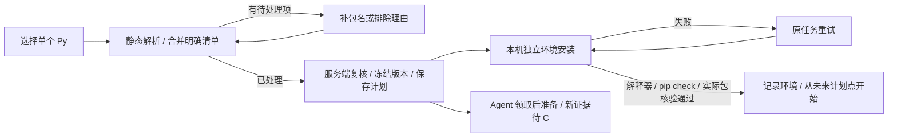

# 依赖自动识别：阶段 B 对齐与验收

日期：2026-10-16。主改 SpiderFly。对照基线为[增量需求](任务设置与依赖自动识别需求.md)与[任务拆分](任务设置与依赖自动识别任务拆分.md)。本记录区分静态分析、保存配置、安装环境和业务运行；不把其中一步通过当作其他步骤通过。

## 1. 交付范围

已实现 N05—N08，以及 N01 的本机分析/环境结构约定。选择一个 `.py` 后自动识别依赖；常见映射直接采用，未知、相对、自身、条件和可见动态导入需要指定包或填写排除理由。补充清单默认折叠，明确约束优先。保存时服务端复核实际文件，冻结清单和分析依据，本机后台安装；首次环境完成前不放行业务运行或计划点。

Agent 仍在实际领取运行时安装冻结清单。N09 的新 pip check、解释器缓存核对和目标环境事实回传属于阶段 C，本轮没有修改 Agent 安装器，也没有两台真实 Windows 电脑的验收结论。

## 2. 实际代码与数据约定

| 职责 | 实际入口与约定 |
| --- | --- |
| 分析 | [dependency_analysis.py](../backend/app/dependency_analysis.py)：平台自己的 `-I` 子进程，只接收 stdin JSON，不执行或导入上传内容。5 秒总超时、2MB、100,000 AST 节点、300 项导入；Python 3.12 语法检查报行号 |
| 分类依据 | [dependency_catalog.py](../backend/app/dependency_catalog.py)、[stdlib_312.json](../backend/app/stdlib_312.json)：固定 CPython 3.12.10 标准库名集；12 类常见发行包和明确别名；来源链接逐项保留，不读取主控安装列表来猜对应关系 |
| 接口 | [apps.py](../backend/app/api/apps.py)：管理员 `POST /api/apps/analyze-dependencies`；无业务对象写入。创建接口接收 `dependency_decisions` 并按实际文件重新分析。版本分析传 task_id，由服务端取得当前目标 |
| 分析记录 | `dependency_analyses(version_id, analysis, created_at)`；记录源码/用户清单/最终清单哈希、文件名、目标、Python 核验状态、解析器/映射版本、项目和行号、决定与排除理由。归一化换行后的文本作为新建源码哈希输入 |
| 清单 | PyPI 包名、可选 extras、版本约束；保留原允许的 extras。拒绝 URL/Git/路径/pip 参数/续行/变量/环境标记；包名按大小写和 `-_.` 归一化。同包不同声明要求合并，不静默择一；明确清单中的额外包保留 |
| 冻结 | [environments.py](../backend/app/environments.py) 保存 v1；[task_versions.py](../backend/app/task_versions.py) 保存后续候选并保持确认边界。映射版本更新不会批量重写历史；未带分析记录的旧版本继续可读 |
| 首次门控 | [database.py](../backend/app/database.py) 新增 `tasks.first_environment_ready`，旧数据默认 1，新建任务置 0。仅本机按该字段门控；准备时 next_run_at 为空，手动及流程入口也拒绝提前放行。Agent 不据此推断本机环境已在目标准备 |
| 安装与事实 | 复用原后台安装器、venv、超时及清理。pip install、解释器、pip check 后，从新环境读取 importlib.metadata，核对实际包和声明。`environment_records` 保存版本、revision、清单哈希、目标、实际包/Python/位数、时间；失败保存阶段和错误 |
| 发布事务 | 环境 ready、成功事实和首次计划释放在同一事务。核对 revision、当前路径/清单、当前代码版本及目标；迟到旧结果不发布。停用不会被安装完成重新启用；首次就绪从当前有效配置计算未来点 |
| 页面 | [DependencyFields.vue](../frontend/src/features/apps/DependencyFields.vue) 共用于创建与版本上传；变更文件/目标/清单即过期并取消旧请求。正常明细和补充清单收起，待处理项展开；读取依赖文件期间也不能提交旧结果 |
| 查看事实 | [DependencyDetails.vue](../frontend/src/features/apps/DependencyDetails.vue) 在编辑任务中按需展示冻结清单、排除理由和实际主控环境；管理员接口不返回 Python 路径，不将主控记录当作 Agent 事实 |

只含标准库也会创建独立解释器并检查，不复制系统已安装包。普通 native 导入 DrissionPage 只识别为包，不自动切到 DP 专用执行器。没有版本约束的包由 pip 解析；环境事实记录实际结果，不承诺跨电脑锁定相同版本或业务 API 兼容。

## 3. 与参考实现逐项比对

参考源码只读，没有修改或运行参考项目。固定版本及文件哈希收录在[本轮指纹](审查证据/依赖自动识别阶段B指纹_2026-10-16.json)。

| 参考入口 | 观察到的行为 | 对本轮需求的取舍 |
| --- | --- | --- |
| [RPAC PythonExecutor](../../RPAC-main/worker/executors/python_executor.py) 的 `_python_run` | 读取 script/interpreter/args，使用已有解释器启动脚本；这条执行入口没有上传 import 分类、冻结清单和独立环境准备链路 | 参考执行与日志分层；不能把它当成 DP01—DP07 的现成实现，也不通过运行脚本试探缺包 |
| [KK dashboard publisher](https://github.com/flyyang12-rgb/kk-rpa-dashboard/blob/e33570e47ec671343c485fdd63d69e144c81bab3/apps/backend/src/rpa_console/publisher.py) 的应用声明扫描 | 要求 app.toml、pyproject.toml、uv.lock 等，校验 Python 声明和仓库内本地依赖路径 | 借鉴明确声明与发布校验；SpiderFly 保持单文件，不引入仓库包、递归本地源码、uv.lock 或全局同步 |
| [KK monorepo runtime](https://github.com/flyyang12-rgb/kk-rpa-monorepo/blob/d65b4edfa9859c897fdf445f4860cf723d3e4267/packages/rpa-core/src/rpa_core/runtime.py) | StepSpec/Step/BaseProgram/ExecutionContext 是其程序框架约定 | 本轮不要求业务脚本继承框架或调用步骤 SDK；依赖准备与现有普通 Python 执行边界分开 |
| SpiderFly 原安装器与 Agent worker | 本机已有 venv、pip install、解释器与 pip check；Agent 已有领取后安装及冻结包缓存 | 直接复用本机安装器并补真实包事实/首次门控；Agent 的新检查和回传列 C，不另造一套部署服务 |

映射依据为各项目官方文档或维护者源码，见映射表中的 URL。Python 静态解析依据 [ast 文档](https://docs.python.org/3.12/library/ast.html)；模块名不能直接等同发行包名的依据见 [PyPA](https://packaging.python.org/en/latest/discussions/distribution-package-vs-import-package/)。这些资料用于确定边界，不代表已经验证所有业务库组合。

## 4. 需求逐条结算

| 需求 | 本轮结论 | 证据与限制 |
| --- | --- | --- |
| TS01 | A 保持，B 回归 | 同页手动/定时；流程仍按整轮计划；未扩展 Agent Cron |
| TS02 | B 完成 | UTF-8/单文件/2MB；静态 worker；未添加 ZIP/目录上传 |
| TS03 | B 本机完成 | 合并清单、安装独立环境、格式和 Python 校验；无私有源网页设置 |
| TS04 | B 本机完成，C 待验 | 本机后台准备；新 Agent 任务不在主控兼容安装队列抢先准备，领取后安装沿用旧协议 |
| TS05 | B 完成，现场部分保留 | 版本确认、冻结和工作流环境保护回归；不更改受限环境和维护授权 |
| TS06 | A/B 完成 | 创建/编辑计划共用字段；创建/版本上传共用依赖字段；窄屏实页核对 |
| TS07 | A 保持，B 回归 | 回执和事务保护不变；分析失败无新对象，安装失败保留已保存任务；原请求重试不重复建任务 |
| TS08 | A 保持，B 回归 | 成员与流程计划冲突仍拒绝；准备失败不变成业务失败或 AI 修复 |
| DP01 | B 完成 | AST、语法行号、大小/节点/项目/超时限制；含顶层写文件和 raise 的脚本均未执行 |
| DP02 | B 完成 | 标准库、映射别名、类型/条件/未知/自身/相对/可见动态项分类与行号测试；阴影覆盖的 TYPE_CHECKING 不误排除 |
| DP03 | B 完成 | 明确约束及额外包保留；同包冲突报错；包名/理由处理入口；无法可靠推断动态及隐式引擎依赖 |
| DP04 | B 完成 | 内容变更废弃结果，服务端重验；v1/候选冻结分析；纯名称和计划编辑不重装、不新建代码版；不重算历史 |
| DP05 | B 完成 | 真实独立环境正常/失败/同任务重试；首次只从未来计划点开始；停用/重启/目标/版本竞争隔离测试 |
| DP06 | C 待实施 | 只确认旧领取后安装路径仍在；没有新增 Agent pip check/缓存解释器核对/事实回传和两机结论 |
| DP07 | B 本机完成，C 待实施 | 主控真实包版本、Python、清单、版本与时间；失败阶段真实。目标电脑的新环境记录待 C |

## 5. AT01—AT18 精细验收

新增测试位于 [test_dependency_analysis.py](../backend/tests/test_dependency_analysis.py)，覆盖纯分析、真实 HTTP、SQLite 冻结、生命周期、故障和竞争；历史测试更新仅对应本轮已明确修改的“新任务首次门控”和“上传语法检查”要求。不是把失败断言删掉。

| 验收 | 结果 | 具体证明 |
| --- | --- | --- |
| AT01 | A 通过，B 回归通过 | 同页每日/每周/Cron；真实新建任务保存计划后显示准备中，就绪后显示未来点 |
| AT02 | A 通过，B 回归通过 | 原单任务/整流程计划、双向成员冲突与权限全套回归 |
| AT03 | A 通过，B 回归通过 | 共用计划字段、原配置回填及版本冲突草稿保护 |
| AT04 | A 通过，B 回归通过 | 非法计划/成员/文件无半创建；配置/审计/创建回执原事务，编辑错误不覆盖原值 |
| AT05 | A 通过，B 回归通过 | 稳定编号、同内容重试只创建一次、同编号异内容冲突、创建结果核对与迟到响应隔离；安装失败不重新 POST 创建 |
| AT06 | B 通过 | 12 类常见发行包及标准库分类；真实页只传 Py 即得到清单 |
| AT07 | B 通过 | PIL→Pillow、win32 别名、from/alias/子模块去重和行号；注释/字符串不计入 |
| AT08 | B 通过，能力限制保留 | 未知/相对/自身、条件和可见动态调用进入待处理；类型导入排除。包名或排除理由可保存；不保证发现全部动态/插件/隐式引擎 |
| AT09 | B 通过 | 明确固定版本保留、额外 openpyxl 保留、规范化、重复/互斥约束及禁止格式拒绝 |
| AT10 | B 通过 | 语法第几行、2MB/节点/项目/worker 超时；真实准备及分析均没有运行脚本副作用 |
| AT11 | B 通过 | 文件/目标/清单/版本失效与迟到响应丢弃；客户端伪造 ready 无法绕过服务端；清单与冻结版本相同 |
| AT12 | B 通过 | 真实 stdlib、requests venv；实际不可达包源失败后在原任务重试；解释器/pip check/实际包事实，零业务执行 |
| AT13 | B 通过（虚拟时间与隔离竞争） | 跨过 09:00 后只生成下一未来点；停用不复活、首次门控重启保留、旧 revision/目标/版本及删除状态不发布；失败无 execution/维护 job |
| AT14 | B 通过 | 名称/计划编辑保持环境和代码版；更新候选先不启用，确认依赖变化后新 revision 准备，旧环境保留；既有流程快照保护全套回归 |
| AT15 | C 待实施/现场待验 | 未用主控 ready 证明 Agent 安装；远程新核验与两机首次安装/缓存/失败/离线恢复未验 |
| AT16 | B 分析/本机校验通过，实际不兼容机器待现场 | 真实鉴权；32 位/非 3.12 的校验函数用合成解释器输出验证拒绝；未自动改机器或放开依赖来源 |
| AT17 | A/B 通过 | 共用组件、新建/版本上传/AI 既有清单保留；文件读取、草稿、迟到请求、空理由、320px 和键盘检查；不重新调用模型 |
| AT18 | 隔离回归通过，条件/现场仍待 | Cron/工作流/Agent 原协议/维护/版本/权限全套；19 个宿主机条件跳过仍明确，真实两机、WSL/桌面和正式业务另验 |

## 6. 验证层与本轮发现

后端 754 项中 735 通过、19 条件跳过，新增 37 项；前端 206 项通过，其中依赖表单新增 14 项，Vite 120 模块构建通过。前端仍为隔离 Vue/DOM 检查，没有新增 `npm test` 命令。源码、检查日志、构建、实页、真实安装和本地加载的最终指纹见[证据](审查证据/依赖自动识别阶段B指纹_2026-10-16.json)。原阶段 A 的证据保留原时点，不用新的统计倒改历史记录。

真实安装的脱敏结果见[独立安装与失败重试](审查证据/依赖自动安装实测_2026-10-16.json)、[实页版本安装](审查证据/依赖版本实页安装_2026-10-16.json)。依赖表单的[14 项隔离检查脚本](审查证据/依赖表单隔离检查_2026-10-16.mjs)及[Vue 加载器](审查证据/依赖表单加载器_2026-10-16.mjs)一并保存；复制进新隔离副本的 frontend 后才运行，工具依赖使用旁边 test-runtime 中的 jsdom，不能直接在正式仓库运行。

真实页面使用隔离账号和合成脚本，核对：常见导入/别名/去重、明确清单补充、更换脚本、条件模块排除、理由保留、保存准备中/运行禁用/未来点、版本候选和确认后的新环境；1366×900 与 320×740 下核对溢出、滚动、保存和 Esc/焦点。新 API 的后端权限、异常和保存防伪另由 HTTP 检查证明，不冒充浏览器网络故障实测。

真实安装在新隔离目录分别验证标准库和 `requests==2.32.5`。将 pip 指向本机不可达测试包源使其真实失败，再恢复公开 PyPI 并通过原任务重建成功。新任务仍是一个、首次计划未提前放行、无 execution、无上传脚本副作用。另在实页确认带 Pillow 的 v2，核对新环境准备及版本事实。pip 的安装脚本属于包安装过程，不等于平台执行业务 Py。

本轮核验修正了以下问题，并追加或保留针对性证明：

- 安装证据、ready 和首次计划必须同事务；证据写入失败会一起回滚。
- 旧 build 的目标/代码/revision 改变时不得发布，纯计划变化则读取当前有效配置；每日/每周推进也增加状态与版本条件。
- 标准库名固定到支持的 Python；TYPE_CHECKING 被赋值或参数覆盖时保守归入条件项。
- 排除理由原本只在 change 时写入，实页连续修改其他字段可丢失；改为 input 即记草稿，重验后保留。
- 自动分析期间、待处理和依赖文件读取期间不能提交旧的 ready；旧响应和卸载后的结果丢弃。
- 分析响应结构不完整时显示错误，不让页面因 items 缺失崩溃；相同依赖文件再次选择也重新分析。
- 清单文字显式使用白绿界面的文字/背景令牌，避免继承深色日志样式导致字迹过浅；最终页面重新检查颜色和溢出。

本轮不承诺业务试跑、全部第三方包兼容或跨电脑可复现。未提交、未推送；本地加载情况以本轮指纹及 CONTEXT 的最终记录为准。

## 7. 本地加载与清理

主控空闲后停止，完整加密备份 17 份运行/配置文件，保留 275 份匹配前版源码和旧 dist。新增的平台 packaging 仅装入项目 `.venv`；普通任务依赖仍装入各自独立环境。原 EXE 启动器启动单进程服务，最终四份静态文件 HTTP 哈希一致、四个 worker 正常，三个匿名受保护接口返回 401，新表/字段已核对，`.env` 未变。最终颜色修正只更新前端资产，匹配上一版组件和 dist 也已保存。Vite 的 HTML 输出统一为 LF 后重新核对 HTTP 哈希，不修改页面内容。

本地地址为 http://127.0.0.1:8383/ 。没有用正式账号、任务、密钥或业务目录测试。隔离合成计划与活动归零、业务 execution 为零，测试服务与标签已关闭，viewport 已复原。桌面和窄屏截图见[表单](审查证据/依赖识别表单_2026-10-16.png)、[320px](审查证据/依赖识别窄屏_2026-10-16.png)。真实业务、两机、WSL/桌面条件另验。
