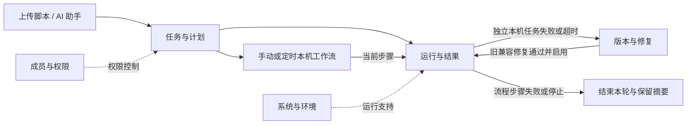

# 功能地图

按下面的模块查找功能说明。第一次部署先看 [README](../../README.md#两台电脑开始使用)；维护代码时看[知识框架与 Python 对照](知识框架与代码对照.md)和[代码对照与模块结构](../开发/代码对照与拆分方案.md)。

当前发布包含统一任务中心、任务内定时、上传依赖识别和 Agent 业务环境核验。单任务与工作流在同一列表管理，创建时选择类型；运行中心分别查看任务执行与流程整轮记录。软件验证与双机现场范围见[当前状态](../../CONTEXT.md)和[双机验收记录](../多宿主机阶段7发布与双机验收.md)。

| 模块 | 负责什么 |
| --- | --- |
| [任务与计划](任务与计划.md) | 创建、编辑时一起设置定时；本机支持每日/每周/Cron 和串行工作流，Agent 支持每日/每周单任务 |
| [运行与结果](运行与结果.md) | 排队、执行、停止、日志和结果下载；两类历史分别分页，流程可信收尾后推进、失败停止下游 |
| [AI 助手](AI助手.md) | 理解需求、探索网页、生成和修改脚本；[DP 任务](DP任务.md) |
| [版本与修复](版本与修复.md) | 管理脚本版本、验证修改、修复失败 |
| [成员与权限](成员与权限.md) | 登录、成员管理、权限和操作审计 |
| [系统与环境](系统与环境.md) | 准备 Python 环境、模型设置、通知和宿主机 |
| [宿主机与远程运行](宿主机与远程运行.md) | 接入、审批 Windows Agent，向指定电脑手动或定时分发任务，回收日志、环境版本与结果 |

每篇只写职责、流程和关键规则。功能调整时同步更新对应文档；技术细节与验证记录留在开发文档里。文档描述行为，实际是否完成仍需代码和验证结果支持。

详细实施见[M1：单任务 Cron](../M1实现与验证记录_2026-10-13.md)、[M2：本机工作流](../M2实现与验证记录_2026-10-13.md)、[M3：整流程计划](../M3实现与验证记录_2026-10-14.md)，以及[任务内定时 A](../任务内定时精细对齐与阶段A验收_2026-10-16.md)、[依赖识别 B](../依赖自动识别阶段B精细对齐与验收_2026-10-16.md)和[Agent 环境 C](../Agent业务环境阶段C精细对齐与验收_2026-10-16.md)。带日期记录反映当时验证，后续现场结果单独更新。
