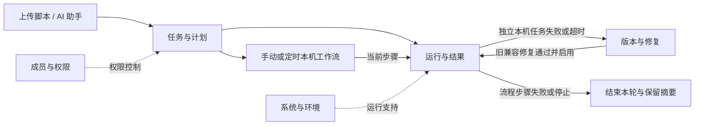

# 功能地图

2026-10-16 [任务内定时阶段 A](../任务内定时精细对齐与阶段A验收_2026-10-16.md) 已实施并加载本地；自动依赖仍待 B/C，见[需求](../任务设置与依赖自动识别需求.md)及[拆分](../任务设置与依赖自动识别任务拆分.md)。历史结果保留原时点。

先看 [知识框架与 Python 对照](知识框架与代码对照.md)：按模块把说明文档、知识资料和实现文件对应起来。

给项目负责人看的简明说明。以后直接用下面的模块名称提问题即可，例如：“运行与结果：取消排队后，页面怎么显示？”

这套文档按当前工作区整理；工作区有未发布改动，正式运行版本另见 [当前状态](../../CONTEXT.md)。主要页面与接口已按模块拆分，技术位置见 [代码对照与模块结构](../开发/代码对照与拆分方案.md)。

统一任务中心已实施并正式加载：单任务和工作流在同一列表管理，从一个新建入口选择类型；运行中心的记录选择任务执行或流程整轮。一级导航按工作台、任务中心、运行中心、管理中心组织，其他角色保留原可访问范围。本轮后端 588 通过/19 条件跳过、前端 72 通过、94 模块，以及真实页面/native 到点和空闲备份加载见[统一任务中心记录](../统一任务中心实现与验证记录_2026-10-14.md)；现场条件与组件/真实页面证据分层保留。

| 模块 | 负责什么 |
| --- | --- |
| [任务与计划](任务与计划.md) | 统一管理单任务与工作流；新建选择类型，在创建或编辑表单内为单任务或整流程设置每日/每周/Cron |
| [运行与结果](运行与结果.md) | 排队、执行、停止、日志和结果下载；两类历史分别分页，流程可信收尾后推进、失败停止下游 |
| [AI 助手](AI助手.md) | 理解需求、探索网页、生成和修改脚本；[DP 任务](DP任务.md) |
| [版本与修复](版本与修复.md) | 管理脚本版本、验证修改、修复失败 |
| [成员与权限](成员与权限.md) | 登录、成员管理、权限和操作审计 |
| [系统与环境](系统与环境.md) | 准备 Python 环境、模型设置、通知和宿主机 |
| [宿主机与远程运行](宿主机与远程运行.md) | 审批 Windows Agent、手动派发、日志产物及失败候选；主控已加载，双机现场尚未完成 |

每篇只写职责、流程和关键规则。功能调整时同步更新对应文档；技术细节与验证记录留在开发文档里。文档描述行为，实际是否完成仍需代码和验证结果支持。

单任务 Cron 见[M1 记录](../M1实现与验证记录_2026-10-13.md)，手动本机工作流见[M2 记录](../M2实现与验证记录_2026-10-13.md)，整流程计划与统一入口见[M3 记录](../M3实现与验证记录_2026-10-14.md)。M1—M3 已于 2026-10-14 由正式主控加载；M3 回归、实际隔离页面及到点运行检查完成。真实业务、WSL、桌面和 Agent 现场矩阵另行验收。
