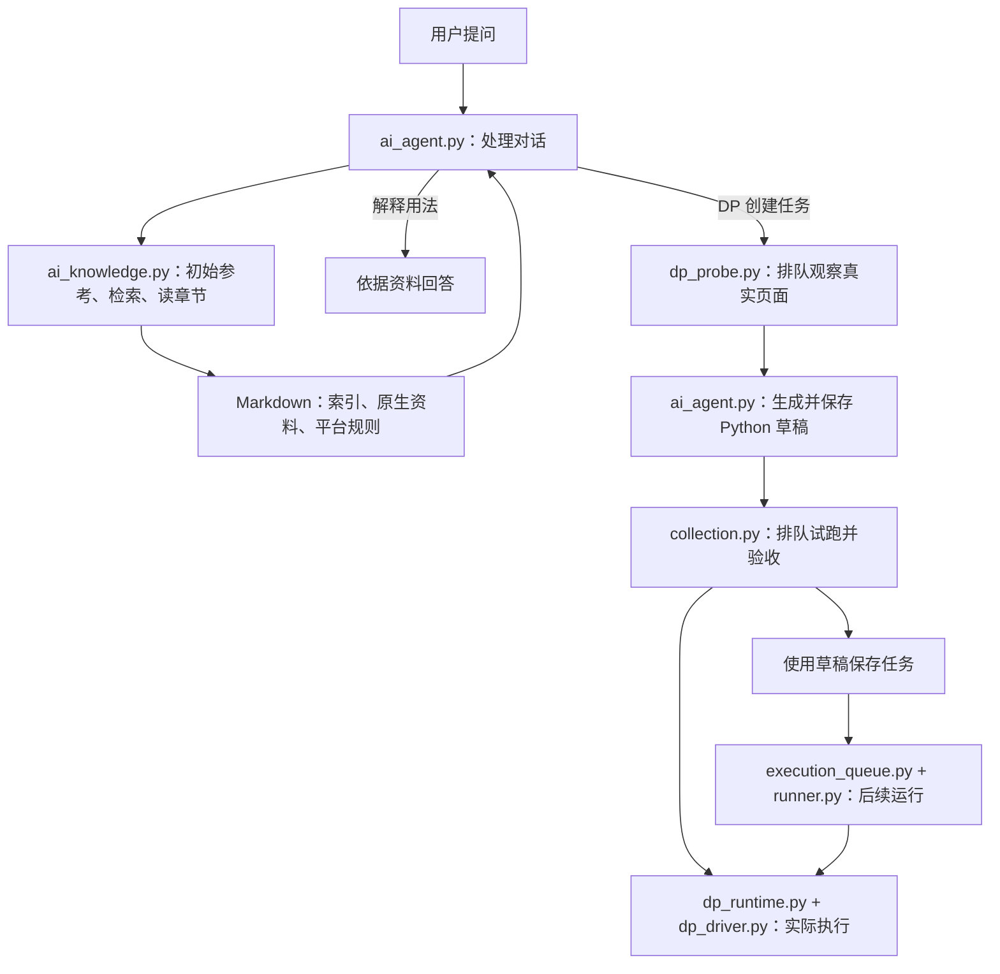
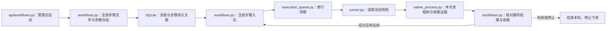

# 知识框架与 Python 对照

你看功能文档提问题，我按同一行找到 Python 实现。文档描述当前行为；改代码时同步该行对应的文档。当前是工作区状态，正式服务加载情况见 [CONTEXT](../../CONTEXT.md)。

## 项目模块对照

Agent 主控远程升级入口为 [agent_updates.py](../../backend/app/services/agent_updates.py) 与 [updater.py](../../agent/spiderfly_agent/updater.py)，分别负责主控授权/冻结及目标验签/下载/回执；仍复用下表宿主机的签名、租约和运维脚本，见[逐项记录](../主控远程升级需求与验收_2026-10-16.md)。

| 模块 | 给你看的文档 | 对应 Python 入口 | 负责什么 |
| --- | --- | --- | --- |
| 任务与计划 | [任务与计划](任务与计划.md) | [apps.py](../../backend/app/api/apps.py)、[tasks.py](../../backend/app/api/tasks.py)、[creation_requests.py](../../backend/app/services/creation_requests.py)、[scheduling.py](../../backend/app/scheduling.py)、[cron_schedule.py](../../backend/app/cron_schedule.py)、[schedules.py](../../backend/app/api/schedules.py)、[cron_runs.py](../../backend/app/services/cron_runs.py) | 创建/编辑时设置定时，定义/计划/审计同事务、创建回执与重试保护；Cron 预览、持久轮次及原触发规则保留 |
| 本机工作流 | [任务与计划](任务与计划.md)、[运行与结果](运行与结果.md) | [api/workflows.py](../../backend/app/api/workflows.py)、[services/workflows.py](../../backend/app/services/workflows.py)、[workflow_schedules.py](../../backend/app/services/workflow_schedules.py) | M2/M3 已加载；手动及定时整轮、双向计划冲突、触发事实、快照和当前步骤协调 |
| 运行与结果 | [运行与结果](运行与结果.md) | [execution_queue.py](../../backend/app/services/execution_queue.py)、[runner.py](../../backend/app/runner.py)、[native_process.py](../../backend/app/native_process.py) | 排队、运行、停止；新 Cron 及 native 工作流可信收尾；结果与日志入口见 [executions.py](../../backend/app/api/executions.py) |
| AI 助手 | [AI 助手](AI助手.md) | [ai_agent.py](../../backend/app/ai_agent.py)、[ai_tools.py](../../backend/app/ai_tools.py) | 理解问题、选择工具、生成草稿 |
| 采集知识库 | [采集知识库](采集知识库.md) | [ai_knowledge.py](../../backend/app/ai_knowledge.py) | 按工具和主题找资料、读取章节 |
| DP 任务 | [DP 任务](DP任务.md) | [dp_probe.py](../../backend/app/dp_probe.py)、[dp_runtime.py](../../backend/app/dp_runtime.py)、[dp_driver.py](../../backend/native/dp_driver.py) | 看页面、执行脚本、管理本次浏览器 |
| 版本与修复 | [版本与修复](版本与修复.md) | [task_versions.py](../../backend/app/task_versions.py)、[maintenance.py](../../backend/app/maintenance.py) | 验证、切换版本、独立任务修复与重跑；排除流程自动维护及冻结 pending 重绑 |
| 成员与权限 | [成员与权限](成员与权限.md) | [users.py](../../backend/app/api/users.py)、[security.py](../../backend/app/security.py) | 账号、角色、操作权限 |
| 管理配置 | [管理配置](../服务配置.md)、[系统与环境](系统与环境.md) | [settings.py](../../backend/app/api/settings.py)、[feishu_settings.py](../../backend/app/feishu_settings.py)、[ai_settings.py](../../backend/app/ai_settings.py)、[feishu.py](../../backend/app/feishu.py) | 团队成员在上，API 密钥和飞书配置在下；群/个人渠道、权限、DPAPI、环境优先和通知读取 |
| 系统与环境 | [系统与环境](系统与环境.md) | [config.py](../../backend/app/config.py)、[environments.py](../../backend/app/environments.py)、[host_runtime.py](../../backend/app/host_runtime.py) | 配置、依赖、宿主机占用检查 |
| 宿主机与远程运行 | [宿主机与远程运行](宿主机与远程运行.md) | [hosts.py](../../backend/app/api/hosts.py)、[host_dispatch.py](../../backend/app/services/host_dispatch.py)、[remote_maintenance.py](../../backend/app/remote_maintenance.py)、[client.py](../../agent/spiderfly_agent/client.py)、[worker.py](../../agent/spiderfly_agent/worker.py) | 审批、签名通信、租约、远程执行、回传及失败候选；主控已加载，双机现场尚未完成 |

上表是主要入口；页面、接口及辅助文件的完整位置在 [开发对照表](../开发/代码对照与拆分方案.md)。

## 统一任务中心和运行记录入口

以下结构已实施并正式加载；本轮后端 588 通过/19 条件跳过、前端 72 通过、94 模块及真实页面/native 到点、空闲备份加载见[统一任务中心记录](../统一任务中心实现与验证记录_2026-10-14.md)。页面统一不合并两类后台身份，也不改变脚本、执行器和模型的职责；WSL、桌面、业务、两机及活动主控崩溃等现场条件另验。

| 用户操作 | 实际前端 | 后端及边界 |
| --- | --- | --- |
| 查看单任务与工作流 | [TaskCenterPage.vue](../../frontend/src/features/taskCenter/TaskCenterPage.vue) | [tasks.py](../../backend/app/api/tasks.py) 及 [api/workflows.py](../../backend/app/api/workflows.py) 读取各自完整定义；类型加 ID 防止串用，部分失败显示载入不完整 |
| 新建选择类型 | [CreationDialog.vue](../../frontend/src/features/taskCenter/CreationDialog.vue)、[CreateTaskPage.vue](../../frontend/src/features/apps/CreateTaskPage.vue) | [apps.py](../../backend/app/api/apps.py) 上传一个 PY；api/workflows.py 引用已有本机 native 任务。创建默认手动，多个脚本分别创建后组合 |
| 创建后设置定时 | [PlanEditor.vue](../../frontend/src/features/schedule/PlanEditor.vue) | tasks.py 和 api/workflows.py 分别保存计划，复用原预览/计算/冲突规则；计划失败只重试已有对象 |
| 查看两类历史 | [RunHistoryPage.vue](../../frontend/src/features/executions/RunHistoryPage.vue)、[WorkflowHistory.vue](../../frontend/src/features/workflows/WorkflowHistory.vue) | [executions.py](../../backend/app/api/executions.py) 及 api/workflows.py 各自后端分页；真实流程步骤 execution 保留并标明来源，远程运行保留原身份 |
| 查看步骤、时间及日志 | [WorkflowRunDetail.vue](../../frontend/src/features/workflows/WorkflowRunDetail.vue)、[ExecutionDetail.vue](../../frontend/src/features/executions/ExecutionDetail.vue) | 本轮计划时间与实际时间分别展示，日志关联实际 execution_id；先关闭流程详情，再切换执行详情 |
| 查询未进入维护原因 | [CronEntryDetails.vue](../../frontend/src/features/schedule/CronEntryDetails.vue) | [maintenance.py](../../backend/app/maintenance.py) 与 [cron_runs.py](../../backend/app/services/cron_runs.py) 同事务保存决定/原因，[schedules.py](../../backend/app/api/schedules.py) 返回原轮次事实；未决失败不提前释放 |

AI 对话由 [AiAssistant.vue](../../frontend/src/AiAssistant.vue) 展示，[AiMessageContent.vue](../../frontend/src/AiMessageContent.vue) 与 [aiMarkdown.js](../../frontend/src/lib/aiMarkdown.js) 完整排版并净化正文；草稿与结果按需展开。AI 草稿仍由 useApps.js 带入确认创建，不因入口迁移自动执行。流程步骤继续排除独立任务自动修复，正常运行已保存脚本不调用模型。

## 采集知识怎么对应代码

| 层次 | 文档或知识位置 | 对应 Python | 分工 |
| --- | --- | --- | --- |
| 知识索引 | [采集总索引](../../backend/ai_knowledge/collection_index.md) | [ai_knowledge.py](../../backend/app/ai_knowledge.py) 的 search、read、bootstrap | 索引说明去哪查，代码负责找章节和返回来源 |
| 原生 API 资料 | [Scrapling 概览](../../backend/ai_knowledge/scrapling/overview.md)、[DP 资料目录](../../backend/ai_knowledge/drissionpage/catalog.md) | [ai_knowledge.py](../../backend/app/ai_knowledge.py)；DP 导入由 [导入脚本](../../scripts/import_drissionpage_knowledge.py) 负责 | 资料解释第三方库，不逐篇生成一个平台 PY |
| Agent 调用规则 | [知识库维护](../开发/采集知识库维护.md) | [ai_tools.py](../../backend/app/ai_tools.py)、[ai_agent.py](../../backend/app/ai_agent.py) | 注册查资料工具，由 Agent 调用、补读并决定下一步 |
| DP 平台约定 | [DP 执行规则](../../backend/ai_knowledge/drissionpage/runtime.md) | [dp_probe.py](../../backend/app/dp_probe.py)、[dp_runtime.py](../../backend/app/dp_runtime.py)、[dp_driver.py](../../backend/native/dp_driver.py) | 约定如何连接；代码落实端口、归属、观察、运行和关闭 |
| 保存与试跑 | [DP 任务](DP任务.md)、[AI 助手](AI助手.md) | [ai_agent.py](../../backend/app/ai_agent.py) 的 save_draft、[collection.py](../../backend/app/collection.py) | 保存模型生成的 PY，按运行标记选择执行器并验收 |
| 验证证据 | [DP 验证记录](../DP创建与试跑验证_2026-09-11.md) | [test_dp_runtime.py](../../backend/tests/test_dp_runtime.py)、[test_ai_knowledge.py](../../backend/tests/test_ai_knowledge.py) | 检查行为与文档是否一致，不把历史测试当作正式服务已生效 |

## AI 配置与账户余额

[AiSettings.vue](../../frontend/src/AiSettings.vue) 负责密钥、官方模型列表与默认模型；[AccountBalance.vue](../../frontend/src/features/settings/AccountBalance.vue) 负责手动余额刷新、保存后一次查询、失败保留过期结果与请求失效。超级管理员页面通过 ai_agent.py 的专用 settings/key 读取已存密钥，响应 no-store；其他角色不调用该接口，卸载与会话失效清空显示。本地 DPAPI 保存方式保持。页面调用 [ai_agent.py](../../backend/app/ai_agent.py) 的管理员余额接口，由 [ai_settings.py](../../backend/app/ai_settings.py) 读取当前有效密钥并查询官方账户。余额只在页面内存展示，不进入业务脚本环境。

[remote_maintenance.py](../../backend/app/remote_maintenance.py) 在远程维护收到有效用量后结算预留，未知用量保守保留；[task_versions.py](../../backend/app/task_versions.py) 的 used_budget 将其纳入本机/远程共享维护预算。账户金额和维护 Token 额度分别处理，见[操作说明](../AI任务助手.md#查询-deepseek-余额)。

## AI 收到问题以后

例如你问“DP 调试为什么用了别的端口”，对应 [DP 任务](DP任务.md) 的端口条目，检查 config.py、dp_runtime.py 和 dp_driver.py；问“AI 为什么没查资料”，对应 [采集知识库](采集知识库.md)，检查 ai_agent.py、ai_tools.py 和 ai_knowledge.py。

## 手动流程怎么对应代码

流程快照独立于 AI 配置；恢复入口在 [runtime.py](../../backend/app/services/runtime.py)，串行边界在 execution_queue.py。删除与环境保护由 [environments.py](../../backend/app/environments.py) 查询整轮活动引用，历史摘要由 workflows.py 独立保存。手动路径证据见[M2 记录](../M2实现与验证记录_2026-10-13.md)；M3 调用 workflow_schedules.py 原子登记计划点并复用上述整轮冻结和推进路径，代码、实际页面及 2026-10-14 正式加载证据见[M3 记录](../M3实现与验证记录_2026-10-14.md)。

## 采集进度

执行详情显示脚本上报的阶段、页码、数量、失败与完整性；未知总量不估算百分比。上报协议和对应 Python 入口见 [采集进度与结果](../采集进度.md)。
