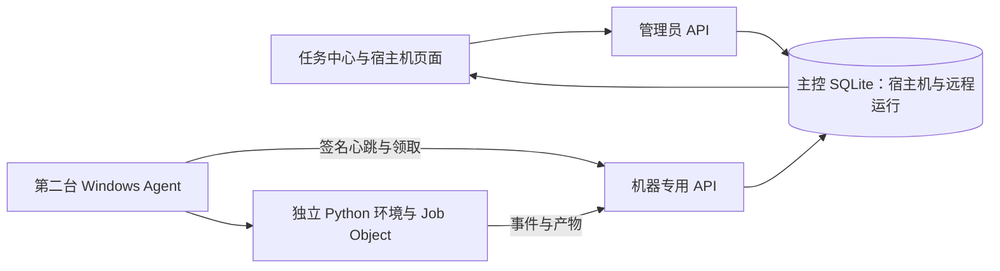
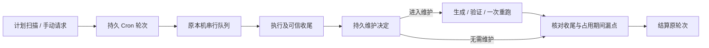
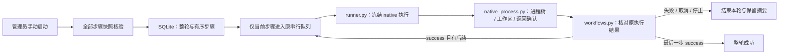
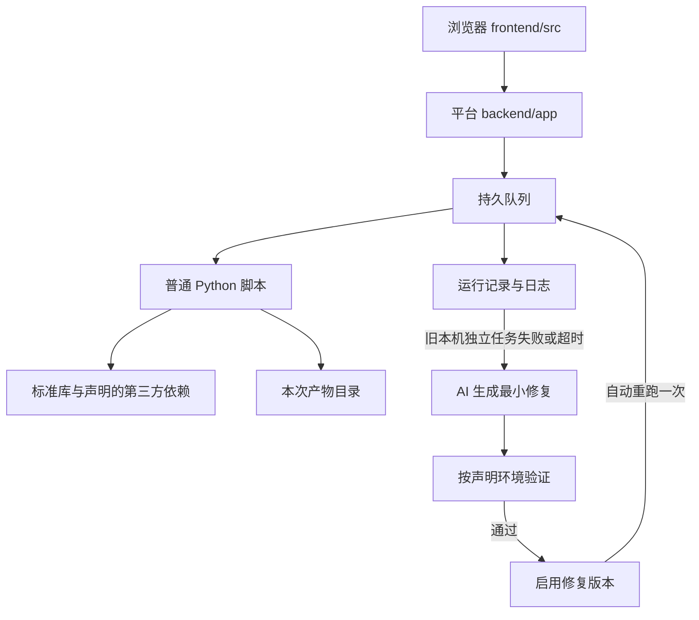

# SpiderFly 项目架构

Agent 0.5.0 主控远程升级复用原宿主机签名和领取事务。[agent_updates.py](../backend/app/services/agent_updates.py) 冻结并签署包、保存升级占用；[updater.py](../agent/spiderfly_agent/updater.py) 后台下载并持久回执；[remote-upgrade.ps1](../agent/remote-upgrade.ps1) 调用原管理脚本，匹配版本重连后才释放。旧版需一次本机引导，原整机锁和业务执行规则不变；[逐项验收](主控远程升级需求与验收_2026-10-16.md)。

2026-10-16 [阶段 C](Agent业务环境阶段C精细对齐与验收_2026-10-16.md) 复用 Agent 原 worker/journal/client；agent/environment.py 负责只读解释器/metadata 校验，backend/app/agent_environment.py 校对冻结运行事实，host_dispatch 按运行保存 remote_environment_records。EnvironmentDetails 在运行/任务详情复用。Agent 0.4.0 需新主控，0.3.0 保留旧行为并标记无明细；主控首次计划门控保持 B。
2026-10-16 阶段 B 增加 dependency_analysis/catalog 和固定 3.12 标准库表。新建及人工候选静态复核后冻结最终清单/决定；原环境 worker 安装、核验实际包并记录事实，首次本机就绪与未来计划释放同事务。前端共用 DependencyFields，环境事实按需查看；新 Agent 任务保留领取后安装，不把主控事实当目标事实。代码/验收与限制见[阶段 B 记录](依赖自动识别阶段B精细对齐与验收_2026-10-16.md)。

平台负责调度和运行记录，普通 Python 脚本负责业务。项目不再维护指令块、专用文件处理运行库或本地 wheel 安装层。

已按 [SpiderFly 总体需求](SpiderFly总体需求.md) 接入并正式加载统一任务中心：共同管理单任务与工作流，新建时选择类型，运行中心查看时间表与两类记录，管理中心负责配置。该调整复用既有任务、流程及执行分层；本轮后端 588 通过/19 条件跳过、前端 72 通过、94 模块及真实页面/native 到点、空闲备份加载证据见[实现与验证记录](统一任务中心实现与验证记录_2026-10-14.md)。M1—M3 原阶段记录保留。

`features/taskCenter/TaskCenterPage.vue` 读取两类完整定义并使用类型加 ID；`CreationDialog.vue` 保存独立创建会话并嵌入单任务上传。2026-10-16 阶段 A 已把计划并入创建/完整编辑，`PlanFields.vue` 与 `lib/plans.js` 共用字段和转换，`PlanEditor.vue` 保留快捷修改；`services/creation_requests.py` 与对象/审计同事务保存创建回执。`features/executions/RunHistoryPage.vue` 切换任务执行与流程整轮历史，两类身份、后端分页和实际步骤 execution 继续分开。共享请求及操作状态通过 workspace 和各 composable 核对会话代际，不把退出前的迟到结果回填到新身份。

新 Cron 的未进入维护决定及具体原因，与维护 job 创建在 `maintenance.record_failure` 的同一事务保存到原 `cron_rounds`。`cron_runs.decide_maintenance` 在决定未提交的失败窗口保留 pending；启动恢复只核对原关联且不重发模型。`api/schedules.py` 返回决定、原因和原因码，`CronEntryDetails.vue` 展示原运行及修复重跑的独立事实。

## 当前多宿主机增量

远程链路已由当前 A 主控加载：网页管理宿主机，主控保存远程运行，Windows Agent 领取指定任务并回传日志与结果。数据库、AI 和知识库仍只在主控。A/B 两台真实电脑的目标一致性尚未完成现场验收。

远程运行冻结普通脚本和依赖快照，不调用旧本机执行队列或旧自动修复。stdout 中的结构化采集进度由主控持久化；失败或超时立即形成管理员站内提醒，按任务开关发送一次飞书摘要，并由独立远程维护队列生成未运行 AI 参考候选，管理员确认后才启用并向原宿主机创建新运行。每天/每周任务可固定计划宿主机，到点后冻结版本和目标并进入对应机器队列；未绑定宿主机的计划仍走旧本机队列。Agent 已有当前用户托盘和顶部状态条；当前不含全局运行看板。旧主控与 Agent 生产入口共用机器互斥锁，暂不支持主控电脑同时运行 Agent。

主控入口为 `api/hosts.py`，身份/租约/事件/产物在 `services/host_dispatch.py`，Agent 位于独立 `agent/`，页面为 `features/hosts/`。能力边界见[宿主机与远程运行](功能地图/宿主机与远程运行.md)，协议见[Agent 协议 v1](Agent协议_v1.md)，验证见[首增量记录](多宿主机首增量验证_2026-09-20.md)。

## 单任务 Cron M1（2026-10-14 已启动加载）

在既有 SQLite 与串行队列上新增五字段 Cron，不增加生产 worker。cron_schedule.py 统一负责北京时间解析、未来点和最近漏点；scheduling.py 扫描并调用 cron_runs.py 事务登记/推进计划，持久轮次保护判重、恢复、重叠跳过与原执行/维护/一次修复重跑关联。api/schedules.py 给页面提供预览、计划点与账本事实，浏览器不推算 Cron。

新 Cron 只允许主控本机。native 在放行业务代码前绑定本次 Windows Job 并保存进程身份；readonly-v1 使用本次外部清理回执；进程树/外部执行结束、公共工作区清理、执行器返回分别确认。collection-v1/drissionpage-v1 专用执行器当前保存和派发前拒绝，普通 native 导入 DrissionPage 仍是普通原生任务。原 manual/daily/weekly 及 Agent 路由不自动迁移。

单任务 Cron 的验证与待交付事项见 [M1 记录](M1实现与验证记录_2026-10-13.md)。其计划只触发单个任务，不隐式启动工作流。

## 手动本机工作流 M2（2026-10-14 已启动加载）

api/workflows.py 提供管理员定义、排序、归档、启动、停止和整轮重跑；services/workflows.py 保存定义、独立轮次和有序步骤。启动先把全部步骤的源码、模板和参数写入独立快照并核对哈希，再在事务内接受本轮。快照不依赖维护或模型配置，保留本轮解释器、native 策略、通知和全局超时。

本轮冻结内容在步骤等待和执行时都不受任务编辑、版本发布、回退或旧自动维护重绑影响。成员停用、删除仍是执行前安全检查；后改运行目标不改本轮冻结的主控本机目标。协调器只预备当前步骤，未派发下游不占用任务；各脚本独立初始化，步骤之间允许其他任务或维护验证进入队列。

步骤失败、超时、manual_required 或无效回执不进入旧自动启用和修复重跑，不放行下游。停止先落库标志，原生 launcher 放行业务代码前再核对；状态与收尾未确认时保持占用。启动恢复及串行边界重新核对原执行关联，中断的 running 结束本轮，不重新运行旧步骤。

未结束整轮保护全部步骤的文件和环境。删除成员先停止相关轮次，确认整轮收尾后保存名称、版本、顺序、时间、状态和错误摘要，再允许清理完整快照、日志和平台产物；摘要不依赖已删除任务或执行。业务目录与外部数据库数据不参与平台清理。

M2 提供手动、主控本机、普通 native Python；readonly-v1、collection-v1、drissionpage-v1 专用执行器未纳入流程，普通 native 使用 DrissionPage 库仍可运行。整流程计划由下述 M3 提供并已加载；不增加 Agent、文件接力或 DAG。M2 验证见 [M2 记录](M2实现与验证记录_2026-10-13.md)，最新加载与现场范围以 CONTEXT 和 M3 记录为准。

## 整流程定时与统一入口 M3（2026-10-14 页面验收和正式加载完成）

PlanEditor.vue 统一选择任务或整个工作流。单任务保存仍调用 api/tasks.py；流程计划调用 api/workflows.py，workflow_schedules.py 在同一事务检查成员必须启用且为手动，保存计划、计算未来点。已启用流程的成员设置独立计划或编辑成员列表也核对同一冲突规则。

scheduling.py 调用 workflow_schedules.scan_due。workflow_triggers 保存唯一计划点；登记、全部步骤快照、原 workflow_runs 关联和 next_run_at 推进同事务。冻结失败通过保存点回滚半轮并记录触发错误；数据库提交失败保留原计划点并清理本次准备目录。继续使用原本机单业务 worker，不增加调度进程或新执行器。

活动轮次统一保护手动和计划触发，新的点跳过；主控恢复只补最近一个漏点。api/schedules.py 返回区分 task/workflow 的准确计划事实，过去点只查历史；useSchedule.js 合并任务与流程时间表，按对象类型区分相同编号。

实际 Codex 隔离页面已验证 Cron 到点运行 A→B→C、活动轮次期间跳过新点、关闭计划后本轮继续完成，以及每日流程首步失败后下游无执行。正式主控确认空闲并完整备份后，已同步静态资源并以原 EXE 单 worker、无 reload 重启；健康接口和 M3 鉴权路由检查通过。证据见[M3 记录](M3实现与验证记录_2026-10-14.md)，正式状态见[CONTEXT](../CONTEXT.md)。真实业务、WSL、桌面及 Agent 现场矩阵仍待独立验收。

## 既有单机职责与依赖

| 位置 | 职责 | 边界 |
| --- | --- | --- |
| `frontend/src` | 用户操作和状态展示 | 不承担调度或业务计算 |
| `backend/app` | 账号、任务、环境、队列、版本、AI、通知 | 不加入订单筛选或金额计算规则 |
| `backend/sandbox` | AI 候选与受限任务验证 | 只开放已声明的环境能力 |
| `backend/ai_knowledge` | AI 编写脚本时使用的知识 | 不承担业务执行 |
| `examples`、`sample_scripts` | 普通 Python 示例 | 不依赖项目私有业务包 |
| `backend/tests` | 平台回归检查 | 在隔离副本执行 |

## 任务与环境

每个任务上传一个 `.py` 文件，按实际需要填写 PyPI 依赖。平台创建独立虚拟环境，安装依赖并检查解释器和依赖一致性。纯标准库脚本无需依赖。

输入模板路径由 `SPIDERFLY_TEMPLATE_FILE` 提供，下载文件写入 `SPIDERFLY_ARTIFACT_DIR`。可选结果回执使用 `SPIDERFLY_RESULT_FILE`。业务脚本自行处理输入、计算和保存，不修改原模板。标准库示例见 [task_template.py](../examples/task_template.py)。

旧指令包与衍生运行库、wheel、安装分支、业务示例和手册已删除。依赖清单遇到已移除的保留包名会明确拒绝，避免误装公网同名包。已上传的任务和运行数据不自动改写；依赖旧包的任务须通过任务版本入口换成普通脚本。

## DeepSeek 官方模型选择增量

2026-10-15 已实现只接入 DeepSeek 官方服务，由官方模型目录选择一个主控全局默认模型，并由正式主控加载。源码、隔离检查、真实页面与未执行的真实模型验证分别见[实现记录](DeepSeek模型列表选择实现与验证_2026-10-15.md)。原 G/U/R/UA 执行规则保留，不增加每用户、每任务或每流程配置、多模型分工或自定义网关。

| 路径 | 职责与边界 |
| --- | --- |
| 配置读取 | 只读本地已保存模型、公开状态与历史目录/检查时间，不联网；返回字段使用白名单，不包含密文 |
| 官方目录查询 | 超级管理员用草稿密钥或当前有效密钥向固定官方地址查询模型 ID；只查询、不落盘、不生成内容 |
| 保存配置 | 使用同一有效密钥重新查目录并校验所选 ID，再将默认模型、调用限额、目录/时间与 DPAPI 密文一次原子提交 |
| 模型调用 | 沿用固定官方 Chat Completions 与现有工具链；已登记轮次使用模型快照，密钥仍每次读取当前有效值 |

非空 `DEEPSEEK_API_KEY` 优先，禁止网页提交非空替换密钥并说明来源；空白环境值按未配置处理。新密钥使用 `data/ai/settings.json` 私有 `_api_key_dpapi` 字段保存 Base64 DPAPI 密文，与 `models`、`catalog_checked_at` 及公开设置同文件提交。目录与时间可通过公开白名单返回，密文始终私有。旧独立 DPAPI 文件只作兼容读取，不删除；新密文字段损坏时明确失败，不降级到旧密钥。回退必须恢复匹配的数据备份和代码，避免旧代码误用旧密钥。

官方目录成功不等于生成、tools、截图输入或业务验收通过，平台不自动增加付费生成探测。20 分钟及后台预算规则保持；10 月 14 日 AF09 远程未知 Token 预留问题本次未修，历史报告及指纹保留原时点。

## 既有单机 AI 遇错自动修复

以下是旧单机链路尚未迁移的实现，不是多宿主机最终规则。远程多宿主机规则只允许 AI 生成候选，经管理员确认才启用并创建新运行，详见[多宿主机需求](多宿主机调度需求.md)。流程步骤不进入旧自动维护，新本机单任务 Cron 按其原轮次维护约束处理。

执行失败或超时后，平台保留原错误并自动创建维护记录。AI 根据冻结的源码、需求、输入和错误生成最小修复；验证通过后自动启用版本，并在同一事务中安排一次重跑。重跑失败不会再次自动修复，避免循环。

没有验收声明的普通脚本，也必须先复现同一错误再验证修复。不能靠删业务逻辑、吞异常或放宽验收通过。失败、停止、预算不足和不支持的环境均保留明确状态。

需由超级管理员配置主控全局 DeepSeek 服务，并准备任务声明的执行环境：WSL readonly-v1 / collection-v1 或已授权 drissionpage-v1 原生 DP。原生 DP 使用宿主机账号权限，不是 WSL 沙箱；任意 Windows 桌面软件、未支持依赖和未知副作用无法直接自动验证，这种情况下不启用未验证代码。模型目录选择与密钥配置按上述增量实施，预算仍由后台/API 管理。设置、用量、停止与回退见 [自动修复说明](自动修复.md)，历史问题与证据见 [2026-10-14 AI 配置对齐报告](AI配置与需求精细对齐报告_2026-10-14.md)，本轮处理按模型选择记录逐项结算。

`runner.py` 执行任务，`services/execution_queue.py` 串行 worker 触发维护，`maintenance.py` 负责生成、验证、版本发布和重跑，`maintenance_runtime.py` 负责受限环境。人工修改版本由 `task_versions.py` 管理。

## 维护边界

`main.py` 负责组装，接口位于 `api/`，队列和生命周期位于 `services/`。`App.vue` 组装导航与页面，功能视图和操作位于 `frontend/src/features/`，共享刷新与状态组装位于 `frontend/src/workspace/`。负责人先看 [功能地图](功能地图/README.md)，开发人员查 [代码对照](开发/代码对照与拆分方案.md)。AI、版本和维护的内部实现未在本轮全面拆分。

正式数据和任务版本只能通过平台流程维护；修改仓库示例不会替换已上传任务。详细约束见 [AGENTS](../AGENTS.md) 和 [任务执行约定](任务执行约定.md)。
